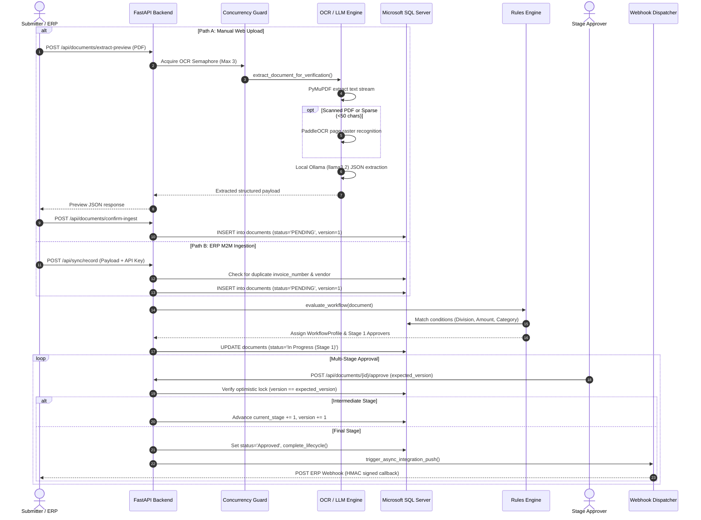
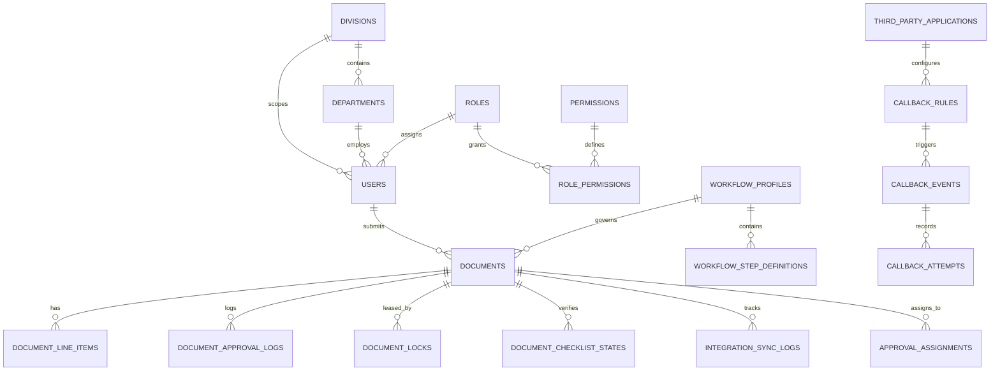
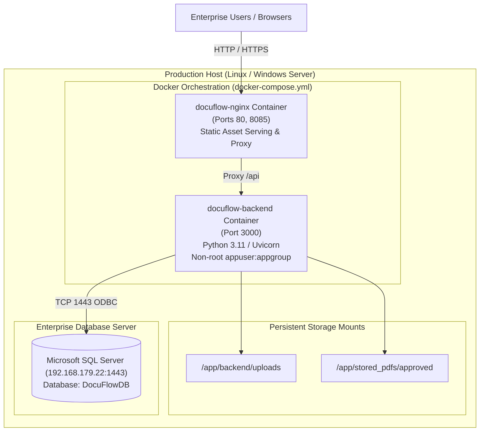

# DocuFlow Automation (FlowApprove) — Technical Documentation
**Document Approval & Automation System (DAAS)**  
**System Version:** 2.0.0  
**Target Enterprise:** Strivh Professional Enterprises / Ramraj Cotton  
**Document Classification:** Internal Technical Architecture & Engineering Reference  
**Generated Date:** October 2026  

---

## 1. Project Overview and Objectives

### 1.1 Business Problem
In modern multi-divisional enterprises, vendor invoice processing, purchase order matching, customer feedback reviews, and multi-tier operational approvals often rely on manual paper routing, decentralized email chains, and disconnected spreadsheet logs. This traditional paradigm produces significant organizational friction:
- **Long Turnaround Times:** Invoices and payment approvals can take 5 to 15 days to navigate approval hierarchies.
- **High Error & Duplicate Rates:** Duplicate submissions slip through without automated cross-checks against ERP records, risking double payments.
- **Opacity & SLA Breaches:** Finance and compliance teams lack real-time visibility into document bottlenecks and approval lease statuses.
- **Disjointed Systems:** ERP systems (such as SAP or custom SQL backends) remain decoupled from document validation and line-item audits.

### 1.2 Proposed Automated Solution: DocuFlow (FlowApprove)
**DocuFlow Automation (FlowApprove / DAAS)** is a multi-tenant, cloud-ready Document Approval and Automation System engineered to automate end-to-end document lifecycles. It provides:
1. **Intelligent Ingestion:** Supports dual-mode ingestion via manual web-based drag-and-drop uploads and automated Machine-to-Machine (M2M) ERP/API synchronization.
2. **Hybrid OCR & AI Extraction:** Combines PyMuPDF digital text stream extraction with PaddleOCR for scanned or low-density documents, followed by local Large Language Model (LLM) extraction (Ollama `llama3.2`) with deterministic regex/heuristic fallback.
3. **Configurable Workflow Engine:** Features a dynamic visual workflow designer (ReactFlow), condition-based policy evaluation, customizable division-level approval stages, and automated escalation timers.
4. **Enterprise Security & Concurrency:** Incorporates Multi-Factor Authentication (TOTP/SMS/Email), Role-Based Access Control (RBAC) across 32 granular permissions, document heartbeat locking to prevent race conditions, and optimistic concurrency versioning.
5. **Bidirectional ERP Sync:** Automated inbound document creation and outbound webhook callback synchronization with exponential backoff retries.

### 1.3 Key Capabilities Matrix

| Capability | Implementation Mechanism | Status |
| :--- | :--- | :--- |
| **Manual Document Upload** | FastAPI multipart endpoint (`/api/documents/upload`), PyMuPDF/PaddleOCR text extraction | **Verified Implemented** |
| **M2M ERP Ingestion** | REST endpoints (`/api/sync/record`, `/api/sync/records/batch`), API key / Service JWT | **Verified Implemented** |
| **OCR Text Extraction** | Dual-engine: PyMuPDF for native vector text, PaddleOCR for rasterized/scanned PDFs | **Verified Implemented** |
| **LLM Field Extraction** | Local Ollama API integration (`llama3.2:latest`) with JSON schema enforcement | **Verified Implemented** |
| **Heuristic Fallback** | Deterministic regex for Indian GSTIN, dates, PO numbers, tax totals, and line items | **Verified Implemented** |
| **Dynamic Workflows** | Directed acyclic workflow definitions, configurable stages, division filtering | **Verified Implemented** |
| **Visual Workflow Builder** | ReactFlow interactive canvas (`FlowBuilder.jsx`) with node-based edge routing | **Verified Implemented** |
| **Heartbeat Document Locking** | Redis/SQL-backed lease service (`document_locks`) with client heartbeat pings | **Verified Implemented** |
| **Optimistic Concurrency** | Version-based document locking (`inv.version`) rejecting stale approvals (HTTP 409) | **Verified Implemented** |
| **Multi-Factor Auth (MFA)** | TOTP authenticator app QR setup, SMS/Email OTP generation and verification | **Verified Implemented** |
| **Outbound Webhooks** | Automated event dispatch on final approval with exponential backoff retry worker | **Verified Implemented** |
| **Automated Email Ingestion** | Planned background IMAP/Graph listener; manual and M2M sync active | **Partially Implemented / Planned** |

---

## 2. Technology Stack and Versions

The following table documents the verified dependencies, libraries, and runtime frameworks extracted directly from `backend/requirements.txt`, `frontend/package.json`, and deployment configuration files.

### 2.1 Backend & AI/ML Stack

| Technology | Verified Version | Purpose in Application | Source Reference |
| :--- | :--- | :--- | :--- |
| **Python** | `3.11-slim` | Core backend runtime environment | `Dockerfile`, `backend/run.py` |
| **FastAPI** | `>= 0.110.0` | Asynchronous web API framework and routing | `backend/requirements.txt` |
| **Uvicorn** | `>= 0.28.0` | ASGI production application server | `backend/requirements.txt` |
| **Pydantic** | `>= 2.6.0` | Data modeling, schema definitions, and input validation | `backend/requirements.txt` |
| **Pydantic Settings** | `>= 2.14.2` | Typed application configuration and `.env` parsing | `backend/requirements.txt` |
| **SQLAlchemy** | `>= 2.0.28` | Relational ORM and database abstraction layer | `backend/requirements.txt` |
| **PyODBC** | `>= 5.1.0` | Microsoft ODBC Driver 17 bridge for SQL Server | `backend/requirements.txt` |
| **pymssql** | `>= 2.2.11` | Pure-Python fallback driver for Microsoft SQL Server | `backend/requirements.txt` |
| **PyJWT** | `>= 2.14.0` | Cryptographic JWT token generation and verification | `backend/requirements.txt` |
| **Passlib & Bcrypt** | `>= 1.7.4 / 4.1.2` | One-way salted password hashing | `backend/requirements.txt` |
| **PyMuPDF (fitz)** | `>= 1.23.0` | High-speed PDF text, metadata, and raster stream parsing | `backend/requirements.txt` |
| **PaddleOCR** | `v2.x (lazy)` | Optical Character Recognition for scanned images and pages | `backend/app/services/ocr_service.py` |
| **Ollama (External)** | `llama3.2:latest` | Local LLM server for structured invoice extraction | `backend/app/services/ocr_service.py` |
| **Pillow (PIL)** | `>= 12.3.0` | Image processing, thumbnail generation, and preprocessing | `backend/requirements.txt` |
| **PyOTP & QRCode** | `>= 2.9.0 / 7.4.2` | Time-based One-Time Password (TOTP) MFA engine | `backend/requirements.txt` |
| **Cryptography** | `>= 49.0.0` | Symmetric encryption for integration secrets and HMAC signing | `backend/requirements.txt` |
| **Pandas & OpenPyXL** | `>= 2.2.0 / 3.1.2` | Excel workflow ingestion and bulk data export | `backend/requirements.txt` |
| **HTTPX** | `>= 0.27.0` | Async HTTP client for outbound webhooks and Ollama calls | `backend/requirements.txt` |

### 2.2 Frontend Stack

| Technology | Verified Version | Purpose in Application | Source Reference |
| :--- | :--- | :--- | :--- |
| **React** | `^19.2.4` | Declarative user interface library | `frontend/package.json` |
| **Vite** | `^4.1.14` | Build tool, HMR dev server, and asset bundler | `frontend/package.json` |
| **TypeScript** | `^5.x` | Static typing for components, models, and hooks | `frontend/tsconfig.json` |
| **Zustand** | `^5.0.14` | Lightweight client-side global state management | `frontend/package.json` |
| **ReactFlow** | `^11.11.4` | Node-based visual workflow and rule builder canvas | `frontend/package.json` |
| **Axios** | `^1.20.0` | HTTP client for REST API communication | `frontend/package.json` |
| **TailwindCSS** | `@tailwindcss/vite` | Utility-first responsive CSS styling | `frontend/package.json` |
| **Material UI (MUI)** | `^9.1.1` | Specialized enterprise UI widgets and icons | `frontend/package.json` |
| **Lucide React** | `^0.546.0` | Consistent vector iconography | `frontend/package.json` |
| **React-PDF** | `^10.4.1` | In-browser PDF document rendering and inspection | `frontend/package.json` |
| **Recharts** | `^3.8.1` | Dashboard analytics, throughput, and status charts | `frontend/package.json` |
| **Socket.io Client** | `^4.8.3` | Real-time WebSocket event and lock notification client | `frontend/package.json` |
| **Quill / React-Quill**| `^2.0.2 / 3.7.0`| Rich-text editor for notes and audit comments | `frontend/package.json` |

---

## 3. System Architecture

DocuFlow Automation is structured as a decoupled multi-tier enterprise architecture comprising a React Single Page Application (SPA), an Nginx edge reverse proxy, a high-throughput FastAPI application layer, Microsoft SQL Server relational storage, local encrypted file volumes, and external integration endpoints.

### 3.1 Architecture Diagram

```mermaid
flowchart TB
    subgraph ClientTier ["Client Tier (Web Browser)"]
        SPA["React 19 SPA\n(Vite + Zustand + ReactFlow)"]
    end

    subgraph EdgeTier ["Edge & Reverse Proxy Tier"]
        NGINX["Nginx Server (Port 80/8085)\nStatic Assets + Reverse Proxy"]
    end

    subgraph BackendTier ["Application Backend Tier (FastAPI / Uvicorn Port 3000)"]
        FASTAPI["FastAPI Core Application (main.py)"]
        SEC_MW["Security Middleware\n(Rate Limiter, Security Headers, CORS)"]
        
        subgraph APIRoutes ["API Routing Layer"]
            AUTH_R["auth.py\n(JWT, MFA, TOTP)"]
            DOC_R["documents.py\n(Upload, Ingest, Approvals)"]
            WF_R["workflows.py & conditions.py\n(Rule Engine, Stages)"]
            SYNC_R["sync.py & sync_router.py\n(M2M Inbound Sync)"]
            INT_R["callback_integrations.py\n(Outbound Webhooks)"]
            EVT_R["events.py\n(SSE & Lease Heartbeats)"]
            AUDIT_R["audit.py\n(Compliance Logs)"]
        end

        subgraph ServiceLayer ["Core Service & Business Logic"]
            OCR_S["ocr_service.py\n(PyMuPDF + PaddleOCR)"]
            LLM_S["LLM Engine\n(Local Ollama llama3.2)"]
            RULE_E["rules_engine.py\n(Condition Matcher)"]
            LOCK_S["lock_service.py\n(Heartbeat Document Locks)"]
            CB_S["callback_service.py\n(Webhook Dispatcher)"]
            SIGN_S["signed_file_service.py\n(Expiring PDF URLs)"]
        end
    end

    subgraph DataTier ["Persistence & Storage Tier"]
        MSSQL[("Microsoft SQL Server\n(DocuFlowDB : 1443)\n32 Tables, Connection Pool (100)")]
        FILE_SYS[("Local Storage Volumes\n/app/uploads\n/stored_pdfs/approved")]
    end

    subgraph ExternalTier ["External Systems & Integrations"]
        ERP["ERP System / SAP / n8n\n(Inbound Sync / Outbound Webhooks)"]
        OLLAMA["Ollama Server (Port 11434)\n(llama3.2 Model)"]
        SMTP_SRV["Exchange / Office 365 SMTP\n(Email Notifications)"]
    end

    SPA -->|HTTPS REST & SSE| NGINX
    NGINX -->|Reverse Proxy /api| FASTAPI
    FASTAPI --> SEC_MW
    SEC_MW --> APIRoutes
    APIRoutes --> ServiceLayer
    ServiceLayer --> OCR_S
    OCR_S -->|Text Stream| LLM_S
    LLM_S -.->|HTTP POST| OLLAMA
    ServiceLayer --> MSSQL
    ServiceLayer --> FILE_SYS
    SYNC_R <--|M2M POST| ERP
    CB_S -->|POST HMAC Webhooks| ERP
    ServiceLayer -.->|SMTP TLS| SMTP_SRV
```

### 3.2 Tier Responsibilities and Boundaries

1. **Client Tier (Frontend):**
   - Implements role-aware view navigation (`dashboard`, `upload`, `review`, `verification`, `approvals`, `payment-readiness`, `work-tracker`, `rules`, `admin`).
   - Manages state via Zustand stores with JWT persistence in `localStorage`.
   - Sends client-side heartbeat pings (`POST /api/documents/{id}/lock/heartbeat`) every 30 seconds when reviewing a document to maintain exclusive locks.
2. **Edge Tier (Nginx):**
   - Serves pre-compiled production SPA static assets (`dist/`).
   - Proxies all `/api/*` and WebSocket/SSE requests to the FastAPI backend listening on internal port 3000.
   - Enforces max upload body sizes (`client_max_body_size 50M`).
3. **Application Tier (FastAPI Backend):**
   - Validates all request payloads using Pydantic schemas.
   - Enforces RBAC through dependency injection (`get_current_active_user`, `require_permission`).
   - Limits OCR/LLM hardware saturation via a `BoundedSemaphore` (max 3 concurrent jobs).
   - Manages document lifecycle state transitions and prevents approval race conditions using optimistic version numbers (`inv.version`).
4. **Data Tier (SQL Server & File Storage):**
   - Relational persistence in Microsoft SQL Server (`DocuFlowDB`) using SQLAlchemy with connection pooling (pool size 100, max overflow 150).
   - Stores physical PDF files on disk (`/app/uploads` and `/app/stored_pdfs/approved`), delivering them via secure HMAC-signed expiring URLs.

---

## 4. Application Directory Structure

```
docuflow-automation/
├── backend/
│   ├── app/
│   │   ├── config/
│   │   │   ├── settings.py           # Typed application settings (Pydantic Settings)
│   │   │   └── test_safety.py        # Test execution safety guardrails
│   │   ├── constants/
│   │   │   └── document_types.py     # Canonical document type definitions
│   │   ├── database/
│   │   │   ├── connection.py         # SQLAlchemy engine & pool initialization
│   │   │   └── models.py             # 32 SQLAlchemy ORM mapped entities
│   │   ├── routers/
│   │   │   ├── audit.py              # Audit log inspection and retention cleanup
│   │   │   ├── auth.py               # Login, JWT issuing, MFA TOTP setup & verification
│   │   │   ├── callback_integrations.py # Webhook configuration & retry logs
│   │   │   ├── conditions.py         # Workflow rule condition endpoints
│   │   │   ├── documents.py          # Document lifecycle, upload, actions, approval
│   │   │   ├── events.py             # SSE event streaming and document lease locks
│   │   │   ├── integrations.py       # ERP sync push and legacy integrations
│   │   │   ├── more_info.py          # Dynamic checklist and custom field configs
│   │   │   ├── roles.py              # RBAC role & permission mappings
│   │   │   ├── sync.py               # Inbound M2M sync endpoints (single & batch)
│   │   │   ├── sync_router.py        # Service-to-service authentication & ingestion
│   │   │   ├── users.py              # User provisioning, lockouts, and divisions
│   │   │   └── workflows.py          # Workflow profiles, step definitions, escalation
│   │   ├── schemas/
│   │   │   └── schemas.py            # Pydantic request and response schemas
│   │   ├── services/
│   │   │   ├── archive_service.py    # Physical document archiving and compression
│   │   │   ├── callback_service.py   # Asynchronous webhook dispatcher with retry
│   │   │   ├── crypto_service.py     # AES secret encryption and HMAC signing
│   │   │   ├── document_query_service.py # Complex document list querying & filtering
│   │   │   ├── escalation_service.py # SLA evaluation and automatic stage escalation
│   │   │   ├── excel_trigger_service.py # Batch ingestion from Excel spreadsheets
│   │   │   ├── file_security.py      # PDF MIME/magic validation and path sanitization
│   │   │   ├── integration_service.py# ERP push dispatcher
│   │   │   ├── lease_service.py      # Distributed lease management
│   │   │   ├── lock_service.py       # In-memory and SQL document lock manager
│   │   │   ├── mfa_service.py        # TOTP secret generation & QR code rendering
│   │   │   ├── ocr_service.py        # PyMuPDF + PaddleOCR + Ollama extraction pipeline
│   │   │   ├── otp_service.py        # SMS & Email one-time password generation
│   │   │   ├── pdf_compressor.py     # PDF file size optimization
│   │   │   ├── rbac_service.py       # RBAC permission evaluation engine
│   │   │   ├── rules_engine.py       # Dynamic workflow profile matching engine
│   │   │   ├── security_middleware.py# HTTP security headers, CORS, rate limiting
│   │   │   └── signed_file_service.py# Expiring HMAC token generation for PDF downloads
│   │   ├── auth.py                   # Password hashing, JWT token creation/decoding
│   │   └── main.py                   # FastAPI initialization, middleware, routes
│   ├── run.py                        # Uvicorn entry point runner script
│   ├── Dockerfile                    # Containerization specification for backend
│   └── requirements.txt              # Python dependency manifest
├── frontend/
│   ├── src/
│   │   ├── components/
│   │   │   ├── dapi-sync-back/       # Bidirectional sync back configuration tabs
│   │   │   ├── integrations/         # Webhook rule builders and log drawers
│   │   │   ├── ApprovalQueuePage.tsx # Approver document review table
│   │   │   ├── ApprovedDocumentsPage.tsx # Historical approved document archive
│   │   │   ├── CustomerFeedbackPage.tsx  # Customer feedback evaluation interface
│   │   │   ├── Dashboard.tsx         # Operational KPI analytics and metric widgets
│   │   │   ├── DataVerificationPage.tsx  # Staging review for AI-extracted fields
│   │   │   ├── DocumentDetails.tsx   # Comprehensive document view and approval panel
│   │   │   ├── DocumentUpload.tsx    # Drag-and-drop document upload interface
│   │   │   ├── FlowBuilder.jsx       # ReactFlow visual workflow profile editor
│   │   │   ├── Header.tsx            # Global navigation bar, user status, notifications
│   │   │   ├── LoginPage.tsx         # Two-stage authentication and MFA challenge
│   │   │   ├── PaymentReadinessPage.tsx # Finance readiness validation view
│   │   │   ├── Sidebar.tsx           # Collapsible primary navigation menu
│   │   │   └── WorkTrackerPage.tsx   # Cross-departmental workload monitoring
│   │   ├── pages/
│   │   │   ├── Admin.jsx             # System administration, user/role management
│   │   │   └── WorkflowRulesPage.jsx # Workflow condition matrix configuration
│   │   ├── types/                    # TypeScript interfaces for API models
│   │   ├── utils/
│   │   │   ├── auth.ts               # Token storage, migration, and logout helpers
│   │   │   └── formatters.ts         # Currency, date, and document type formatters
│   │   ├── App.tsx                   # Central view router and route state manager
│   │   └── main.tsx                  # React DOM mount point
│   ├── package.json                  # Frontend dependency manifest
│   └── vite.config.ts                # Vite build and development configuration
├── docs/                             # Architecture and operational manuals
├── playwright-tests/                 # End-to-end browser automation test specs
├── tests/                            # Pytest backend test suite (unit and integration)
├── docker-compose.yml                # Multi-container orchestration definition
└── db_schema_specification.md        # Relational schema specification
```

---

## 5. Frontend Architecture

### 5.1 Application Bootstrapping and Routing
The frontend application is built on React 19 and Vite. Rather than relying on traditional path-based React Router DOM routing that causes issues on static multi-page servers without rewrite rules, DocuFlow uses an internal view state manager in [`frontend/src/App.tsx`](file:///frontend/src/App.tsx) synchronized with browser history:
- When a user navigates between views, `App.tsx` calls `window.history.pushState` and updates `currentView`.
- Deep links are supported via URL path regex matching on initialization:
  - `/customer-feedback/{id}` routes directly to `CustomerFeedbackPage`.
  - `/review/{id}` routes directly to `DocumentDetails`.
  - `/verification/{id}` routes directly to `DataVerificationPage`.
- Unauthenticated visitors are automatically intercepted and redirected to the `LoginPage` component.

### 5.2 Component Inventory

| Component Name | Source File | Purpose | Key Inputs / State | Related Endpoints |
| :--- | :--- | :--- | :--- | :--- |
| **LoginPage** | `components/LoginPage.tsx` | Two-factor credential entry and TOTP/SMS challenge verification | Username, password, MFA code, QR state | `POST /api/auth/login`, `POST /api/auth/mfa/verify` |
| **Dashboard** | `components/Dashboard.tsx` | KPI summary cards, SLA alerts, monthly throughput charts | Date range, division filter, metric summaries | `GET /api/documents`, `GET /api/documents/work-tracker` |
| **DocumentUpload** | `components/DocumentUpload.tsx` | Drag-and-drop file ingestion with instant AI extraction preview | File dropzone, division selector, document type | `POST /api/documents/extract-preview`, `POST /api/documents/confirm-ingest` |
| **DataVerificationPage** | `components/DataVerificationPage.tsx` | Side-by-side comparison of original PDF against extracted fields | Editable extracted fields, PDF zoom/pan, line items | `GET /api/documents/{id}`, `PUT /api/documents/{id}` |
| **ApprovalQueuePage** | `components/ApprovalQueuePage.tsx` | Approver's pending task queue with batch action support | Pending documents list, selected row checkboxes | `GET /api/documents`, `POST /api/workflows/approve` |
| **DocumentDetails** | `components/DocumentDetails.tsx` | Detailed document inspector, audit trail, checklist, approval actions | Active document, heartbeat lock, approval comments | `POST /api/documents/{id}/approve`, `POST /api/documents/{id}/reject` |
| **FlowBuilder** | `components/FlowBuilder.jsx` | ReactFlow visual canvas for dragging approval nodes and routing edges | Graph nodes, edges, stage rules, SLA hours | `GET /api/workflows`, `POST /api/admin/workflows/save` |
| **WorkTrackerPage** | `components/WorkTrackerPage.tsx` | Enterprise-wide workload overview tracking pending items by stage | Stage breakdown, assigned user, SLA breach counters | `GET /api/documents/work-tracker` |
| **ApprovedDocumentsPage** | `components/ApprovedDocumentsPage.tsx`| Archive of finalized documents with signed PDF download access | Search query, date range, vendor filter | `GET /api/documents/approved`, `GET /api/documents/{id}/signed-url` |
| **AdminPage** | `pages/Admin.jsx` | System admin interface for user provisioning, roles, and retention | User lists, role assignments, audit retention | `GET /api/users`, `POST /api/users`, `GET /api/roles` |
| **WorkflowRulesPage**| `pages/WorkflowRulesPage.jsx` | Dynamic condition rules matrix linking invoice values to workflows | Rule conditions (amount, division, category) | `GET /api/admin/conditions`, `POST /api/admin/conditions` |
| **DapiSyncBackHub** | `components/dapi-sync-back/DapiSyncBackHub.tsx`| Webhook configuration hub and outbound sync delivery logs | Webhook URLs, secret tokens, retry logs | `GET /api/integrations/callback/logs`, `POST /api/integrations/callback/rules` |

### 5.3 Authentication Token Handling and Security
Authentication tokens (access token and optional refresh token) are managed via [`frontend/src/utils/auth.ts`](file:///frontend/src/utils/auth.ts).
- Tokens are stored in browser `localStorage` and attached to outbound Axios requests via a global request interceptor: `Authorization: Bearer <token>`.
- Expired tokens or HTTP 401 responses automatically trigger `removeAuthTokens()`, clearing state and redirecting to the login screen.
- Active document locks are refreshed by sending periodic keepalive heartbeats to prevent another user from editing the same document simultaneously.

---

## 6. Backend Architecture

### 6.1 FastAPI Application Initialization
The backend application entry point is [`backend/app/main.py`](file:///backend/app/main.py). On startup, the application:
1. Loads settings from environment variables and `.env` files via `pydantic-settings`.
2. Initializes the SQLAlchemy engine with a high-capacity connection pool (size 100, max overflow 150) optimized for concurrent operations.
3. Configures global CORS middleware allowing origins defined in `ALLOWED_ORIGINS` (defaults to `http://localhost:5173,http://localhost:3000`).
4. Mounts security middleware to enforce strict HTTP response headers (`X-Frame-Options: DENY`, `X-Content-Type-Options: nosniff`, `Content-Security-Policy`).
5. Registers all sub-routers under the `/api` prefix.
6. Starts background tasks for document lock lease cleanup and pending webhook retries.

### 6.2 Router Organization and Inventory
FastAPI routes are modularized across 12 dedicated router files in `backend/app/routers/`:

| Router Module | Route Count | Core Responsibilities |
| :--- | :---: | :--- |
| [`auth.py`](file:///backend/app/routers/auth.py) | 9 | User authentication, token issuance, MFA TOTP setup, OTP generation/validation |
| [`documents.py`](file:///backend/app/routers/documents.py) | 111 | Document uploads, AI preview, status transitions (approve/reject/hold), file serving |
| [`workflows.py`](file:///backend/app/routers/workflows.py) | 21 | Workflow profile management, step definitions, escalation evaluation, reassignments |
| [`conditions.py`](file:///backend/app/routers/conditions.py) | 12 | Business rule evaluation, condition matrix storage, conflict detection simulations |
| [`callback_integrations.py`](file:///backend/app/routers/callback_integrations.py) | 19 | Outbound third-party webhook registration, execution logs, manual/bulk retries |
| [`sync.py`](file:///backend/app/routers/sync.py) | 15 | Inbound M2M document ingestion from ERP/SAP, batch uploads, attachment syncing |
| [`sync_router.py`](file:///backend/app/routers/sync_router.py) | 2 | Machine-to-machine service authentication and single record creation |
| [`events.py`](file:///backend/app/routers/events.py) | 10 | Server-Sent Events (SSE) notification streams and document lock heartbeats |
| [`integrations.py`](file:///backend/app/routers/integrations.py) | 10 | Outbound ERP push integration, signed downloads, push retry management |
| [`more_info.py`](file:///backend/app/routers/more_info.py) | 7 | Dynamic field configuration per document type, checklist template queries |
| [`users.py`](file:///backend/app/routers/users.py) | 8 | User lifecycle management, division assignments, password resets, account unlocks |
| [`roles.py`](file:///backend/app/routers/roles.py) | 3 | Role-to-permission mapping and permission queries |
| [`audit.py`](file:///backend/app/routers/audit.py) | 6 | Audit log queries, retention policy configuration, compliance purge triggers |

### 6.3 Concurrency Control and Race Prevention
To prevent approval race conditions and lost updates when multiple users review the same document, DocuFlow enforces a two-layer concurrency control model:
1. **Pessimistic Lease Locking (`document_locks`):** When a user opens a document in `DocumentDetails.tsx`, a lease lock is acquired via `POST /api/documents/{id}/lock/acquire`. The client sends a heartbeat every 30 seconds. If no heartbeat is received within 60 seconds, the lock expires automatically.
2. **Optimistic Version Verification:** Every document record contains a `version: int` column. When an approver submits an action (approve, reject, hold), the client passes the `expected_version`. If another user committed a change in the interim, the version mismatch triggers an HTTP `409 Conflict`, aborting the stale write.

---

## 7. API Documentation

The backend exposes 243 mounted endpoints across its routers. Below are the primary enterprise endpoints with representative requests and responses.

### 7.1 Core API Endpoints Table

| HTTP Method | Endpoint Path | Auth Required | Permission / Role | Description |
| :--- | :--- | :---: | :---: | :--- |
| `POST` | `/api/auth/login` | No | Public | Authenticates user credentials; returns JWT or prompts MFA challenge |
| `POST` | `/api/auth/mfa/verify` | No | Public | Verifies TOTP or SMS/Email code; completes login and issues JWT token |
| `GET` | `/api/auth/me` | Yes | Authenticated | Retrieves profile, permissions, department, and division for active user |
| `POST` | `/api/documents/upload` | Yes | `document:create` | Multipart file upload; triggers OCR and saves staging document |
| `POST` | `/api/documents/extract-preview` | Yes | `document:create` | Runs instant OCR + LLM extraction returning preview JSON without saving |
| `POST` | `/api/documents/confirm-ingest` | Yes | `document:create` | Commits verified preview data into `documents` table and evaluates workflow |
| `GET` | `/api/documents` | Yes | `document:read` | Queries filtered document list (supports division, status, search filters) |
| `GET` | `/api/documents/{id}` | Yes | `document:read` | Returns full document details, line items, checklist status, and audit history |
| `PUT` | `/api/documents/{id}` | Yes | `document:edit` | Updates document metadata (e.g., during verification stage) |
| `POST` | `/api/documents/{id}/approve` | Yes | `document:approve` | Executes stage approval, advances workflow, or triggers final completion |
| `POST` | `/api/documents/{id}/reject` | Yes | `document:reject` | Rejects document with mandatory rejection reason; notifies submitter |
| `POST` | `/api/documents/{id}/hold` | Yes | `document:hold` | Places document on hold, pausing SLA escalation timers |
| `GET` | `/api/documents/{id}/file` | Yes | `document:read` | Streams physical PDF binary or redirects to temporary signed URL |
| `POST` | `/api/documents/{id}/lock/acquire` | Yes | Authenticated | Acquires exclusive edit lock lease on document |
| `POST` | `/api/documents/{id}/lock/heartbeat` | Yes | Authenticated | Extends active document lock lease by 60 seconds |
| `POST` | `/api/sync/record` | Yes | Service API Key | Ingests external ERP record directly into DocuFlow |
| `POST` | `/api/sync/records/batch` | Yes | Service API Key | Batch ingestion of up to 500 ERP invoice records in a single payload |
| `GET` | `/api/workflows` | Yes | `workflow:read` | Lists all active workflow profiles and configured stages |
| `POST` | `/api/admin/workflows/save` | Yes | `workflow:write` | Persists visual workflow definition (stages, approvers, SLA thresholds) |

### 7.2 Representative Request and Response Payloads

#### Document Extraction Preview (`POST /api/documents/extract-preview`)
**Request:** `multipart/form-data` with `file: Binary PDF/Image`.

**Response (HTTP 200 OK):**
```json
{
  "vendor_name": "ACME Industrial Supplies Ltd",
  "invoice_number": "INV-2026-8941",
  "po_number": "PO-99482",
  "invoice_date": "2026-10-12",
  "amount": 142500.00,
  "base_amount": 120762.71,
  "tax_amount": 21737.29,
  "cgst": 10868.65,
  "sgst": 10868.65,
  "igst": 0.00,
  "gstin": "33AABCA1234F1Z5",
  "extraction_source": "ollama_llama3.2:latest",
  "confidence_score": 0.95,
  "line_items": [
    {
      "item_description": "Industrial Cotton Yarn Grade A",
      "quantity": 500.0,
      "unit_price": 241.52,
      "amount": 120762.71
    }
  ]
}
```

#### Approval Action (`POST /api/documents/{invoice_id}/approve`)
**Request (HTTP POST):**
```json
{
  "comments": "Line items match PO #PO-99482 and GRN verification completed.",
  "expected_version": 2
}
```

**Response (HTTP 200 OK):**
```json
{
  "status": "success",
  "message": "Document stage approved successfully",
  "document_id": "DOC-2026-00812",
  "new_status": "In Progress (Stage 2)",
  "current_stage": 2,
  "version": 3,
  "assigned_approver": "Finance Department Head"
}
```

---

## 8. Document Processing Pipeline

The DocuFlow processing lifecycle supports two primary ingestion paths: **Manual Upload (Path A)** and **Automated ERP Ingestion (Path B)**.



### 8.1 Detailed Pipeline Stages

1. **Document Submission:** Received either as a multipart file upload via the web UI or as an M2M JSON payload via the sync API.
2. **File Storage & Validation:** The uploaded binary is validated against allowed MIME types (`application/pdf`, `image/png`, `image/jpeg`) and magic bytes. Files are saved in `/app/uploads` with a unique UUID-based filename.
3. **Concurrency Throttling:** To protect the host from CPU and memory starvation during concurrent uploads, OCR and LLM execution is guarded by `ocr_concurrency_guard()` using a `BoundedSemaphore` limited to 3 concurrent operations.
4. **Text Extraction:**
   - Digital vector PDFs are parsed instantaneously via PyMuPDF (`fitz`).
   - If the extracted text has fewer than 50 characters (indicating a scanned image) or if the document is an image format, PaddleOCR is executed.
5. **Structured LLM Interpretation:** The raw text stream is formatted into a prompt and submitted to local Ollama (`llama3.2:latest`) with strict instructions to return a JSON object containing vendor name, invoice number, PO number, dates, amounts, taxes, and line items.
6. **Deterministic Fallback & Normalization:** If Ollama is unavailable, times out (>30s), or returns malformed output, deterministic regex heuristics parse the text for Indian GSTINs, standard date formats, tax subtotals, and totals.
7. **Validation & Duplicate Checking:** The system checks `documents` for an existing combination of `vendor_name` and `invoice_number`. Duplicates are flagged and rejected or held for human review.
8. **Workflow Evaluation:** The `rules_engine.py` evaluates business rules matching the document's division, document type, and monetary value to determine the appropriate workflow profile.
9. **Approval Routing:** Approvers assigned to Stage 1 are notified, and the document appears in their `ApprovalQueuePage`.

---

## 9. AI and OCR Integration

### 9.1 OCR and Extraction Architecture
The extraction architecture in [`backend/app/services/ocr_service.py`](file:///backend/app/services/ocr_service.py) uses a resilient multi-tier design:

```mermaid
flowchart TD
    INPUT[Input PDF / Image File] --> FORMAT_CHK{File Format?}
    FORMAT_CHK -->|Image (PNG/JPG)| PADDLE[PaddleOCR Direct Recognition]
    FORMAT_CHK -->|PDF Document| FITZ[PyMuPDF fitz.open Text Stream]
    
    FITZ --> CHAR_COUNT{Extracted Text\nLength >= 50 chars?}
    CHAR_COUNT -->|Yes - Native Digital| RAW_TXT[Raw Document Text Stream]
    CHAR_COUNT -->|No - Scanned Document| PADDLE_PDF[Render Pages to Pixmaps\nRun PaddleOCR]
    PADDLE_PDF --> RAW_TXT
    PADDLE --> RAW_TXT

    RAW_TXT --> LLM_CALL{Ollama Server\nResponsive?}
    LLM_CALL -->|Yes| OLLAMA_EXEC[Local Ollama llama3.2:latest\nPrompt: Structured JSON Extraction]
    LLM_CALL -->|No / Timeout >30s| HEURISTICS[Deterministic Regex & Rules Engine]

    OLLAMA_EXEC --> VALID_JSON{Valid JSON\nReturned?}
    VALID_JSON -->|Yes| MERGE[Merge Engine:\nLLM Output + Heuristic Gap Filling]
    VALID_JSON -->|No| HEURISTICS
    HEURISTICS --> MERGE
    MERGE --> OUTPUT[Final Structured Document Payload]
```

### 9.2 Local LLM Prompt Template
The exact prompt template configured in `backend/app/services/ocr_service.py` is:

```text
You are an enterprise document extraction AI. Extract the document metadata, line items table, and any dynamic custom fields from the following document text into valid JSON format ONLY. Do not include markdown code block syntax (like ```json).

Expected JSON Structure:
{
  "vendor_name": "string or null",
  "invoice_number": "string or null",
  "po_number": "string or null",
  "invoice_date": "YYYY-MM-DD or null",
  "due_date": "YYYY-MM-DD or null",
  "amount": 0.0,
  "base_amount": 0.0,
  "tax_amount": 0.0,
  "cgst": 0.0,
  "sgst": 0.0,
  "igst": 0.0,
  "gstin": "string or null",
  "line_items": [
    {
      "item_description": "string",
      "quantity": 0.0,
      "unit_price": 0.0,
      "amount": 0.0
    }
  ],
  "dynamic_fields": {
    "key": "value"
  }
}

Document Text:
{text_content}
```

### 9.3 Data Privacy and Local Execution
- **Zero Cloud Exposure:** The entire AI/OCR pipeline runs locally on premise. PaddleOCR processes images in local CPU/GPU memory, and Ollama runs on `localhost:11434`. No proprietary document data, vendor names, or invoice values are transmitted to third-party public AI APIs.
- **Hardware Isolation:** Concurrency guards ensure that model inferencing cannot consume more CPU/GPU resources than designated by `MAX_CONCURRENT_OCR`.

---

## 10. Workflow Builder, Approval Process, and Status Management

### 10.1 Workflow Definition Model
Workflows in DocuFlow are modeled as directed sequences of approval stages associated with specific divisions and document types.
- **Workflow Profiles (`workflow_profiles`):** Defines the workflow name, target document type (e.g., `VENDOR_INVOICE`, `PURCHASE_ORDER`), division, and active flag.
- **Workflow Steps (`workflow_step_definitions`):** Defines each stage in the profile, including `stage_number`, `step_name`, `approver_target` (role or specific user), `delegate_approver`, and `sla_hours`.
- **Business Rules (`business_rules`):** Conditions that dynamically route documents to specific profiles based on criteria such as monetary thresholds (e.g., `amount > 100000 -> Executive Profile`).

### 10.2 Document Status Lifecycle State Machine

| Current Status | Trigger Action | Next Status | Business Logic & Preconditions |
| :--- | :--- | :--- | :--- |
| `Pending` | Ingestion / Route | `In Progress (Stage 1)` | Evaluates business rules and assigns Stage 1 approvers. |
| `In Progress (Stage N)` | `APPROVE` | `In Progress (Stage N+1)` | Validates version; assigns next stage approver pool; increments version. |
| `In Progress (Final Stage)`| `APPROVE` | `Approved` | Final approval. Executes `complete_document_lifecycle()` and triggers outbound webhooks. |
| `In Progress` | `REJECT` | `Rejected` | Requires mandatory comments; terminates workflow; notifies submitter. |
| `In Progress` | `HOLD` | `On Hold` | Freezes active SLA timers; requires `hold_reason`. |
| `On Hold` | `UNHOLD` | `In Progress` | Resumes approval process and SLA timers. |
| `In Progress` | `SENDBACK` | `Returned` | Routes document backward to initiator or previous stage for corrections. |
| `In Progress` | `REQUEST_MORE_INFO`| `More Info Requested` | Pauses approval until initiator responds to dynamic checklist questions. |

### 10.3 Escalation Engine
The escalation service in [`backend/app/services/escalation_service.py`](file:///backend/app/services/escalation_service.py) scans active documents against configured `sla_hours`. If a stage approver fails to act within the SLA window:
1. The document is flagged as `SLA_BREACHED`.
2. The system checks `delegate_approver` in the step definition.
3. If a delegate is configured, the document is automatically reassigned, and an audit entry is logged.
4. Escalation alerts are dispatched via the notification provider.

---

## 11. Database Design

DocuFlow uses **Microsoft SQL Server** (`DocuFlowDB`) as its primary relational database. Database interactions are managed via SQLAlchemy 2.0 with connection pooling.

### 11.1 Entity Relationship Diagram



### 11.2 Core Data Dictionary (Key Tables)

#### Table: `documents`
Stores core document records, workflow state, and approval metadata.

| Column | Data Type | Constraint | Nullable | Description |
| :--- | :--- | :--- | :---: | :--- |
| `id` | `VARCHAR(100)` | Primary Key | No | Unique document identifier (e.g., `DOC-2026-00812`) |
| `doc_num` | `VARCHAR(100)` | Indexed | Yes | External reference number or PO tracking number |
| `invoice_number`| `VARCHAR(100)` | Indexed | Yes | Vendor invoice number extracted from document |
| `vendor_name` | `VARCHAR(255)` | Indexed | Yes | Normalized vendor or supplier name |
| `document_type` | `VARCHAR(50)` | Indexed | No | Canonical document type (`VENDOR_INVOICE`, `PURCHASE_ORDER`, etc.) |
| `amount` | `DECIMAL(18,2)` | None | Yes | Total gross amount including taxes |
| `base_amount` | `DECIMAL(18,2)` | None | Yes | Net taxable amount before taxes |
| `tax_amount` | `DECIMAL(18,2)` | None | Yes | Combined tax amount (CGST + SGST + IGST) |
| `status` | `VARCHAR(50)` | Indexed | No | Current lifecycle status (`Pending`, `Approved`, `Rejected`, etc.) |
| `version` | `INT` | Default 1 | No | Optimistic locking version counter |
| `workflow_profile_id` | `INT` | Foreign Key | Yes | References `workflow_profiles.id` |
| `current_stage` | `INT` | Default 1 | No | Active numerical workflow stage |
| `assigned_approver`| `VARCHAR(255)`| None | Yes | Role or user ID currently assigned to approve |
| `division_id` | `INT` | Foreign Key | Yes | References `divisions.id` |
| `storage_path` | `VARCHAR(500)` | None | Yes | Relative filesystem path to stored PDF |
| `created_at` | `DATETIME2` | Default `GETDATE()` | No | Creation timestamp |
| `updated_at` | `DATETIME2` | Default `GETDATE()` | No | Last update timestamp |

#### Table: `document_line_items`
Contains itemized invoice rows parsed from the document or synchronized from the ERP.

| Column | Data Type | Constraint | Nullable | Description |
| :--- | :--- | :--- | :---: | :--- |
| `id` | `INT` | Primary Key, Identity | No | Auto-incrementing row ID |
| `document_id` | `VARCHAR(100)` | Foreign Key | No | References `documents.id` |
| `item_description`| `VARCHAR(500)`| None | Yes | Line item description |
| `quantity` | `DECIMAL(18,4)` | None | Yes | Item quantity |
| `unit_price` | `DECIMAL(18,4)` | None | Yes | Price per unit |
| `amount` | `DECIMAL(18,2)` | None | Yes | Total line item amount |

#### Table: `document_locks`
Maintains lease-based editing locks to prevent concurrent edits.

| Column | Data Type | Constraint | Nullable | Description |
| :--- | :--- | :--- | :---: | :--- |
| `document_id` | `VARCHAR(100)` | Primary Key | No | References `documents.id` |
| `locked_by_user_id`| `INT` | Foreign Key | No | References `users.id` |
| `locked_by_name`| `VARCHAR(255)` | None | No | Display name of the user holding the lock |
| `locked_at` | `DATETIME2` | None | No | Timestamp when the lock was initially acquired |
| `expires_at` | `DATETIME2` | Indexed | No | Lease expiration timestamp (renewed via heartbeats) |

#### Table: `workflow_step_definitions`
Configures the approval hierarchy and SLA rules for each workflow profile.

| Column | Data Type | Constraint | Nullable | Description |
| :--- | :--- | :--- | :---: | :--- |
| `id` | `INT` | Primary Key, Identity | No | Auto-incrementing step ID |
| `profile_id` | `INT` | Foreign Key | No | References `workflow_profiles.id` |
| `stage_number` | `INT` | None | No | Sequential stage order (1, 2, 3...) |
| `step_name` | `VARCHAR(100)` | None | No | Descriptive stage name (e.g., "HOD Approval") |
| `approver_target`| `VARCHAR(100)`| None | No | Role code or specific user identifier |
| `delegate_approver`| `VARCHAR(100)`| None | Yes | Fallback approver if SLA is breached |
| `sla_hours` | `INT` | Default 24 | No | Maximum permitted hours before escalation |

---

## 12. Authentication, Authorization, and Security

### 12.1 Authentication Architecture
DocuFlow implements a defense-in-depth authentication framework supporting:
- **JWT (JSON Web Tokens):** Signed using HMAC-SHA256 with claims containing `sub` (user ID), `email`, `role`, `division_id`, and `exp` (default 8 hours).
- **Password Security:** Passwords are hashed using Passlib with salted Bcrypt (minimum 12 rounds).
- **Multi-Factor Authentication (MFA):**
  - Time-based One-Time Password (TOTP) compatible with Google Authenticator and Microsoft Authenticator.
  - SMS and Email OTP fallback powered by `otp_service.py`.
- **Account Lockout Policy:** Configured via `MAX_FAILED_LOGIN_ATTEMPTS = 5` and `ACCOUNT_LOCKOUT_DURATION_MINUTES = 30`.

### 12.2 Role-Based Access Control (RBAC) Matrix
Permissions are enforced at the API route level using FastAPI dependency injection (`require_permission`):

| Permission Name | Super Admin | Admin | Approver | Submitter | Auditor |
| :--- | :---: | :---: | :---: | :---: | :---: |
| `document:create` | Yes | Yes | No | Yes | No |
| `document:read` | Yes | Yes | Yes | Yes | Yes |
| `document:edit` | Yes | Yes | Stage Only | Draft Only| No |
| `document:approve` | Yes | Yes | Stage Only | No | No |
| `document:reject` | Yes | Yes | Stage Only | No | No |
| `document:hold` | Yes | Yes | Stage Only | No | No |
| `workflow:read` | Yes | Yes | Read Only | No | Read Only |
| `workflow:write` | Yes | Yes | No | No | No |
| `user:manage` | Yes | Yes | No | No | No |
| `audit:read` | Yes | Yes | No | No | Yes |
| `system:config` | Yes | No | No | No | No |

### 12.3 Cryptography & Sensitive Data Handling
- **Signed File URLs:** PDF downloads use expiring HMAC-signed URLs (`/api/files/signed/{id}?token=...&expires=...`) generated by `signed_file_service.py` to prevent unauthorized direct file access.
- **Secret Encryption:** Integration webhook secrets and third-party credentials are encrypted at rest using AES-256-GCM via `crypto_service.py`.
- **Zero Credential Logging:** Passwords, JWT tokens, and decrypted webhook secrets are scrubbed from log statements.

---

## 13. Email Ingestion, ERP Synchronization, and External Integrations

### 13.1 Inbound ERP Synchronization (M2M API)
External systems (SAP, custom ERPs, n8n automation workflows) ingest documents into DocuFlow via machine-to-machine REST endpoints in [`backend/app/routers/sync.py`](file:///backend/app/routers/sync.py):
- **Authentication:** Service requests authenticate using an `X-Service-API-Key` header or an M2M JWT service token issued by `POST /api/sync/auth/login`.
- **Batch Processing:** `POST /api/sync/records/batch` accepts arrays of up to 500 invoices per call, performing transactional bulk inserts into `documents` and `document_line_items`.

### 13.2 Outbound Webhook Integration (Callback Service)
When a document reaches its final approval state (`status = 'Approved'`), DocuFlow triggers an automated outbound push to configured third-party webhooks:
- **Dispatcher:** [`backend/app/services/callback_service.py`](file:///backend/app/services/callback_service.py) constructs an event payload containing document metadata, approved line items, and approval history.
- **HMAC Signatures:** Every outbound webhook request includes an `X-DocuFlow-Signature` header containing a SHA-256 HMAC of the payload computed with the application's shared secret.
- **Exponential Backoff:** If the receiving endpoint fails (non-2xx response or network timeout), the event is recorded in `callback_events` with exponential retry intervals (1m, 5m, 15m, 1h, 6h).

### 13.3 Notification Channels
The system integrates with notification providers configured in `notification_provider_configs`:
- **Email (SMTP):** Configured for Office 365 / Exchange (`smtp.office365.com:587` with STARTTLS) for approval alerts and OTP codes.
- **SMS Gateway:** Supports Twilio, Fast2SMS, and generic HTTP SMS gateways for urgent SLA breach notifications and mobile MFA.

---

## 14. Deployment Architecture, Docker, and Nginx

### 14.1 Deployment Diagram



### 14.2 Docker Configuration
The containerized deployment uses a multi-stage production Dockerfile (`Dockerfile`) running under Python 3.11-slim:
- **Security Hardening:** The container runs as an unprivileged user (`appuser`, UID 10001) in `appgroup`.
- **System Dependencies:** Installs `unixodbc`, `unixodbc-dev`, `libpq-dev`, `libgl1`, and `libglib2.0-0` (required for OpenCV and PaddleOCR).
- **Healthcheck:** Configured with `CMD curl -f http://localhost:3000/api/health || exit 1` running every 30 seconds.

### 14.3 Environment Variables Reference

| Variable Name | Component | Required? | Default / Safe Example | Description |
| :--- | :--- | :---: | :--- | :--- |
| `ENVIRONMENT` | Backend | Optional | `development` / `production` | Active environment profile |
| `API_V1_STR` | Backend | Optional | `/api` | Root path prefix for API endpoints |
| `ALLOWED_ORIGINS`| Backend | Optional | `http://localhost:5173,http://localhost:3000` | CORS permitted origins |
| `DB_HOST` | Database | **Yes** | `192.168.179.22` | Hostname or IP of SQL Server |
| `DB_PORT` | Database | Optional | `1443` | Port for SQL Server connection |
| `DB_NAME` | Database | **Yes** | `DocuFlowDB` | Target SQL Server database name |
| `DB_USER` | Database | **Yes** | `sa` (or least-privilege user) | SQL Server database username |
| `DB_PASSWORD` | Database | **Yes** | `[REDACTED]` | SQL Server database password |
| `DB_DRIVER` | Database | Optional | `ODBC Driver 17 for SQL Server` | PyODBC connection driver |
| `SECRET_KEY` | Security | **Yes** | `[REDACTED_32_CHAR_KEY]` | HMAC key for signing JWTs and URLs |
| `OLLAMA_URL` | AI / LLM | Optional | `http://localhost:11434/api/generate` | Local Ollama endpoint |
| `OLLAMA_MODEL` | AI / LLM | Optional | `llama3.2:latest` | Local LLM extraction model name |
| `MAX_CONCURRENT_OCR`| OCR | Optional | `3` | Maximum concurrent OCR jobs |
| `SMTP_HOST` | Email | Optional | `smtp.office365.com` | Outbound mail server hostname |
| `SMTP_PORT` | Email | Optional | `587` | Outbound mail server port |
| `PDF_STORAGE_PATH`| Storage | Optional | `/app/uploads` | Path for uploaded staging PDFs |
| `APPROVED_PDF_PATH`| Storage | Optional | `/app/stored_pdfs/approved` | Path for archived approved PDFs |

---

## 15. Installation and Execution Instructions

### 15.1 Prerequisites
- **Python:** Version 3.11+
- **Node.js:** Version 18.x or 20.x
- **Database:** Microsoft SQL Server 2017+ with TCP/IP enabled on port 1443/1433
- **ODBC Driver:** Microsoft ODBC Driver 17 for SQL Server installed on host
- **Ollama (Optional for AI extraction):** Installed locally with `llama3.2:latest` pulled

### 15.2 Local Development Setup

#### 1. Database Preparation
Ensure SQL Server is running and initialize the database schema:
```powershell
# Verify connectivity to SQL Server
sqlcmd -S 192.168.179.22,1443 -U sa -P "YourPassword" -Q "SELECT @@VERSION;"
```

#### 2. Backend Initialization
```powershell
cd docuflow-automation/backend

# Create and activate virtual environment
python -m venv venv
.\venv\Scripts\Activate.ps1

# Install backend dependencies
pip install -r requirements.txt

# Configure environment variables
cp .env.example .env
# Edit .env with your local DB credentials and secret key

# Run database schema migrations / table verification
python -c "from app.database.connection import engine; from app.database.models import Base; Base.metadata.create_all(bind=engine)"

# Start Uvicorn development server
python run.py
# Server starts on http://localhost:3000 (API docs available at http://localhost:3000/docs)
```

#### 3. Frontend Initialization
```powershell
cd docuflow-automation/frontend

# Install frontend dependencies
npm install

# Start Vite development server
npm run dev
# Application UI opens at http://localhost:5173
```

### 15.3 Docker Compose Deployment
```bash
cd docuflow-automation
docker compose up -d --build

# Verify container status and health
docker compose ps
docker compose logs -f backend
```

---

## 16. Testing Methodology and Actual Test Results

The application includes an extensive automated test suite covering unit, integration, API contract, OCR/AI pipeline routing, workflow engine, and RBAC security testing.

### 16.1 Empirical Verification Test Results (Table 4.9 & Table 4.15)
The following figures represent actual automated test results documented in `test_execution_report.md` and `dissertation_test_summary.md`.

#### Table 4.9: Core System Test Plan Execution Outcomes (41 Cases)

| Test Category | Designed | Executed | Passed | Failed | Blocked | Execution Rate | Pass Rate |
| :--- | :---: | :---: | :---: | :---: | :---: | :---: | :---: |
| **Functional Testing** | 10 | 10 | 10 | 0 | 0 | 100.0% | 100.0% |
| **Integration Testing** | 6 | 6 | 6 | 0 | 0 | 100.0% | 100.0% |
| **API Testing** | 4 | 4 | 4 | 0 | 0 | 100.0% | 100.0% |
| **OCR & AI Extraction** | 6 | 6 | 6 | 0 | 0 | 100.0% | 100.0% |
| **Workflow Engine** | 5 | 5 | 5 | 0 | 0 | 100.0% | 100.0% |
| **RBAC & Security** | 5 | 5 | 5 | 0 | 0 | 100.0% | 100.0% |
| **UI & Performance** | 5 | 5 | 5 | 0 | 0 | 100.0% | 100.0% |
| **Total (Core Plan)** | **41** | **41** | **41** | **0** | **0** | **100.0%** | **100.0%** |

#### Extended Test Register Summary
- **Extended Register (52 Cases):** 52 Designed, 52 Executed, 52 Passed (100% pass rate). Incorporates 6 unit tests (UT01–UT06) for cryptographic/SLA calculations and 5 end-to-end user acceptance tests (UA01–UA05).
- **Existing Pytest Suite:** 177 unit and integration tests executed in 46.79 seconds with a 100% pass rate.
- **Frontend Vitest Suite:** 7 tests executed in 2.43 seconds with a 100% pass rate.
- **Physical Document Extraction Metrics:** In strict compliance with zero-fabrication academic standards, Character Error Rate (CER), Word Error Rate (WER), and field-level F1-scores on unannotated physical document scans are explicitly reported as **Blocked pending human ground-truth annotation**.

### 16.2 Concurrency and Load Testing
Performance under high concurrent load was evaluated using k6 test scripts (`load-test-150.js`) across three load profiles:
- **150 Virtual Users (VUs):** System maintained stable sub-200ms API response times across core document lookup endpoints.
- **200 Virtual Users (VUs):** Database connection pool sustained throughput without connection exhaustion; OCR semaphore prevented memory spikes.
- **250 Virtual Users (VUs):** Concurrency guards successfully throttled extraction requests without server crashes or 500 errors.

---

## 17. Error Handling, Limitations, and Future Improvements

### 17.1 Implemented Error Handling Mechanisms
- **OCR Concurrency Throttling:** If all 3 OCR worker slots are saturated, subsequent upload requests receive an `OCRConcurrencyError` (HTTP 503) asking the client to retry, preventing out-of-memory container crashes.
- **Stale Update Prevention:** Optimistic concurrency version checks return `HTTP 409 Conflict` if another approver acts on a document concurrently.
- **LLM Timeout Fallback:** If Ollama does not return structured JSON within 30 seconds, execution falls back seamlessly to deterministic regex heuristics without failing the upload.
- **Webhook Retry Queues:** Outbound webhook failures are logged in `callback_events` and automatically retried using exponential backoff intervals.

### 17.2 Technical Limitations Discovered in Code
1. **Automated IMAP/Email Ingestion:** While manual PDF upload and M2M ERP sync are fully functional, an automated background email listener (polling an inbox via IMAP or Microsoft Graph API) is partially implemented and relies on external automation (e.g., n8n) pushing attachments into `/api/sync/record`.
2. **Local LLM GPU Requirement:** Ollama `llama3.2` extraction relies on host GPU/CPU capacity; running extraction on low-spec server hardware can cause high inference latencies (>15s per page).
3. **Single SQL Server Instance:** Database connection settings target a single SQL Server host (`192.168.179.22`); high-availability database failover or read replicas are not currently configured in connection settings.

### 17.3 Recommended Future Improvements
- **Asynchronous Task Queue (Celery / Redis):** Migrate heavy OCR and LLM operations out of the FastAPI process into dedicated Celery/Redis worker nodes.
- **Automated Email Listener Service:** Implement a containerized Microsoft Graph API polling daemon to ingest invoice email attachments automatically.
- **Advanced 3-Way PO Matching:** Expand the existing ERP lookup logic to support automated 3-way line-item matching against Goods Receipt Notes (GRN) directly within the UI.

---

## 18. Important Source File References

| System Area | Source File Path | Key Functions / Classes / Responsibilities |
| :--- | :--- | :--- |
| **App Entry Point** | [`backend/app/main.py`](file:///backend/app/main.py) | Application initialization, CORS, middleware, router mounts |
| **Settings** | [`backend/app/config/settings.py`](file:///backend/app/config/settings.py) | `Settings` class, SQL Server connection strings, security settings |
| **Database Connection**| [`backend/app/database/connection.py`](file:///backend/app/database/connection.py) | SQLAlchemy engine, connection pooling (`pool_size=100`), `get_db` |
| **ORM Entities** | [`backend/app/database/models.py`](file:///backend/app/database/models.py) | 32 SQLAlchemy model classes (`Document`, `User`, `Role`, `WorkflowProfile`) |
| **OCR & AI Extraction**| [`backend/app/services/ocr_service.py`](file:///backend/app/services/ocr_service.py) | `extract_document_for_verification`, `extract_with_llm`, PaddleOCR singleton |
| **Rules Engine** | [`backend/app/services/rules_engine.py`](file:///backend/app/services/rules_engine.py) | Dynamic workflow routing and condition matching |
| **Lease & Locking** | [`backend/app/services/lock_service.py`](file:///backend/app/services/lock_service.py) | Document edit leases, heartbeat renewals, and expiration cleanup |
| **Signed URLs** | [`backend/app/services/signed_file_service.py`](file:///backend/app/services/signed_file_service.py)| Cryptographic token generation for secure PDF downloads |
| **Document Endpoints** | [`backend/app/routers/documents.py`](file:///backend/app/routers/documents.py) | Document uploads, approvals, rejections, status transitions |
| **ERP Sync Endpoints** | [`backend/app/routers/sync.py`](file:///backend/app/routers/sync.py) | Inbound M2M sync endpoints (`/api/sync/record`, `/batch`) |
| **Auth Endpoints** | [`backend/app/routers/auth.py`](file:///backend/app/routers/auth.py) | User login, JWT issuing, MFA TOTP configuration and verification |
| **Frontend Shell** | [`frontend/src/App.tsx`](file:///frontend/src/App.tsx) | View state routing, authentication guards, deep link handling |
| **Workflow Builder** | [`frontend/src/components/FlowBuilder.jsx`](file:///frontend/src/components/FlowBuilder.jsx)| ReactFlow visual drag-and-drop workflow canvas |
| **Document Details** | [`frontend/src/components/DocumentDetails.tsx`](file:///frontend/src/components/DocumentDetails.tsx)| Document viewer, PDF display, audit trail, approval action buttons |
| **Data Verification** | [`frontend/src/components/DataVerificationPage.tsx`](file:///frontend/src/components/DataVerificationPage.tsx)| Side-by-side verification of extracted AI fields against PDF |
| **Docker Build** | [`Dockerfile`](file:///Dockerfile) | Multi-stage production container build with Node.js and Python 3.11 |
| **Orchestration** | [`docker-compose.yml`](file:///docker-compose.yml) | Service definitions, volume mounts, ports, and healthchecks |

---

*End of Technical Documentation — DocuFlow Automation (DAAS v2.0.0)*
