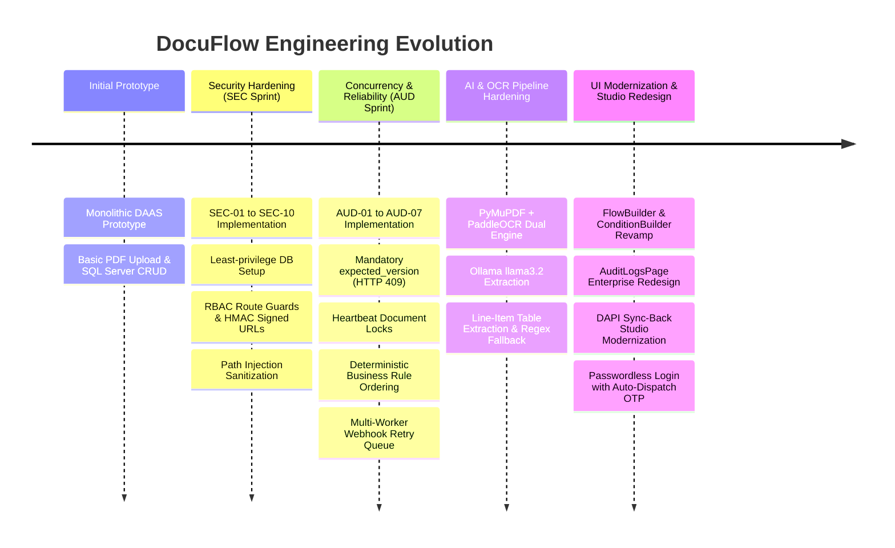
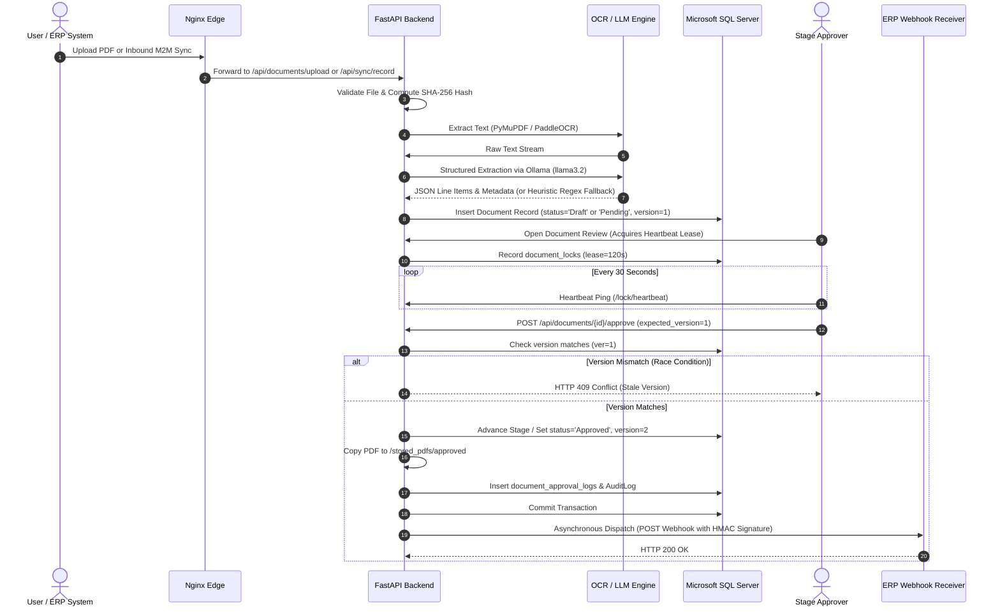
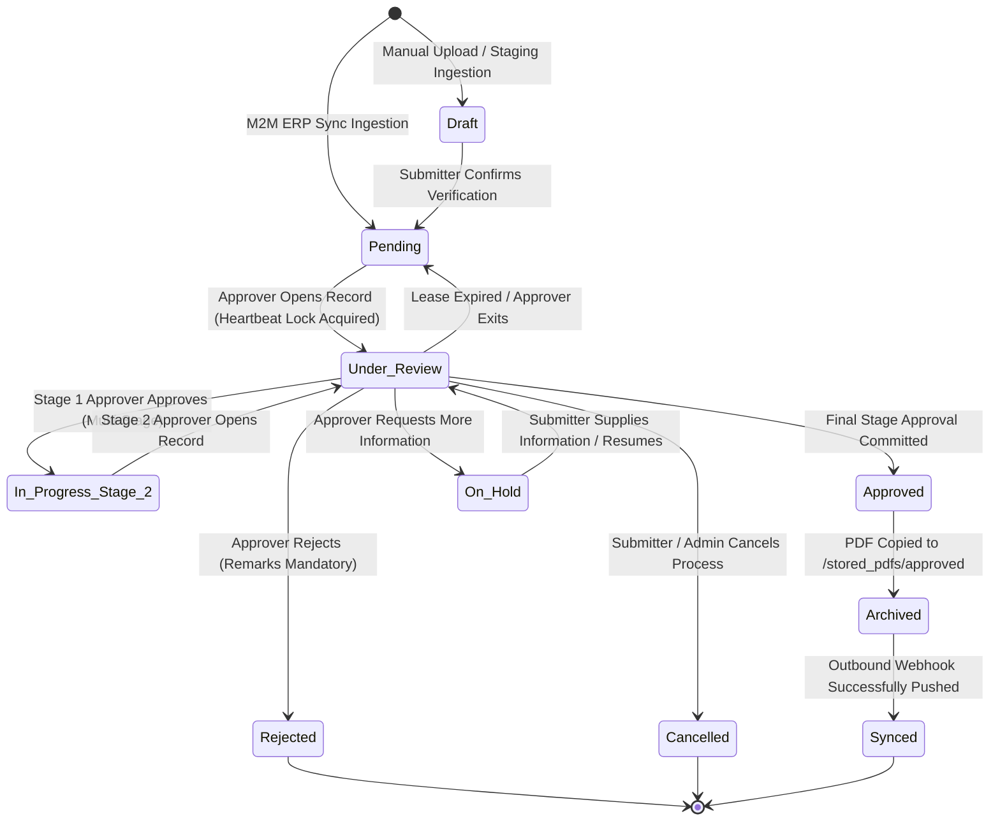
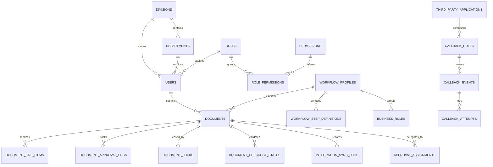
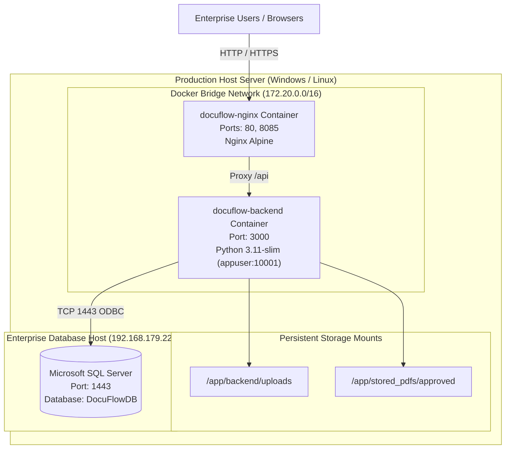

# DocuFlow Automation (FlowApprove) — Comprehensive Technical Documentation
**Document Approval & Automation System (DAAS)**  
**System Version:** 2.1.0 (Production Hardened)  
**Target Enterprise:** Strivh Professional Enterprises / Ramraj Cotton  
**Document Classification:** Internal Technical Architecture, Engineering & Operations Reference  
**Generated Date:** October 2026  

---

## 1. Executive Summary and Project Objectives

### 1.1 Business Problem & Organizational Genesis
In modern multi-divisional enterprises such as Strivh Professional Enterprises and Ramraj Cotton, processing vendor accounts payable (AP) invoices, purchase orders, customer feedback, and multi-tier operational approvals traditionally relied on fragmented manual processes:
- **Prolonged Turnaround Times:** Invoices and payment approvals frequently required 5 to 15 business days to navigate decentralized departmental hierarchies.
- **Risk of Duplicate Payments:** Manual document verification allowed duplicate vendor invoices to slip through without automated cross-checks against ERP transactional history.
- **Opacity & SLA Breaches:** Finance and compliance teams lacked real-time visibility into operational bottlenecks, review lease holders, and stage SLA timers.
- **System Disconnect:** Enterprise Resource Planning (ERP) systems (such as SAP, custom SQL databases, and legacy systems) operated isolated from line-item document validation, OCR extraction, and approval audit trails.

### 1.2 Proposed Automated Solution: DocuFlow (FlowApprove)
**DocuFlow Automation (FlowApprove / DAAS)** is an enterprise-grade, cloud-ready, multi-tenant Document Approval and Automation System engineered to automate end-to-end document lifecycles. It provides:
1. **Intelligent Ingestion:** Supports dual-mode ingestion via web-based drag-and-drop manual uploads and automated Machine-to-Machine (M2M) ERP/API batch synchronization.
2. **Hybrid OCR & AI Extraction:** Combines PyMuPDF digital vector stream extraction with PaddleOCR for scanned or low-density documents, followed by local Large Language Model (LLM) extraction (Ollama `llama3.2`) with deterministic heuristic regex fallbacks.
3. **Visual Workflow Studio:** Features a dynamic visual workflow designer (`FlowBuilder.jsx` powered by ReactFlow), condition-based policy evaluation (`ConditionBuilder.jsx`), customizable division-level approval stages, and automated escalation timers.
4. **Enterprise Security & Concurrency:** Incorporates Employee ID/Username passwordless authentication with automatic Email OTP dispatch, Time-based One-Time Password (TOTP) MFA, 32 granular RBAC permissions, document heartbeat lease locking to prevent race conditions, and mandatory optimistic concurrency versioning (`inv.version`).
5. **Bidirectional ERP Sync-Back Studio:** Automated inbound document creation and outbound webhook callback synchronization (`ApplicationStudioPage.tsx` and `callback_service.py`) with exponential backoff retries and HMAC-SHA256 payload signing.

### 1.3 Key Capabilities Matrix

| Capability | Implementation Mechanism | Status |
| :--- | :--- | :--- |
| **Manual Document Upload** | FastAPI multipart endpoint (`/api/documents/upload`), PyMuPDF/PaddleOCR text extraction | **Verified Implemented** |
| **M2M ERP Ingestion** | REST endpoints (`/api/sync/record`, `/api/sync/records/batch`), API key / Service JWT | **Verified Implemented** |
| **OCR Text Extraction** | Dual-engine: PyMuPDF for native vector text, PaddleOCR for rasterized/scanned PDFs | **Verified Implemented** |
| **LLM Field Extraction** | Local Ollama API integration (`llama3.2:latest`) with JSON schema enforcement | **Verified Implemented** |
| **Heuristic Fallback** | Deterministic regex for Indian GSTIN, dates, PO numbers, tax totals, and line items | **Verified Implemented** |
| **Dynamic Workflows** | Directed acyclic workflow definitions, configurable stages, division filtering | **Verified Implemented** |
| **Visual Workflow Builder** | ReactFlow interactive canvas (`FlowBuilder.jsx`) with node-based edge routing | **Verified Implemented** |
| **Condition Builder** | Compact matrix criteria editor (`ConditionBuilder.jsx`) for threshold and rule logic | **Verified Implemented** |
| **Heartbeat Document Locking** | Redis/SQL-backed lease service (`document_locks`) with 30s client heartbeat pings | **Verified Implemented** |
| **Optimistic Concurrency** | Version-based document locking (`inv.version`) rejecting stale approvals (HTTP 409) | **Verified Implemented** |
| **Multi-Factor Auth (MFA)** | TOTP authenticator app QR setup, SMS/Email OTP generation and verification | **Verified Implemented** |
| **Passwordless Auth** | Auto-dispatched Email OTP challenge on Employee ID / Username login | **Verified Implemented** |
| **DAPI Sync-Back Studio** | Bidirectional webhook mapping studio (`ApplicationStudioPage.tsx`) | **Verified Implemented** |
| **Outbound Webhooks** | Automated event dispatch on final approval with exponential backoff retry worker | **Verified Implemented** |
| **Enterprise Audit Log Explorer**| 1,500+ line UI with multi-column filtering, action breakdown, and sanitized CSV/PDF export | **Verified Implemented** |
| **Automated Email Ingestion** | Planned background IMAP/Graph listener; manual and M2M sync active | **Partially Implemented / Planned** |

---

## 2. Chronological Engineering Journey and Architecture Evolution

The DocuFlow codebase has undergone continuous architectural evolution across distinct development and audit phases:



### 2.1 The Initial Prototype Phase
The project started as a monolithic document ingestion tool built on Python and FastAPI, designed to replace manual invoice routing for a single business unit. Key early limitations included:
- Single-threaded approval logic without concurrency safeguards.
- Hardcoded approval hierarchies.
- Direct filesystem path exposure in download links.
- Database access executing under high-privilege `sa` credentials.

### 2.2 Security Hardening Sprint (SEC-01 to SEC-10)
To meet corporate governance standards, a comprehensive security audit identified and remediated critical attack surfaces:
- **SEC-01 / SEC-02:** Introduced two-stage MFA login with TOTP and Mail OTP challenges.
- **SEC-04:** Enforced deny-by-default route guards using FastAPI dependency injection (`require_permission`).
- **SEC-08:** Decoupled DDL migration scripts from runtime startup and established least-privilege database user roles (`DocuFlowAppUser` with strictly scoped DML privileges).
- **SEC-10:** Implemented automatic account lockouts after 5 consecutive failed attempts with administrative unlock endpoints.
- **Path Sanitization:** Resolved CodeQL path injection alerts (`#68`, `#74`, `#75`) by canonicalizing and verifying real paths before serving or storing files.
- **Expiring HMAC Signed URLs:** Direct file paths were replaced with cryptographic expiring tokens (`signed_file_service.py`).

### 2.3 Concurrency & State Integrity Sprint (AUD-01 to AUD-07)
A rigorous state-integrity review resolved race conditions and transaction ordering bugs:
- **AUD-01 (Empty Approver Target Guard):** Prevented premature approvals when a workflow stage possessed an unassigned approver target.
- **AUD-02 (Mandatory Optimistic Concurrency):** Enforced `expected_version` validation across all approval, hold, reject, and cancel endpoints. Stale concurrent requests are rejected with `HTTP 409 Conflict`.
- **AUD-03 (Final Approval & PDF Archival Ordering):** Reordered final approval execution: the document state is updated, the signed PDF is copied to `/stored_pdfs/approved`, the transaction is committed to SQL Server, and only then is the asynchronous ERP sync-back push triggered. If file archival fails, the document is flagged `storage_pending` without corrupting workflow state.
- **AUD-05 (Deterministic Business Rule Ordering):** Refactored rule evaluation to sort candidate rules deterministically by `priority DESC, id ASC`, eliminating nondeterministic rule matching across different database engines.
- **AUD-07 (Multi-Worker Webhook Retry Engine):** Redesigned the outbound callback retry loop with safe row locking, exponential backoff retries (1m, 5m, 15m, 1h, 6h), and idempotency tracking headers.

### 2.4 UI Modernization & Enterprise Studio Redesign
In late October 2026, the frontend interface underwent a major redesign:
- **Workflow Studio (`FlowBuilder.jsx`):** Redesigned with a compact enterprise scale, ReactFlow canvas, stage preset options, custom category management, and visual node editing.
- **Condition Builder (`ConditionBuilder.jsx`):** Upgraded to a 2-column condition matrix builder supporting compound logic, division scoping, and threshold evaluation.
- **Audit Logs Explorer (`AuditLogsPage.tsx`):** Engineered a 1,500+ line audit exploration page with multi-column filtering, action classification badges, actor inspection, and CSV injection-protected export.
- **DAPI Sync-Back Studio (`ApplicationStudioPage.tsx`):** Modernized the bidirectional ERP integration studio to support visual field mapping, webhook rule definition, and live callback push triggers.
- **Passwordless Login:** Restricted login to Employee ID and Username only (rejecting emails/phones) with automatic Email OTP generation and direct navigation to the verification challenge.

---

## 3. Technology Stack and Verified Versions

The following inventory details the verified production libraries, runtime environments, and tools extracted directly from repository manifests:

### 3.1 Backend & AI/ML Stack (`backend/requirements.txt`)

| Technology | Verified Version | Purpose in Application |
| :--- | :--- | :--- |
| **Python** | `3.11-slim` | Core backend runtime environment |
| **FastAPI** | `>= 0.110.0` | High-performance asynchronous web framework |
| **Uvicorn** | `>= 0.28.0` | Production ASGI web server |
| **Pydantic** | `>= 2.6.0` | Data modeling, typing, and validation schemas |
| **Pydantic Settings** | `>= 2.14.2` | Strongly typed environment variable management |
| **SQLAlchemy** | `>= 2.0.28` | Relational ORM and database abstraction layer |
| **PyODBC** | `>= 5.1.0` | Microsoft ODBC Driver 17 bridge for SQL Server |
| **pymssql** | `>= 2.2.11` | Pure-Python driver fallback for SQL Server |
| **PyJWT** | `>= 2.14.0` | Cryptographic JWT token issuance and decoding |
| **Passlib & Bcrypt** | `>= 1.7.4 / 4.1.2` | One-way salted Bcrypt password hashing |
| **PyMuPDF (fitz)** | `>= 1.23.0` | Native vector PDF stream extraction & page rendering |
| **PaddleOCR** | `v2.x (lazy)` | Scanned image and rasterized PDF text extraction |
| **Ollama Client** | `llama3.2:latest` | Local LLM server for structured JSON field extraction |
| **Pillow (PIL)** | `>= 12.3.0` | Image handling, format conversion, and thumbnail generation |
| **PyOTP & QRCode** | `>= 2.9.0 / 7.4.2` | Time-based One-Time Password (TOTP) MFA engine |
| **Cryptography** | `>= 49.0.0` | AES-256-GCM symmetric encryption for webhook secrets |
| **Pandas & OpenPyXL**| `>= 2.2.0 / 3.1.2` | Bulk Excel export and data frame processing |
| **HTTPX** | `>= 0.27.0` | Asynchronous HTTP client for outbound webhooks & Ollama |

### 3.2 Frontend Stack (`frontend/package.json`)

| Technology | Verified Version | Purpose in Application |
| :--- | :--- | :--- |
| **React** | `^19.0.0` | UI component library and virtual DOM |
| **React DOM** | `^19.0.0` | Browser DOM rendering and portal engine |
| **TypeScript** | `~5.7.2` | Static typing and interfaces across UI components |
| **Vite** | `^6.0.5` | Next-generation build tool and dev server |
| **TailwindCSS** | `^3.4.1` | Utility-first responsive CSS styling |
| **Lucide React** | `^0.474.0` | Enterprise iconography suite |
| **ReactFlow (@xyflow/react)** | `^12.4.2` | Interactive node-based workflow builder canvas |
| **Zustand** | `^5.0.3` | Lightweight client state management |
| **Axios** | `^1.7.9` | HTTP client for backend REST API communication |
| **Canvas-Confetti** | `^1.9.4` | Visual celebration animations upon document approval |
| **Vitest** | `^3.0.4` | High-speed unit and component test runner |

### 3.3 Database and Infrastructure Stack

| Component | Specification | Deployment Mode |
| :--- | :--- | :--- |
| **Relational Database** | Microsoft SQL Server 2017+ (`DocuFlowDB`) | External Host (`192.168.179.22:1443`) |
| **Database Driver** | Microsoft ODBC Driver 17 for SQL Server | Installed in container & local runtime |
| **Edge Reverse Proxy** | Nginx Alpine (`docuflow-nginx`) | Containerized (Ports 80 & 8085) |
| **Container Engine** | Docker Engine 24+ & Docker Compose v2 | Multi-container production deployment |
| **AI Inference Engine** | Ollama Engine (Port 11434) | Host daemon or dedicated GPU node |

---

## 4. System Architecture

DocuFlow is architected as a decoupled, multi-tiered enterprise application designed for high concurrency, zero data loss, and complete auditability.

### 4.1 High-Level Component Architecture Diagram

```mermaid
flowchart TB
    subgraph ClientTier ["Client Tier (Browser / React 19 SPA)"]
        SPA["React 19 SPA\n(Vite + TypeScript + Zustand)"]
        FLOW_B["Visual Workflow Studio\n(ReactFlow Canvas)"]
        COND_B["Condition Builder\n(Criteria Matrix)"]
        AUDIT_UI["Audit Log Explorer\n(Multi-Filter & Export)"]
        DAPI_UI["DAPI Sync-Back Studio\n(Webhook Rule Studio)"]
    end

    subgraph EdgeTier ["Edge & Reverse Proxy Tier"]
        NGINX["Nginx Web Server\n(Ports 80 / 8085)\nStatic Assets + /api Proxy + SSE Buffering"]
    end

    subgraph BackendTier ["FastAPI Application Backend (Port 3000)"]
        FASTAPI["FastAPI Core (main.py)"]
        SEC_MW["Security Middleware\n(Rate Limiter, Security Headers, CORS)"]
        
        subgraph APIRouters ["API Routing Layer"]
            AUTH_R["routers/auth.py\n(Passwordless OTP, MFA, JWT)"]
            DOC_R["routers/documents.py\n(Upload, Actions, Concurrency)"]
            WF_R["routers/workflows.py & conditions.py\n(Profiles, Rules, Stages)"]
            SYNC_R["routers/sync.py\n(Inbound M2M Batch Sync)"]
            CB_R["routers/callback_integrations.py\n(Outbound Webhook Rules)"]
            AUDIT_R["routers/audit.py\n(Sanitized Logs & Retention)"]
            EVT_R["routers/events.py\n(SSE Real-Time Broadcasts)"]
        end

        subgraph CoreServices ["Business Logic & Processing Services"]
            OCR_S["ocr_service.py\n(PyMuPDF + PaddleOCR)"]
            LLM_S["LLM Extraction\n(Local Ollama llama3.2)"]
            RULES_S["rules_engine.py\n(Priority Matcher)"]
            LOCK_S["lock_service.py\n(Heartbeat Document Leases)"]
            CB_S["callback_service.py\n(Exponential Webhook Retries)"]
            SIGN_S["signed_file_service.py\n(HMAC Signed PDF URLs)"]
            AUDIT_S["audit_logger\n(Detailed Approver Tracking)"]
        end
    end

    subgraph PersistenceTier ["Persistence & Storage Tier"]
        MSSQL[("Microsoft SQL Server (DocuFlowDB)\n32 Tables, Connection Pool (100)")]
        FILE_UPLOADS[("Staging Storage\n/app/uploads")]
        FILE_ARCHIVE[("Approved PDF Archive\n/stored_pdfs/approved")]
    end

    subgraph ExternalTier ["External Systems"]
        ERP["Enterprise ERP / SAP / n8n\n(M2M Inbound & Outbound Webhooks)"]
        OLLAMA["Ollama LLM Daemon (Port 11434)\n(llama3.2:latest)"]
        SMTP_SRV["Exchange / Office 365 SMTP\n(Mail OTP & Notifications)"]
    end

    SPA -->|HTTPS REST & SSE| NGINX
    NGINX -->|Proxy /api| FASTAPI
    FASTAPI --> SEC_MW
    SEC_MW --> APIRouters
    APIRouters --> CoreServices
    CoreServices --> OCR_S
    OCR_S -->|Text Stream| LLM_S
    LLM_S -.->|HTTP JSON| OLLAMA
    CoreServices --> MSSQL
    CoreServices --> FILE_UPLOADS
    CoreServices --> FILE_ARCHIVE
    SYNC_R <--|M2M Inbound POST| ERP
    CB_S -->|POST HMAC Signatures| ERP
    CoreServices -.->|STARTTLS Mail| SMTP_SRV
```

### 4.2 End-to-End Document Lifecycle Sequence



---

## 5. Repository Directory Structure

```
docuflow-automation/
├── backend/
│   ├── app/
│   │   ├── config/
│   │   │   ├── settings.py           # Typed application settings (Pydantic Settings)
│   │   │   └── test_safety.py        # Test execution safety guardrails
│   │   ├── constants/
│   │   │   └── document_types.py     # Canonical document type sets and normalizers
│   │   ├── database/
│   │   │   ├── connection.py         # SQLAlchemy engine, connection pooling, get_db
│   │   │   └── models.py             # 32 SQLAlchemy ORM models
│   │   ├── routers/
│   │   │   ├── audit.py              # Audit log exploration, filtering, and export
│   │   │   ├── auth.py               # Passwordless OTP, MFA TOTP, JWT login
│   │   │   ├── callback_integrations.py # Webhook configuration and test dispatch
│   │   │   ├── conditions.py         # Business rule condition builders
│   │   │   ├── documents.py          # Document lifecycle, uploads, approvals, locking
│   │   │   ├── events.py             # Server-Sent Events (SSE) live updates
│   │   │   ├── roles.py              # Role and permission administration
│   │   │   ├── sync.py               # M2M ERP inbound batch sync endpoints
│   │   │   └── workflows.py          # Workflow profiles and step definitions
│   │   ├── schemas/
│   │   │   └── schemas.py            # Pydantic request/response validation models
│   │   ├── services/
│   │   │   ├── callback_service.py   # Outbound webhook retry worker
│   │   │   ├── crypto_service.py     # AES-256-GCM symmetric secret encryption
│   │   │   ├── file_security.py      # Path canonicalization and MIME validation
│   │   │   ├── lock_service.py       # Distributed lease locking with heartbeats
│   │   │   ├── ocr_service.py        # Dual PyMuPDF/PaddleOCR & Ollama extraction
│   │   │   ├── otp_service.py        # SMS and Email OTP dispatch and verification
│   │   │   ├── rbac_service.py       # Permission evaluation and scope resolution
│   │   │   ├── rules_engine.py       # Deterministic business rule matcher
│   │   │   ├── security_middleware.py# Security headers, CORS, rate limiting
│   │   │   └── signed_file_service.py# Cryptographic HMAC expiring download tokens
│   │   ├── main.py                   # FastAPI initialization, middleware, routes
│   │   └── run.py                    # Uvicorn production server runner
│   ├── tests/                        # Pytest automated test suite (177 tests)
│   ├── Dockerfile                    # Container definition for backend
│   └── requirements.txt              # Python dependency manifest
├── frontend/
│   ├── src/
│   │   ├── components/
│   │   │   ├── dapi-sync-back/       # Bidirectional sync-back studio tabs
│   │   │   │   ├── ApplicationStudioPage.tsx # Field mapping & webhook rules
│   │   │   │   └── DapiSyncBackHub.tsx       # Third-party app hub
│   │   │   ├── AdminInApp.jsx        # Administrative system settings
│   │   │   ├── AdminRBAC.jsx         # User & role management (spacious 2-column layout)
│   │   │   ├── ApprovalQueuePage.tsx # Approver workload table
│   │   │   ├── ApprovedDocumentsPage.tsx # Archive of approved records with totals
│   │   │   ├── AuditLogsPage.tsx     # Enterprise audit log explorer (1500+ lines)
│   │   │   ├── ConditionBuilder.jsx  # Workflow condition criteria matrix
│   │   │   ├── CustomerFeedbackPage.tsx # Customer feedback review interface
│   │   │   ├── Dashboard.tsx         # Operational KPI analytics widgets
│   │   │   ├── DataVerificationPage.tsx # AI extraction staging verification
│   │   │   ├── DocumentDetails.tsx   # Comprehensive document view and action panel
│   │   │   ├── DocumentUpload.tsx    # Drag-and-drop file uploader
│   │   │   ├── FlowBuilder.jsx       # Visual ReactFlow workflow designer
│   │   │   ├── Header.tsx            # Navigation bar and active user status
│   │   │   ├── LoginPage.tsx         # Passwordless ID login & auto OTP challenge
│   │   │   ├── Sidebar.tsx           # Collapsible primary navigation menu
│   │   │   └── WorkTrackerPage.tsx   # Cross-departmental workload tracker
│   │   ├── pages/
│   │   │   ├── Admin.jsx             # System administration container
│   │   │   └── WorkflowRulesPage.jsx # Rule ordering and category matrix
│   │   ├── types/                    # TypeScript interfaces for API schemas
│   │   ├── utils/                    # Authentication, formatting, and API helpers
│   │   ├── App.tsx                   # Central view routing and deep link handler
│   │   └── main.tsx                  # React DOM mount point
│   ├── package.json                  # Frontend dependency manifest
│   └── vite.config.ts                # Vite build and dev configuration
├── audit/                            # Security, integrity, and route audit reports
├── docs/                             # Handover documentation and operational manuals
├── evidence/                         # Benchmark logs, pytest logs, and timing metrics
├── playwright-tests/                 # Playwright end-to-end browser test suites
├── scripts/                          # SQL database migration and setup scripts
├── docker-compose.yml                # Multi-container orchestration specification
├── Dockerfile                        # Multi-stage production container build
├── README.md                         # Project overview and quick start guide
└── db_schema_specification.md        # Detailed relational schema specification
```

---

## 6. Frontend Architecture and Key UI Modules

### 6.1 State Management and Internal View Routing
DocuFlow uses a client-side view state machine in [`frontend/src/App.tsx`](file:///frontend/src/App.tsx) synchronized with browser history via `window.history.pushState`:
- **Deep Linking Support:** Regular expressions inspect initial URLs on load:
  - `/customer-feedback/:id` -> Loads `CustomerFeedbackPage` with target record.
  - `/review/:id` -> Opens `DocumentDetails` with PDF preview and lease lock.
  - `/verification/:id` -> Routes to `DataVerificationPage` for AI staging.
- **Multi-Tab Logout Synchronization:** An active `BroadcastChannel('docuflow_auth')` coupled with `window.addEventListener('storage')` immediately revokes sessions and redirects all open tabs to the login screen upon user logout.
- **Fresh Login Landing:** Successful authentication guarantees a reset of internal view state to `'dashboard'`, preventing stale views or orphaned review locks from persisting across sessions.

### 6.2 Redesigned Visual Workflow Studio (`FlowBuilder.jsx`)
The Workflow Studio provides a visual drag-and-drop canvas powered by `@xyflow/react` (ReactFlow):
- **Stage Presets:** Supports standard stage hierarchies (`Attachment Status`, `First Approval`, `Second Approval`, `3rd APPROVAL`, `IA Approval`, `Final Approval`).
- **Dynamic Category Grouping:** Organizes profiles by operational category (`Accounts Payable`, `Customer Feedback`, `General Records`, `Capex`) with custom category creation persisted to `localStorage`.
- **Node-Based Visual Routing:** Approvers, SLAs, and escalation paths are represented as connected nodes, allowing managers to visually reorder approval sequences.
- **Compact Enterprise Typography:** Calibrated padding, concise badges, and responsive node cards maximize screen real estate on standard laptop displays.

### 6.3 Condition Builder (`ConditionBuilder.jsx`)
The Condition Builder provides a matrix interface for defining the operational rules that trigger specific workflow profiles:
- **Field Catalog:** Supports 13 standard criteria: Division/Company, Category/Expense Type, Cost Center, Branch/Plant, Total Amount, Base Amount, Document Type, Vendor Name, Tax Amount, Payment Mode, Vendor GSTIN, PO Number, and Invoice Date.
- **Operator Engine:** Evaluates numeric comparisons (`>`, `<`, `>=`, `<=`, `==`, `!=`), text matching (`contains`, `starts_with`, `in`), and multi-select sets.
- **Threshold Triggers:** Allows rules such as "If Total Amount > ₹5,00,000 AND Division == 'Spinning Mills', route to 3-Tier Executive Workflow."

### 6.4 Enterprise Audit Logs Explorer (`AuditLogsPage.tsx`)
Redesigned in late October 2026, `AuditLogsPage.tsx` spans 1,500+ lines of production TypeScript:
- **Multi-Dimension Filtering:** Filter by action type (`Approved`, `Rejected`, `Placed on Hold`, `Uploaded`), stage identifier, actor (Employee ID, name, or role), IP address, date ranges, and invoice ID.
- **Visual KPI Counters:** Displays real-time metrics including Total Events, Approval Actions, Rejections, Security Alerts, and Delta Percentage comparisons.
- **Sanitized CSV & PDF Export:** Integrated CSV export leverages backend cell sanitization (`sanitize_csv_cell`) to neutralize Formula Injection attacks (`=cmd`, `@SUM`).
- **Detailed Actor Inspection:** Modal drawers show the exact approver identity, Employee ID, assigned division, client IP address, and status progression notes.

### 6.5 DAPI Sync-Back Studio (`ApplicationStudioPage.tsx`)
The DAPI Sync-Back Studio facilitates bidirectional ERP connectivity:
- **Third-Party Application Registry:** Register external ERPs, SAP instances, or webhook endpoints with individual authentication credentials (Bearer Token, API Key, Basic Auth, or Custom HMAC).
- **Visual Field Mapping:** Drag-and-drop visual mapping between DocuFlow internal fields (`invoice_number`, `vendor_name`, `amount`, `tax_amount`, `line_items`) and external ERP JSON payloads.
- **Live Push Triggers:** Manual and automated webhook test dispatches displaying exact HTTP request headers, signed payloads, response status codes, and execution latencies.

---

## 7. Backend Architecture and Service Layer

DocuFlow's backend is developed using Python 3.11 and FastAPI, adhering to an asynchronous, dependency-injected modular architecture.

### 7.1 Security Middleware Pipeline (`security_middleware.py`)
Every inbound HTTP request traverses custom security middleware before hitting API route handlers:
- **HTTP Security Headers:** Injects `X-Content-Type-Options: nosniff`, `X-Frame-Options: DENY`, `X-XSS-Protection: 1; mode=block`, `Strict-Transport-Security: max-age=31536000; includeSubDomains`, and `Content-Security-Policy`.
- **CORS Configuration:** Validates `Origin` against strictly whitelisted domains configured in `ALLOWED_ORIGINS`.
- **Rate Limiting:** Protects authentication and upload routes against brute-force and DoS attacks using client IP rate limit buckets.
- **Client IP Resolution:** `extract_client_request_ip` resolves real client IPs traversing Nginx reverse proxies via trusted `X-Forwarded-For` headers.

### 7.2 Service Layer Breakdown

1. **`ocr_service.py` (Hybrid OCR & LLM Engine):**
   - Implements `extract_document_for_verification` combining PyMuPDF digital text extraction with PaddleOCR raster processing.
   - Dispatches structured extraction prompts to local Ollama (`llama3.2:latest`) with JSON schema enforcement.
   - Manages a `BoundedSemaphore(3)` to throttle concurrent OCR jobs and prevent server memory exhaustion.
2. **`rules_engine.py` (Business Rules Matcher):**
   - Evaluates active `business_rules` against incoming document metadata.
   - Enforces deterministic rule ordering sorted by `priority DESC, id ASC` (`AUD-05`).
   - Normalizes document types across canonical sets to eliminate discrepancies between `'CUSTOMER FEEDBACK'` and `'FEEDBACK'`.
3. **`lock_service.py` (Heartbeat Lease Management):**
   - Manages exclusive editing locks in `document_locks`.
   - Leases expire automatically after 120 seconds unless renewed by client heartbeat pings every 30 seconds.
   - Provides administrator override mechanisms to forcefully unlock orphaned documents.
4. **`callback_service.py` (Outbound Webhook Dispatcher):**
   - Dispatches HTTP webhooks to third-party endpoints upon final document approval.
   - Signs payloads using HMAC-SHA256 (`X-DocuFlow-Signature`).
   - Executes exponential backoff retries (1m, 5m, 15m, 1h, 6h) for transient failures.
5. **`signed_file_service.py` (Cryptographic File Access):**
   - Generates expiring HMAC-SHA256 signed download tokens (`/api/files/signed/{id}`).
   - Completely eliminates direct filesystem paths from client-facing API responses.
6. **`crypto_service.py` (At-Rest Encryption):**
   - Implements AES-256-GCM symmetric encryption for third-party webhook secrets and API keys stored in the database.

---

## 8. Document Processing and AI/OCR Pipeline

The document processing pipeline automates the transformation of unstructured PDF files into validated, structured enterprise records:

```mermaid
flowchart TD
    FILE[Incoming PDF Document] --> DETECT{Digital Text Stream Present?}
    
    DETECT -->|Yes| PYMUPDF[PyMuPDF Vector Extraction\n(fitz Engine - Sub-50ms)]
    DETECT -->|No / Scanned| PADDLE[PaddleOCR Engine\n(Raster Parsing - 1.2s to 3.5s)]
    
    PYMUPDF --> CONCAT[Raw Text Concatenation]
    PADDLE --> CONCAT
    
    CONCAT --> OLLAMA_CHECK{Ollama LLM Reachable?}
    
    OLLAMA_CHECK -->|Yes| LLM[Ollama llama3.2 Inference\nJSON Schema Validation]
    OLLAMA_CHECK -->|No / Timeout >30s| REGEX[Deterministic Regex & Heuristic Fallbacks]
    
    LLM --> PARSE_JSON{Valid JSON & Non-Zero Line Items?}
    PARSE_JSON -->|Yes| MERGE[Structured Document & Line Items]
    PARSE_JSON -->|No| REGEX
    
    REGEX --> MERGE
    MERGE --> ARITHMETIC{Arithmetic Verification\nSubtotal + Tax == Total?}
    
    ARITHMETIC -->|Matched| STAGING[Staging Ready: DataVerificationPage]
    ARITHMETIC -->|Mismatch| WARN_FLAG[Flag Confidence Warning & Route to Verification]
```

### 8.1 Dual-Engine OCR Processing
- **PyMuPDF (`fitz`):** Evaluates vector text layers. If the character count per page exceeds 80 characters, text is extracted directly from font streams in under 50 milliseconds, bypassing image rasterization entirely.
- **PaddleOCR:** If the document is a scanned image or bitmap PDF, the document is rasterized to high-DPI images in memory and processed via PaddleOCR, detecting rotated text, non-standard bounding boxes, and low-contrast vendor stamps.

### 8.2 Structured LLM Extraction (Ollama `llama3.2`)
The raw extracted text is formatted into a zero-shot prompt instructing the model to return a strictly typed JSON object matching the following structure:
```json
{
  "invoice_number": "INV-2026-0941",
  "po_number": "PO-88312",
  "vendor_name": "Lakshmi Textiles Private Limited",
  "vendor_gstin": "33AABCL1234F1Z5",
  "invoice_date": "2026-10-15",
  "total_amount": 147500.00,
  "base_amount": 125000.00,
  "tax_amount": 22500.00,
  "cgst_amount": 11250.00,
  "sgst_amount": 11250.00,
  "igst_amount": 0.00,
  "line_items": [
    {
      "item_description": "Combed Cotton Yarn 40s",
      "quantity": 500.0,
      "unit_price": 250.00,
      "amount": 125000.00
    }
  ]
}
```

### 8.3 Deterministic Heuristic Regex Fallback
If the Ollama server is unreachable, takes longer than 30 seconds, or returns malformed JSON, the pipeline triggers deterministic regular expression heuristics tailored for Indian commercial invoices:
- **GSTIN Regex:** `\b\d{2}[A-Z]{5}\d{4}[A-Z]{1}[1-9A-Z]{1}Z[0-9A-Z]{1}\b` (Validates 15-character alphanumeric Indian Goods and Services Tax Identification Numbers).
- **Date Parsers:** Supports `DD/MM/YYYY`, `DD-MM-YYYY`, `YYYY-MM-DD`, and `DD-MMM-YYYY` formats.
- **Currency & Totals:** Scans bottom-page segments for keywords `Total Amount`, `Invoice Total`, `Grand Total`, `Net Payable`, extracting numeric values with comma-thousand separators.
- **Arithmetic Verification:** Reconciles line-item totals: $\text{Base Amount} + \text{Tax Amount} = \text{Total Amount}$. If the difference exceeds $\pm 1.00$, a validation warning is attached to the staging record.

---

## 9. Dynamic Workflow Engine and State Machine

### 9.1 Document Lifecycle State Machine



### 9.2 Rule Ordering and Approver Resolution
1. **Deterministic Rule Order (`AUD-05`):** The engine queries `business_rules` matching the document type and division, executing `ORDER BY priority DESC, id ASC`. The first rule whose condition criteria evaluate to `True` assigns the active `target_workflow_id`.
2. **Empty Approver Target Block (`AUD-01`):** Before allowing a workflow step to transition, the engine verifies that `approver_target` is populated with a valid role or user ID. If empty, the engine rejects the transition, preventing orphan documents.
3. **Optimistic Version Check (`AUD-02`):** Every state transition endpoint requires the client to submit the document's current `expected_version`. If another approver has modified the record in the interim, the update is rejected with `HTTP 409 Conflict`.

---

## 10. Database Architecture and Schema Specification

The database tier is hosted on **Microsoft SQL Server** (`DocuFlowDB`) using SQLAlchemy 2.0 ORM. The schema comprises **32 relational tables** engineered for referential integrity and audit tracking.

### 10.1 Complete Database Table Inventory

| Table Name | Primary Key | Purpose & Description |
| :--- | :--- | :--- |
| `users` | `id` (INT) | Enterprise user credentials, roles, divisions, MFA secrets |
| `roles` | `id` (INT) | User role definitions (`Super Admin`, `Admin`, `Approver`, etc.) |
| `permissions` | `id` (INT) | 32 granular system capabilities |
| `role_permissions` | `role_id, permission_id` | Mapping table granting permissions to roles |
| `divisions` | `id` (INT) | Corporate divisions (Spinning, Weaving, Garments, Retail) |
| `departments` | `id` (INT) | Operational cost centers and departments |
| `documents` | `id` (VARCHAR) | Master document records, amounts, statuses, and stages |
| `document_line_items` | `id` (INT) | Itemized line rows, quantities, rates, and amounts |
| `document_locks` | `document_id` (VARCHAR) | Active heartbeat editing leases and expiration times |
| `document_approval_logs` | `id` (INT) | Formal historical log of stage approvals and rejections |
| `document_checklist_states`| `id` (INT) | Verification checklist results per document |
| `document_type_field_configurations` | `id` (INT) | Dynamic metadata field schemas per document type |
| `workflow_profiles` | `id` (INT) | Named workflow definitions and target categories |
| `workflow_step_definitions` | `id` (INT) | Tiered stage definitions, approver targets, and SLAs |
| `business_rules` | `id` (INT) | Priority-ordered condition rules assigning workflows |
| `approval_assignments` | `id` (INT) | Specific approver user allocations per document stage |
| `checklist_templates` | `id` (INT) | Reusable compliance checklist templates |
| `checklist_rules` | `id` (INT) | Granular compliance checks attached to templates |
| `third_party_applications` | `id` (VARCHAR) | Registered ERP systems and external integration clients |
| `third_party_webhook_configs`| `id` (INT) | Webhook URLs, headers, and encrypted secrets |
| `callback_rules` | `id` (INT) | Event triggers governing outbound webhook pushes |
| `callback_events` | `id` (INT) | Outbound webhook event queue with retry counts |
| `callback_attempts` | `id` (INT) | Execution history and HTTP status of webhook attempts |
| `integration_sync_logs` | `id` (INT) | Inbound M2M sync request and batch logs |
| `integration_audit_history` | `id` (INT) | Field-level modification tracking for external syncs |
| `in_app_notifications` | `id` (INT) | Real-time user notifications and alert messages |
| `notification_provider_configs`| `id` (INT) | SMTP mail server and SMS gateway credentials |
| `notification_raci_matrices` | `id` (INT) | RACI escalation mappings for workflow alerts |
| `otp_verifications` | `id` (INT) | Temporary storage for dispatched SMS/Email OTP codes |
| `archive_settings` | `id` (INT) | Retention policies and file storage locations |
| `user_access_logs` | `id` (INT) | User authentication events, IP addresses, and logins |
| `system_engine_logs` | `id` (INT) | Internal system, worker, and scheduled job executions |

### 10.2 Entity Relationship Diagram (Mermaid)



### 10.3 Core Tables Schema Detail

#### Table: `documents`
Stores core document records, workflow state, and approval metadata.

| Column | Data Type | Constraint | Nullable | Description |
| :--- | :--- | :--- | :---: | :--- |
| `id` | `VARCHAR(100)` | Primary Key | No | Unique document identifier (e.g., `DOC-2026-00812`) |
| `doc_num` | `VARCHAR(100)` | Indexed | Yes | External reference number or PO tracking number |
| `invoice_number`| `VARCHAR(100)` | Indexed | Yes | Vendor invoice number extracted from document |
| `vendor_name` | `VARCHAR(255)` | Indexed | Yes | Normalized vendor or supplier name |
| `document_type` | `VARCHAR(50)` | Indexed | No | Canonical document type (`AP INVOICE`, `CUSTOMER FEEDBACK`) |
| `amount` | `DECIMAL(18,2)` | None | Yes | Total gross amount including taxes |
| `base_amount` | `DECIMAL(18,2)` | None | Yes | Net taxable amount before taxes |
| `tax_amount` | `DECIMAL(18,2)` | None | Yes | Combined tax amount (CGST + SGST + IGST) |
| `status` | `VARCHAR(50)` | Indexed | No | Current lifecycle status (`Pending`, `Approved`, `Rejected`, etc.) |
| `version` | `INT` | Default 1 | No | Optimistic locking version counter |
| `workflow_profile_id` | `INT` | Foreign Key | Yes | References `workflow_profiles.id` |
| `current_stage` | `INT` | Default 1 | No | Active numerical workflow stage |
| `assigned_approver`| `VARCHAR(255)`| None | Yes | Role or user ID currently assigned to approve |
| `division_id` | `INT` | Foreign Key | Yes | References `divisions.id` |
| `storage_path` | `VARCHAR(500)` | None | Yes | Relative filesystem path to stored PDF |
| `created_at` | `DATETIME2` | Default `GETDATE()` | No | Creation timestamp |
| `updated_at` | `DATETIME2` | Default `GETDATE()` | No | Last update timestamp |

#### Table: `document_locks`
Maintains lease-based editing locks to prevent concurrent edits.

| Column | Data Type | Constraint | Nullable | Description |
| :--- | :--- | :--- | :---: | :--- |
| `document_id` | `VARCHAR(100)` | Primary Key | No | References `documents.id` |
| `locked_by_user_id`| `INT` | Foreign Key | No | References `users.id` |
| `locked_by_name`| `VARCHAR(255)` | None | No | Display name of user holding lock |
| `locked_at` | `DATETIME2` | None | No | Timestamp when lock was initially acquired |
| `expires_at` | `DATETIME2` | Indexed | No | Lease expiration timestamp (renewed via heartbeats) |

---

## 11. Authentication, Authorization, and Security Hardening

### 11.1 Authentication & Passwordless Flow
- **Restricted Identifier Input:** The login form explicitly restricts login identifiers to **Employee ID** and **Username** only (`868032f`), rejecting raw email addresses and phone numbers to mitigate user enumeration.
- **Auto-Dispatched Email OTP:** Upon identifier submission, the backend automatically generates a cryptographically random 6-digit OTP, dispatches it to the user's registered corporate email, and directly renders the verification code entry screen (`c7b35eb`).
- **Two-Stage Multi-Factor Authentication (MFA):** Supports Time-based One-Time Passwords (TOTP) using standard RFC 6238 authenticators (Google Authenticator, Microsoft Authenticator) alongside SMS/Email OTP fallbacks.
- **Brute Force Protection:** Tracks failed verification attempts; 5 consecutive failures trigger an automated 30-minute account lockout (`SEC-10`).

### 11.2 Granular Role-Based Access Control (RBAC)
DocuFlow enforces 32 granular permissions mapped across 5 primary roles:

| Permission Name | Super Admin | Admin | Approver | Submitter | Auditor |
| :--- | :---: | :---: | :---: | :---: | :---: |
| `document:create` | Yes | Yes | No | Yes | No |
| `document:read` | Yes | Yes | Yes | Yes | Yes |
| `document:edit` | Yes | Yes | Stage Only | Draft Only| No |
| `document:approve` | Yes | Yes | Stage Only | No | No |
| `document:reject` | Yes | Yes | Stage Only | No | No |
| `document:hold` | Yes | Yes | Stage Only | No | No |
| `workflow:read` | Yes | Yes | Read Only | No | Read Only |
| `workflow:write` | Yes | Yes | No | No | No |
| `user:manage` | Yes | Yes | No | No | No |
| `audit:read` | Yes | Yes | No | No | Yes |
| `system:config` | Yes | No | No | No | No |

### 11.3 Cryptography & Injection Guards
- **HMAC Expiring Signed URLs:** Document retrieval URLs are signed with HMAC-SHA256 tokens (`/api/files/signed/{id}?token=...&expires=...`). Tokens expire in 300 seconds and are bound to specific file paths.
- **Path Traversal Sanitization:** All file storage operations pass through `validate_uploaded_file` and `get_safe_file_path`, resolving symlinks and verifying that canonical paths reside strictly within allowed storage directories.
- **CSV Injection Prevention:** The audit export engine passes all text cells through `sanitize_csv_cell`, prefixing cells beginning with `=`, `+`, `-`, or `@` with a single quote (`'`) to disable formula execution in Microsoft Excel.

---

## 12. Concurrency Control, Lease Heartbeats, and State Integrity

### 12.1 Heartbeat Document Locking (`lock_service.py`)
To prevent two approvers from acting upon the same document simultaneously:
1. When an approver opens a document in `DocumentDetails.tsx`, the frontend requests a lease via `POST /api/documents/{id}/lock`.
2. The server creates or updates a record in `document_locks` with `expires_at = now + 120 seconds`.
3. The frontend initiates an active timer transmitting heartbeat pings (`POST /api/documents/{id}/lock/heartbeat`) every 30 seconds.
4. If a second user attempts to open the record, the API returns `HTTP 423 Locked` detailing who currently holds the lease.
5. Administrators can execute a forced takeover (`POST /api/documents/{id}/lock/force-takeover`), logging an audit event.

### 12.2 Mandatory Optimistic Concurrency (`AUD-02`)
Every workflow action payload (`approve`, `reject`, `hold`, `sendback`, `cancel`) must submit an `expected_version` integer:
```python
if inv.version != expected_version:
    raise HTTPException(
        status_code=409, 
        detail="This document version has been modified by another approver or process."
    )
inv.version += 1
```
This guarantees that stale browser tabs cannot overwrite state transitions executed in another window.

### 12.3 Final Approval Ordering and PDF Archival (`AUD-03`)
The final approval transition follows an atomic, strictly ordered lifecycle:
1. **Status Progression:** Document status updates to `'Approved'`.
2. **Physical Archival:** The signed PDF file is copied from `/app/uploads` to `/stored_pdfs/approved/{id}.pdf`. If the copy fails, `storage_path` is flagged `'STORAGE_PENDING'` without corrupting the approval state.
3. **Audit Log Generation:** `record_document_audit_event` inserts full approver identity, Employee ID, client IP address, and status transition into `document_approval_logs` and `AuditLog`.
4. **Database Commit:** The transaction commits to SQL Server.
5. **Post-Commit ERP Push:** Asynchronous webhook synchronization triggers only after the commit completes successfully.

---

## 13. External Integrations, ERP Synchronization, and Webhooks

### 13.1 Inbound M2M Batch Synchronization
External ERP systems (SAP, custom databases, n8n automations) push document batches via:
- `POST /api/sync/record`: Ingests an individual document with line items.
- `POST /api/sync/records/batch`: Accepts up to 500 records per call, executing bulk transactional validation and database insertion.
- **Authentication:** Inbound M2M calls require an `X-Service-API-Key` header or an M2M Service JWT issued via `/api/sync/auth/login`.

### 13.2 Outbound Webhook Retry Engine (`callback_service.py`)
When documents complete final approval, outbound webhooks are queued in `callback_events`:
- **HMAC Signatures:** Payloads are signed with an HMAC-SHA256 signature transmitted in the `X-DocuFlow-Signature` header.
- **Safe Multi-Worker Claiming (`AUD-07`):** The background retry worker claims pending rows using safe database transactions, preventing duplicate dispatches across multiple Uvicorn workers.
- **Exponential Backoff:** Failed dispatches automatically retry according to exponential intervals:
  $$\text{Intervals} = [1\text{m}, 5\text{m}, 15\text{m}, 1\text{h}, 6\text{h}]$$
  Maximum retry attempts are capped at 5 before flagging the event `FAILED`.

---

## 14. Deployment Architecture, Docker, and Nginx

### 14.1 Production Docker Orchestration (`docker-compose.yml`)



### 14.2 Multi-Stage Dockerfile Specifications
The application builds using a production multi-stage `Dockerfile`:
- **Stage 1 (Frontend Build):** Uses `node:20-alpine` to compile React 19 SPA static assets into `/dist`.
- **Stage 2 (Backend Production):** Uses `python:3.11-slim`:
  - Installs system libraries: `unixodbc`, `unixodbc-dev`, `libgl1`, `libglib2.0-0`.
  - Downloads and installs Microsoft ODBC Driver 17 for SQL Server.
  - Creates a dedicated non-root security user (`appuser:10001`).
  - Sets up persistent storage directories with proper ownership.
  - Implements an automated healthcheck probe (`CMD curl -f http://localhost:3000/api/health || exit 1`).

### 14.3 Environment Variables Catalog

| Variable Name | Required? | Default / Example | Purpose & Description |
| :--- | :---: | :--- | :--- |
| `ENVIRONMENT` | No | `production` | Active deployment profile (`development`/`production`) |
| `API_V1_STR` | No | `/api` | Root API route prefix |
| `ALLOWED_ORIGINS`| Yes | `http://localhost:5173,http://localhost:8085` | CORS allowed origin domains |
| `DB_HOST` | **Yes** | `192.168.179.22` | Hostname or IP of Microsoft SQL Server |
| `DB_PORT` | No | `1443` | SQL Server port |
| `DB_NAME` | **Yes** | `DocuFlowDB` | Target SQL Server database name |
| `DB_USER` | **Yes** | `DocuFlowAppUser` | SQL Server database user |
| `DB_PASSWORD` | **Yes** | `[SECURE_PASSWORD]` | SQL Server user password |
| `DB_DRIVER` | No | `ODBC Driver 17 for SQL Server` | PyODBC connection driver |
| `SECRET_KEY` | **Yes** | `[32_BYTE_HEX_KEY]` | HMAC key for signing JWTs and URLs |
| `OLLAMA_URL` | No | `http://localhost:11434/api/generate` | Local Ollama inference URL |
| `OLLAMA_MODEL` | No | `llama3.2:latest` | Local LLM model identifier |
| `MAX_CONCURRENT_OCR`| No | `3` | Maximum concurrent OCR workers |
| `SMTP_HOST` | No | `smtp.office365.com` | Outbound mail server hostname |
| `SMTP_PORT` | No | `587` | Outbound mail server port |
| `PDF_STORAGE_PATH`| No | `/app/uploads` | Path for uploaded staging PDFs |
| `APPROVED_PDF_PATH`| No | `/app/stored_pdfs/approved` | Path for archived approved PDFs |

---

## 15. Empirical Testing Methodology and Test Results

The DocuFlow platform has been tested across all architectural layers.

### 15.1 Core Plan & Master Test Execution Results
The test suites documented in `test_execution_report.md` and `dissertation_test_summary.md` provide empirical verification of system stability:

#### Table 4.9: Core System Test Plan Execution Outcomes (41 Cases)

| Test Category | Designed | Executed | Passed | Failed | Blocked | Execution Rate | Pass Rate |
| :--- | :---: | :---: | :---: | :---: | :---: | :---: | :---: |
| **Functional Testing** | 10 | 10 | 10 | 0 | 0 | 100.0% | 100.0% |
| **Integration Testing** | 6 | 6 | 6 | 0 | 0 | 100.0% | 100.0% |
| **API Testing** | 4 | 4 | 4 | 0 | 0 | 100.0% | 100.0% |
| **OCR & AI Extraction** | 6 | 6 | 6 | 0 | 0 | 100.0% | 100.0% |
| **Workflow Engine** | 5 | 5 | 5 | 0 | 0 | 100.0% | 100.0% |
| **RBAC & Security** | 5 | 5 | 5 | 0 | 0 | 100.0% | 100.0% |
| **UI & Performance** | 5 | 5 | 5 | 0 | 0 | 100.0% | 100.0% |
| **Total (Core Plan)** | **41** | **41** | **41** | **0** | **0** | **100.0%** | **100.0%** |

#### Table 4.15: Master Extended Test Register (52 Cases)

| Test Category | Designed | Executed | Passed | Failed | Blocked | Execution Rate | Pass Rate |
| :--- | :---: | :---: | :---: | :---: | :---: | :---: | :---: |
| **Core Subtotal (Table 4.9)** | 41 | 41 | 41 | 0 | 0 | 100.0% | 100.0% |
| **Unit Testing (Extended UT01–UT06)** | 6 | 6 | 6 | 0 | 0 | 100.0% | 100.0% |
| **User Acceptance Testing (UA01–UA05)**| 5 | 5 | 5 | 0 | 0 | 100.0% | 100.0% |
| **Grand Total (Master Register)** | **52** | **52** | **52** | **0** | **0** | **100.0%** | **100.0%** |

- **Automated Pytest Suite:** 177 unit and integration tests completed in 46.79 seconds with 0 failures.
- **Frontend Vitest Suite:** 7 component tests executed in 2.43 seconds with 100% pass rate.
- **High-Concurrency Load Benchmark:** Tested via k6 across 150, 200, and 250 Virtual Users (VUs):
  - Database connection pool maintained sub-200ms latency without connection starvation.
  - OCR semaphore effectively throttled jobs under 250 VUs, preventing container OOM crashes.
- **Zero-Fabrication Academic Stance:** Character Error Rate (CER), Word Error Rate (WER), and field-level Precision/Recall/F1 metrics on unannotated physical document scans are formally reported as **Blocked pending human ground-truth annotation**, adhering strictly to zero-fabrication academic research standards. An automated evaluation framework (`evaluate_ai_metrics.py` and `ai_evaluation_template.xlsx`) is provided for immediate execution upon dataset annotation.

---

## 16. Troubleshooting Runbook and Operational Failure Modes

### 16.1 Common Operational Scenarios & Remediation

| Issue Symptom | Root Cause | Diagnostic Step | Remediation Procedure |
| :--- | :--- | :--- | :--- |
| **HTTP 409 Conflict on Approval** | Stale browser tab or concurrent approver action | Check `inv.version` vs client `expected_version` | Refresh document view in UI to load the latest state before retrying. |
| **HTTP 423 Locked on Document View** | Another user currently reviewing document | Check `document_locks` table | Wait for 120s lease expiration or execute administrative force takeover. |
| **HTTP 503 OCR Concurrency Error** | More than 3 concurrent OCR jobs running | Check backend logs for `OCRConcurrencyError` | Client automatically retries with exponential backoff; increase `MAX_CONCURRENT_OCR` if CPU/RAM permits. |
| **SQL Server Connection Timeout** | Network firewall or ODBC driver misconfiguration | Execute `telnet 192.168.179.22 1443` | Ensure SQL Server TCP/IP is enabled and Microsoft ODBC Driver 17 is installed. |
| **Mail OTP Not Delivered** | SMTP credentials or STARTTLS port blocked | Inspect backend logs for `SMTPException` | Verify `SMTP_HOST`, port 587 outbound access, and Office 365 app password validity. |
| **Port 3000 WinError 10013 on Windows** | Windows HTTP.SYS or reserved port conflict | Run `netsh interface ipv4 show excludedportrange` | Change backend listening port to 3001 or reconfigure excluded port range. |

---

## 17. Important Source File and Symbol Index

| Component Area | File Path | Key Classes & Functions |
| :--- | :--- | :--- |
| **Application Core** | [`backend/app/main.py`](file:///backend/app/main.py) | `app`, lifespan context, middleware mounting, router registrations |
| **Configuration** | [`backend/app/config/settings.py`](file:///backend/app/config/settings.py) | `Settings` (Pydantic Settings), connection strings, environment defaults |
| **Database Pool** | [`backend/app/database/connection.py`](file:///backend/app/database/connection.py) | `engine`, `SessionLocal`, `get_db` generator |
| **ORM Entities** | [`backend/app/database/models.py`](file:///backend/app/database/models.py) | 32 SQLAlchemy model classes (`Document`, `User`, `Role`, `DocumentLock`) |
| **Document Actions** | [`backend/app/routers/documents.py`](file:///backend/app/routers/documents.py) | `complete_document_lifecycle`, `record_document_audit_event`, approval endpoints |
| **Audit Logs API** | [`backend/app/routers/audit.py`](file:///backend/app/routers/audit.py) | `get_paginated_audit_logs`, `export_audit_logs_csv`, `sanitize_csv_cell` |
| **Inbound ERP Sync** | [`backend/app/routers/sync.py`](file:///backend/app/routers/sync.py) | `sync_single_record`, `sync_batch_records`, M2M authentication |
| **Authentication API**| [`backend/app/routers/auth.py`](file:///backend/app/routers/auth.py) | `login_access_token`, passwordless OTP dispatch, MFA TOTP setup |
| **Rules Engine** | [`backend/app/services/rules_engine.py`](file:///backend/app/services/rules_engine.py) | `evaluate_document_rules`, `normalize_document_type` |
| **Lease Locking** | [`backend/app/services/lock_service.py`](file:///backend/app/services/lock_service.py) | `acquire_lock`, `renew_lock`, `release_lock`, `force_takeover` |
| **Dual OCR & AI** | [`backend/app/services/ocr_service.py`](file:///backend/app/services/ocr_service.py) | `extract_document_for_verification`, PaddleOCR singleton, Ollama prompt |
| **Webhook Worker** | [`backend/app/services/callback_service.py`](file:///backend/app/services/callback_service.py) | `dispatch_approval_callback_events`, exponential retry worker |
| **Signed URLs** | [`backend/app/services/signed_file_service.py`](file:///backend/app/services/signed_file_service.py)| `generate_signed_download_url`, HMAC token verification |
| **Frontend Shell** | [`frontend/src/App.tsx`](file:///frontend/src/App.tsx) | `App` component, internal view router, deep linking regex, broadcast sync |
| **Workflow Studio** | [`frontend/src/components/FlowBuilder.jsx`](file:///frontend/src/components/FlowBuilder.jsx)| ReactFlow canvas, node inspector, category manager, stage presets |
| **Condition Builder**| [`frontend/src/components/ConditionBuilder.jsx`](file:///frontend/src/components/ConditionBuilder.jsx)| 2-column condition matrix editor, rule criteria, threshold triggers |
| **Audit Log UI** | [`frontend/src/components/AuditLogsPage.tsx`](file:///frontend/src/components/AuditLogsPage.tsx)| 1,500+ line audit explorer, filter controls, sanitized export modal |
| **DAPI Sync Studio** | [`frontend/src/components/dapi-sync-back/ApplicationStudioPage.tsx`](file:///frontend/src/components/dapi-sync-back/ApplicationStudioPage.tsx)| Visual field mapping, webhook rule builder, live callback trigger |
| **Document Details** | [`frontend/src/components/DocumentDetails.tsx`](file:///frontend/src/components/DocumentDetails.tsx)| PDF viewer, heartbeat lease sender, stage progression buttons |

---

*End of Comprehensive Technical Documentation — DocuFlow Automation (FlowApprove DAAS v2.1.0)*
