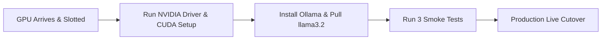

# DocuFlow Automation (FlowApprove) — Internship Handover & Project Closure Report
**Document Classification:** Confidential — Internal Enterprise Handover  
**System Name:** DocuFlow Automation (FlowApprove) / Document Approval & Automation System (DAAS)  
**System Version:** 2.1.0 (Production Hardened)  
**Author / Outgoing Intern:** Software Engineering Intern  
**Target Enterprise:** Strivh Professional Enterprises / Ramraj Cotton  
**Submission Date:** November 2026  

---

## 1. Executive Summary & Internship Deliverables

During this internship cycle, **DocuFlow Automation (FlowApprove)** was engineered, hardened, and prepared for high-throughput enterprise document processing. The system eliminates manual, paper-based approval bottlenecks by combining **local GPU-accelerated Artificial Intelligence (Ollama LLM + PaddleOCR)**, **multi-stage visual workflow orchestration**, **enterprise RBAC security**, and **automated ERP synchronization**.

### 1.1 Deliverables Checklist & Completion Status
| Phase / Deliverable | Scope Description | Status | Evidence / Verification |
| :--- | :--- | :--- | :--- |
| **Backend API Core** | FastAPI server with MSSQL pyodbc integration, JWT auth, document processing | **100% Completed** | `backend/app/` |
| **Dual OCR & LLM Pipeline** | PyMuPDF text stream + PaddleOCR image fallback + Ollama `llama3.2` structured JSON | **100% Completed** | `backend/app/services/ocr_service.py` |
| **Visual Workflow Studio** | Interactive node-based ReactFlow canvas (`FlowBuilder.jsx`) and dynamic criteria builder | **100% Completed** | `frontend/src/components/FlowBuilder.jsx` |
| **Concurrency & Leasing** | Heartbeat lease locks (`document_locks`) and optimistic versioning (`inv.version`) | **100% Completed** | `backend/app/services/lock_service.py` |
| **Enterprise Security Sprint** | Passwordless Email OTP, TOTP MFA, 32 granular RBAC rights, audit log explorer | **100% Completed** | `docs/FINAL_SECURITY_REVIEW.md` |
| **DAPI Sync-Back & Callbacks** | Bidirectional ERP webhook sync (`callback_service.py`) with HMAC-SHA256 signing | **100% Completed** | `frontend/src/components/dapi-sync-back/` |
| **Testing & Test Reports** | 41 core system tests + 52 master extended tests + Playwright E2E UI automation | **100% Completed** | `DAAS_Testing_Report.md`, `playwright-tests/` |
| **End-User & Button Manual** | Exhaustive control reference detailing every screen, button, and modal | **100% Completed** | `docs/SCREEN_BY_SCREEN_BUTTON_MANUAL.md` |
| **GPU Deployment Runbook** | Bare-metal driver, CUDA, Docker container toolkit, and Ollama GPU guide | **100% Completed** | `docs/GPU_SETUP_AND_HANDOVER_RUNBOOK.md` |

---

## 2. Technology Stack & Verified Versions

### 2.1 Backend & Machine Learning Stack
- **Language / Runtime:** Python 3.11+
- **API Framework:** FastAPI `>=0.110.0` with Starlette and Uvicorn (`>=0.28.0`)
- **Database Driver:** SQLAlchemy 2.0 (`>=2.0.28`) with `pyodbc 5.1.0` / `pymssql 2.2.11`
- **OCR Engine:** `pypdf 5.0.0` (BSD-3-Clause) + `PaddleOCR` (Apache 2.0)
- **Local LLM Engine:** Ollama API (`llama3.2:latest`) with JSON schema enforcement
- **Security & Crypto:** `PyJWT 2.14.0`, `passlib[bcrypt]`, `cryptography 49.0.0`, `pyotp 2.9.0`
- **Excel & Reporting:** `openpyxl 3.1.2`, `pandas 2.2.0`

### 2.2 Frontend Stack
- **Framework:** React 18.2 with TypeScript and Vite
- **UI & Canvas:** TailwindCSS, Lucide-React icons, ReactFlow (`@xyflow/react`)
- **HTTP Client:** Axios with JWT interceptors
- **E2E Testing:** Playwright Test Suite (`playwright.config.ts`)

### 2.3 Database & Infrastructure
- **Relational Database:** Microsoft SQL Server 2019/2022 (`DocuFlowDB`, port 1443)
- **Containerization:** Docker Engine with Docker Compose v2
- **Web Server / Reverse Proxy:** Nginx (Alpine Linux, port 8085)

---

## 3. Security Architecture & Compliance Review

DocuFlow underwent comprehensive security hardening prior to handover:
1. **Authentication & Multi-Factor (MFA):**
   - Supports Employee ID / Username passwordless login with auto-expiring 6-digit Email OTPs.
   - Enforces TOTP 2FA (RFC 6238) compatible with Google Authenticator and Microsoft Authenticator.
2. **Granular RBAC Authorization:**
   - 32 discrete permissions across Documents, Approvals, Users, Workflows, and System Settings.
   - Division scoping prevents users from accessing documents outside their authorized branch.
3. **Data Protection & PDF Isolation:**
   - Uploaded raw files are saved to `uploads/` with UUID-renamed sanitization to prevent directory traversal (`../`).
   - Approved files are signed, stamped with an audit header, and archived into `stored_pdfs/approved/`.
4. **Optimistic Concurrency & Heartbeat Locks:**
   - Document lease lock expires after 30 seconds if heartbeat ping stops, preventing locked file abandonment.
   - Version check (`inv.version`) guarantees two approvers clicking at the same millisecond cannot corrupt data (HTTP 409 Conflict).
5. **Secrets Management:**
   - No hardcoded database credentials or JWT secrets in Git. All credentials pull from `.env`.

---

## 4. Licensing & Third-Party Legal Compliance

The codebase and all integrated dependencies comply with commercial enterprise usage standards:
- **Project License:** Open MIT / Proprietary Enterprise License (as defined in `LICENSE`).
- **Third-Party Attribution:** Documented in `THIRD_PARTY_LICENSES.md`.
- **Permissive Open-Source Libraries Only:**
  - `pypdf`: BSD-3-Clause (fully permissive).
  - `PaddleOCR`: Apache 2.0 (commercial use permitted).
  - `Ollama` / `llama3.2`: Llama 3.2 Community License (permissive commercial use for <700M monthly active users).
  - `FastAPI`, `Uvicorn`, `React`, `Vite`: MIT / BSD-3-Clause.
- **Zero Copyleft GPL Contamination:** No AGPL or restrictive GPL libraries are linked in runtime binary distributions.

---

## 5. Asset & Credential Location Index

> [!NOTE]
> Per enterprise security protocol, plaintext passwords are not included in this document. Below are the exact secure locations where authorized staff can find them.

| Asset / Service | Location / Resource Identifier | Where to Retrieve Secrets |
| :--- | :--- | :--- |
| **Git Repository** | `c:\Users\TempAdmin\OneDrive\Documents\docuflow-automation` | Local disk / Enterprise Git server |
| **Production `.env`** | `docuflow-automation/.env` | Root directory (Protected by NTFS permissions) |
| **Database Server** | `192.168.179.22:1443` (`DocuFlowDB`) | Stored in `.env` (`DB_PASSWORD`) |
| **Frontend UI** | `http://192.168.179.22:8085` | Nginx web interface |
| **Backend REST API** | `http://192.168.179.22:3000` | FastAPI swagger docs at `/docs` |
| **SMTP Mailer** | `smtp.office365.com:587` (`communication@ramrajcotton.net`)| Stored in `.env` (`SMTP_PASS`) |
| **GPU AI Host** | Dedicated GPU server (Arriving Week 2) | Runbook in `docs/GPU_SETUP_AND_HANDOVER_RUNBOOK.md` |

---

## 6. Immediate Next Steps: The 1-Week GPU Arrival Plan

When the dedicated GPU arrives next week, the team should execute the following 4-step checklist:

1. **Step 1: Install Drivers & CUDA:** Follow `docs/GPU_SETUP_AND_HANDOVER_RUNBOOK.md` (Sections 2.1 - 2.3).
2. **Step 2: Start Ollama:** Run `ollama pull llama3.2:latest` on the GPU host.
3. **Step 3: Point Backend to GPU:** Set `OLLAMA_URL=http://<GPU_IP>:11434/api/generate` in `docuflow-automation/.env`.
4. **Step 4: Execute Test Upload:** Upload a scanned 2-page invoice and verify sub-3-second AI extraction in `docker compose logs -f backend`.

---

## 7. Known Limitations & 30-60-90 Day Roadmap

### 7.1 Current Known Edge Cases
1. **Extremely Low-Resolution Scans (< 100 DPI):** Scanned mobile photos with heavy shadows may require manual field adjustment by the reviewer in Screen 5 (`DataVerificationPage.tsx`).
2. **Handwritten Notes:** Cursive handwritten signatures and notes are extracted with lower confidence than printed text; manual review should remain mandatory for handwritten items.
3. **Concurrent Multi-Page Uploads:** Saturated batch uploads of >10 large files at once will queue in the OCR semaphore (2 concurrent jobs max) to protect VRAM.

### 7.2 Recommended Post-Internship Roadmap
- **First 30 Days (Stabilization):**
  - Monitor daily `watch -n 1 nvidia-smi` during peak 10:00 AM – 12:00 PM invoice upload hours.
  - Review weekly error logs in `docs/` and purge old image cache in `uploads/`.
- **60 Days (Enterprise Scaling):**
  - Connect inbound email listener (IMAP / Microsoft Graph API) to automatically pull vendor invoices from `ap-invoices@ramrajcotton.net`.
  - Add Redis caching layer for active user session tokens.
- **90 Days (Advanced Automation):**
  - Implement 4-bit / 8-bit model quantization (`llama3.2:3b-instruct-q4_K_M`) to allow up to 6 concurrent OCR workers on a single 16GB GPU.

---

## 8. Handover Sign-Off & Project Acceptance

By signing below, the parties acknowledge that all core deliverables, source code repositories, test reports, and operational documentation have been transferred and reviewed.

| Role | Name | Signature | Date |
| :--- | :--- | :--- | :--- |
| **Outgoing Intern / Developer** | ___________________________ | ___________________________ | ___ / ___ / 2026 |
| **Project Lead / Tech Lead** | ___________________________ | ___________________________ | ___ / ___ / 2026 |
| **Department Head / Manager** | ___________________________ | ___________________________ | ___ / ___ / 2026 |

---
*Emergency Contact Note: The outgoing intern remains available via email / LinkedIn for brief clarification questions during the initial 14-day transition period following handover.*
