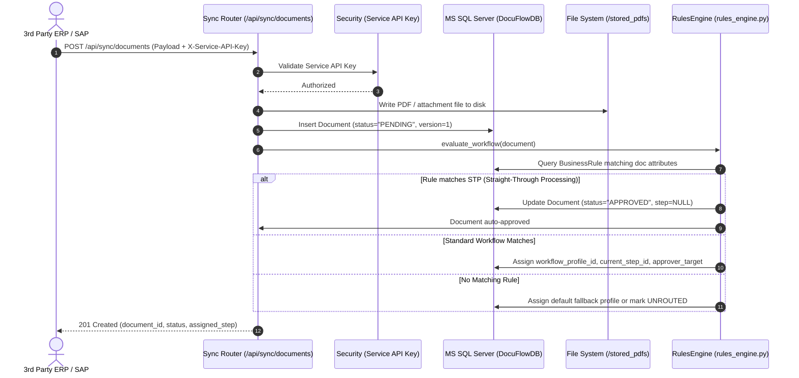

# PART 2: Architecture

## 2.1 System Architecture Overview

DocuFlow is built as a decoupled, multi-tier client-server enterprise system consisting of a React-based Single Page Application (SPA), a high-performance Python FastAPI REST backend, a relational Microsoft SQL Server database, local file storage volumes, and asynchronous background workers for ERP synchronization and lock management.

```mermaid
flowchart TB
    subgraph ClientTier ["Client Tier (Browser)"]
        SPA["React 19 SPA (Vite + TailwindCSS + Zustand)"]
    end

    subgraph ReverseProxy ["Edge & Reverse Proxy Tier"]
        NGINX["Nginx Web Server (Port 80/8085)\nStatic Assets + API Reverse Proxy"]
    end

    subgraph AppTier ["Application Backend Tier (FastAPI / Uvicorn Port 3000)"]
        FASTAPI["FastAPI Core App (main.py)"]
        SEC_MW["Security Middleware (SecurityHeaders, RateLimiter)"]
        
        subgraph APIRouters ["API Routing Layer"]
            AUTH_R["auth.py (JWT, MFA, Azure SSO)"]
            DOC_R["documents.py (Approval, Actions, Signed URLs)"]
            SYNC_R["sync.py / sync_router.py (ERP Ingestion)"]
            WF_R["workflows.py & conditions.py (Workflow Matrix)"]
            INT_R["integrations.py (Webhooks & Retries)"]
            MORE_R["more_info.py (Checklists & Dynamic Forms)"]
            ROLE_R["roles.py & users.py (RBAC & Provisioning)"]
            AUDIT_R["audit.py (Immutable Compliance Logs)"]
        end

        subgraph CoreServices ["Core Business & Automation Services"]
            RE_SVC["RulesEngine (rules_engine.py)"]
            INT_SVC["IntegrationService (integration_service.py)"]
            LOCK_SVC["DocumentLockManager (lock_service.py)"]
            SIGN_SVC["SignedFileService (signed_file_service.py)"]
            CRYPTO_SVC["CryptoService (crypto_service.py)"]
            OCR_SVC["OCRService (ocr_service.py)"]
            MFA_SVC["MFAService & OTPService (mfa_service.py)"]
        end

        subgraph BackgroundWorkers ["Background Asynchronous Tasks"]
            RETRY_WORKER["Sync Retry Engine (process_pending_sync_retries)"]
            LOCK_REAPER["Lock Reaper (cleanup_expired_locks)"]
            EXCEL_SVC["Excel Trigger Watcher (excel_trigger_service.py)"]
        end
    end

    subgraph DataTier ["Persistence Tier"]
        MSSQL[("Microsoft SQL Server (DocuFlowDB)\nHost: 192.168.179.22:1443")]
        FS_UPLOADS["/app/uploads (Temporary & Inbound Uploads)"]
        FS_APPROVED["/app/stored_pdfs/approved (Archived PDFs: YYYY/MM/doc_id)"]
    end

    subgraph ExternalServices ["External Systems & Services"]
        ERP["External ERP / SAP / n8n Webhook Receivers"]
        AZURE["Microsoft Azure AD (OAuth2 SSO)"]
        SMTP_SRV["Corporate SMTP Server (Port 587 OTP & Alerts)"]
        SMS_GW["SMS Provider (Twilio / Fast2SMS / Generic)"]
    end

    SPA -->|HTTP / WebSocket| NGINX
    NGINX -->|Proxy /api/ & /uploads/| FASTAPI
    FASTAPI --> SEC_MW
    SEC_MW --> APIRouters
    APIRouters --> CoreServices
    CoreServices --> BackgroundWorkers

    APIRouters -->|SQLAlchemy 2.0 / pyodbc| MSSQL
    CoreServices -->|SQLAlchemy 2.0 / pyodbc| MSSQL
    BackgroundWorkers -->|SQLAlchemy 2.0 / pyodbc| MSSQL

    CoreServices -->|Read/Write Files| FS_UPLOADS
    CoreServices -->|Archive PDF on Final Approval| FS_APPROVED

    INT_SVC -->|Outbound Webhooks (HMAC & Retries)| ERP
    ERP -->|Inbound Document Intake (API Key)| SYNC_R
    AUTH_R -->|OAuth Token Exchange| AZURE
    MFA_SVC -->|SMTP Mail Delivery| SMTP_SRV
    MFA_SVC -->|SMS Dispatch| SMS_GW
```

---

## 2.2 Component Breakdown & Interactions

### 1. Frontend Client
- **Technology**: React 19, TypeScript, Vite, TailwindCSS v4, React Router v7, Zustand state management.
- **Serving Mechanism**: Multi-stage Docker build served via Nginx ([`frontend/Dockerfile`](file:///frontend/Dockerfile) and [`frontend/nginx.conf`](file:///frontend/nginx.conf)).
- **Interactions**:
  - Sends bearer token `Authorization: Bearer <JWT>` for all authenticated `/api/*` endpoints.
  - Receives short-lived HMAC-signed URLs (`/api/documents/{id}/file-url`) for viewing PDFs and images securely without exposing raw filesystem paths.
  - Renders visual workflow diagrams using `reactflow` in [`FlowBuilder.jsx`](file:///frontend/src/components/FlowBuilder.jsx).

### 2. Backend Application Server
- **Technology**: Python 3.11, FastAPI, Uvicorn ASGI server ([`backend/app/main.py`](file:///backend/app/main.py)).
- **Lifecycle Management**:
  - `lifespan` context manager in [`main.py`](file:///backend/app/main.py#L40-L75) initializes the database engine, validates production secrets via `validate_production_service_api_key`, initializes default RBAC permissions, and starts background scheduled workers.
- **Security Middleware**: [`backend/app/services/security_middleware.py`](file:///backend/app/services/security_middleware.py) enforces:
  - Content Security Policy (CSP), HSTS, X-Frame-Options, X-Content-Type-Options.
  - Per-IP rate limiting (`RateLimiterMiddleware`).

### 3. Database Layer
- **Engine**: Microsoft SQL Server Enterprise / Standard edition.
- **Connection**: Managed via SQLAlchemy 2.0 `sessionmaker` in [`backend/app/database/connection.py`](file:///backend/app/database/connection.py).
- **Driver**: `mssql+pyodbc` with `ODBC Driver 17 for SQL Server`.
- **Failover / Network Resilience**: [`settings.py`](file:///backend/app/config/settings.py#L60-L125) executes socket ping checks against `192.168.179.22:1443`. If the primary host is unreachable in local test environments, it falls back to `localhost:1433` trusted connection.

### 4. Background Daemons & Scheduled Jobs
- **Sync Retry Worker**: `process_pending_sync_retries` in [`backend/app/services/integration_service.py`](file:///backend/app/services/integration_service.py) scans `IntegrationSyncLog` rows in `PENDING` or `FAILED` state where `retry_count < max_retries` and `next_retry_at <= now()`, executing retries with exponential backoff.
- **Lock Reaper**: `cleanup_expired_locks` in [`backend/app/services/lock_service.py`](file:///backend/app/services/lock_service.py) removes stale rows from `DocumentLock` when `expires_at < now()`.
- **Excel Watcher**: `ExcelTriggerService` in [`backend/app/services/excel_trigger_service.py`](file:///backend/app/services/excel_trigger_service.py) watches configured Excel sheets (`data/SD Checklists.xlsx`) to inject documents dynamically.

---

## 2.3 Data Flow Diagrams: Primary User Journeys

### Journey 1: Inbound ERP Document Intake & Workflow Routing



---

### Journey 2: User Approval, Archiving & ERP Back-Sync

```mermaid
sequenceDiagram
    autonumber
    actor Approver as Assigned Approver
    participant UI as React UI (ApprovalQueuePage)
    participant DocAPI as Documents Router (/api/documents/{id}/approve)
    participant Lock as LockManager (lock_service.py)
    participant DB as MS SQL Server
    participant Life as complete_document_lifecycle()
    participant Storage as Approved Storage (/stored_pdfs/approved/)
    participant IntService as IntegrationService (Outbound Back-Sync)
    participant ERP as 3rd Party ERP Webhook

    Approver->>UI: Click "Approve" (provides comments, version=N)
    UI->>DocAPI: POST /api/documents/{id}/approve (expected_version=N)
    DocAPI->>Lock: acquire_lock(doc_id, user_id)
    Lock-->>DocAPI: Lock acquired (prevents concurrent race)
    DocAPI->>DB: Check expected_version == doc.version
    alt Version mismatch (Race Condition)
        DocAPI-->>UI: 409 Conflict ("Document was modified by another user")
    else Version matches
        DocAPI->>DB: Advance workflow step OR mark FINAL_APPROVED
        alt Has Next Workflow Step
            DocAPI->>DB: Update current_step_id to next step, doc.version += 1
            DocAPI-->>UI: 200 OK (Moved to next approval stage)
        else No Next Step (Final Approval)
            DocAPI->>Life: complete_document_lifecycle(doc_id, user_id)
            Life->>Storage: Archive PDF to /stored_pdfs/approved/{YYYY}/{MM}/{doc_id}/
            Life->>DB: Update doc.status = "APPROVED", storage_path
            Life->>IntService: trigger_async_integration_push(doc)
            IntService->>ERP: POST /webhook/approval-status (HMAC signed)
            alt ERP Responds 200 OK
                IntService->>DB: Log IntegrationSyncLog (status="SUCCESS")
            else ERP Offline / HTTP 5xx
                IntService->>DB: Log IntegrationSyncLog (status="FAILED", next_retry_at=+1m)
            end
            Life->>DB: Insert immutable AuditLog row
            DocAPI-->>UI: 200 OK (Document fully approved & back-synced)
    DocAPI->>Lock: release_lock(doc_id, user_id)
```

---

**Verified against source**: [`backend/app/main.py`](file:///backend/app/main.py), [`backend/app/services/security_middleware.py`](file:///backend/app/services/security_middleware.py), [`backend/app/services/integration_service.py`](file:///backend/app/services/integration_service.py), [`backend/app/services/lock_service.py`](file:///backend/app/services/lock_service.py), [`backend/app/routers/documents.py`](file:///backend/app/routers/documents.py), [`backend/app/routers/sync.py`](file:///backend/app/routers/sync.py), [`frontend/Dockerfile`](file:///frontend/Dockerfile), [`frontend/nginx.conf`](file:///frontend/nginx.conf), [`docker-compose.yml`](file:///docker-compose.yml).

