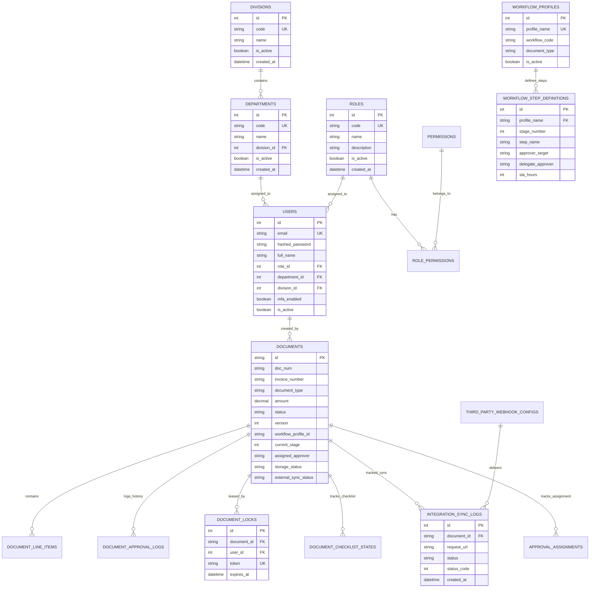

# PART 8: Database

## 8.1 Entity Relationship Diagram (ERD)

The following Mermaid ER diagram illustrates the core relational topology across organization, user identity, document ingestion, workflow step hierarchies, and audit logging in `DocuFlowDB`:

---

## 8.2 Database Table Inventory (Exact Count: 31 Tables)

The DocuFlow schema declared in [`backend/app/database/models.py`](file:///backend/app/database/models.py) contains exactly **31 database tables**:

| # | Table Name | Columns | Primary Key | Foreign Keys | Explicit Indexes | Description |
| :-: | :--- | :-: | :---: | :-: | :-: | :--- |
| 1 | `approval_assignments` | 14 | `id` | `document_id`, `approver_user_id` | 4 | Step-level approval assignments and stage completion timestamps |
| 2 | `business_rules` | 18 | `id` | - | 5 | Dynamic routing rules, priority, and conditions JSON |
| 3 | `callback_attempts` | 14 | `id` | `callback_event_id` | 3 | Individual HTTP attempt records for callback deliveries |
| 4 | `callback_events` | 14 | `id` | `document_id`, `rule_id`, `application_id` | 6 | Event queue records for outbound webhooks |
| 5 | `callback_rules` | 29 | `id` | `application_id` | 2 | Rules defining URL patterns and auth for webhook callbacks |
| 6 | `checklist_rules` | 12 | `id` | - | 0 | Conditional rules for displaying checklist items |
| 7 | `checklist_templates` | 7 | `id` | - | 2 | Reusable checklist question templates |
| 8 | `departments` | 6 | `id` | `division_id` | 3 | Organizational departments |
| 9 | `divisions` | 5 | `id` | - | 2 | Organizational corporate divisions |
| 10 | `document_approval_logs`| 13 | `id` | `document_id` | 3 | Historical log of every user approval/rejection action |
| 11 | `document_checklist_states`| 8 | `id` | `document_id` | 2 | Checklist item checkbox state for a document |
| 12 | `document_line_items` | 9 | `id` | `document_id` | 1 | Itemized invoice and purchase line items |
| 13 | `document_locks` | 7 | `id` | `document_id`, `user_id` | 3 | Concurrency lease locks for active document reviews |
| 14 | `document_type_field_configurations`| 14 | `id` | `document_type_id` | 5 | Dynamic custom field schemas per document type |
| 15 | `documents` | 90 | `id` | - | 24 | Primary document record (invoices, vouchers, claims) |
| 16 | `in_app_notifications` | 9 | `id` | - | 3 | User notifications and alert inbox |
| 17 | `integration_audit_history`| 8 | `id` | - | 3 | Audit history for integration config changes |
| 18 | `integration_sync_logs`| 12 | `id` | `document_id` | 5 | Outbound ERP push sync attempts and responses |
| 19 | `notification_provider_configs`| 7 | `id` | - | 0 | SMTP / SMS gateway delivery provider credentials |
| 20 | `notification_raci_matrices`| 9 | `id` | - | 2 | RACI matrix defining email/SMS recipients per event |
| 21 | `otp_verifications` | 8 | `id` | `user_id` | 3 | Temporary email/SMS OTP codes for MFA verification |
| 22 | `permissions` | 14 | `id` | - | 6 | Granular RBAC permissions catalog |
| 23 | `role_permissions` | 5 | `id` | `role_id`, `permission_id` | 2 | Join table binding permissions and scopes to roles |
| 24 | `roles` | 6 | `id` | - | 2 | System roles (SUPER_ADMIN, APPROVER, REQUESTER, etc.) |
| 25 | `system_engine_logs` | 8 | `id` | `document_id` | 4 | Background workers, escalations and policy engine events |
| 26 | `third_party_applications`| 11 | `id` | - | 2 | External API applications and integration consumers |
| 27 | `third_party_webhook_configs`| 11 | `id` | - | 1 | Registered outbound ERP webhooks and encrypted secrets |
| 28 | `user_access_logs` | 8 | `id` | - | 3 | User authentication, login, and MFA event logs |
| 29 | `users` | 28 | `id` | `department_id` | 12 | User accounts, credentials, and profile settings |
| 30 | `workflow_profiles` | 21 | `id` | - | 4 | Workflow routing profile definitions |
| 31 | `workflow_step_definitions`| 12 | `id` | `workflow_profile_id` | 1 | Steps, approval targets, and SLA hours per workflow |

---

### Table: `approval_assignments` (14 columns)

| Column Name | Type | Nullable | PK | Default | Foreign Key | Indexed |
| :--- | :--- | :---: | :---: | :--- | :--- | :---: |
| `id` | `INTEGER` | No | PK | `-` | - | - |
| `document_id` | `VARCHAR(100)` | No | - | `-` | documents.id | Yes |
| `workflow_profile_id` | `VARCHAR(200)` | Yes | - | `-` | - | Yes |
| `stage_number` | `INTEGER` | No | - | `-` | - | - |
| `stage_name` | `VARCHAR(200)` | Yes | - | `-` | - | - |
| `approver_user_id` | `INTEGER` | Yes | - | `-` | users.id | Yes |
| `approver_handle` | `VARCHAR(200)` | No | - | `-` | - | - |
| `status` | `VARCHAR(50)` | No | - | `PENDING` | - | Yes |
| `sequence_order` | `INTEGER` | No | - | `1` | - | - |
| `assigned_at` | `DATETIME` | No | - | `<function datetime.utcnow at 0x0000012FB87EC400>` | - | - |
| `completed_at` | `DATETIME` | Yes | - | `-` | - | - |
| `remarks` | `TEXT` | Yes | - | `-` | - | - |
| `created_at` | `DATETIME` | No | - | `<function datetime.utcnow at 0x0000012FB87EC4A0>` | - | - |
| `updated_at` | `DATETIME` | No | - | `<function datetime.utcnow at 0x0000012FB87EC540>` | - | - |

**Explicit Table Indexes**:
- `ix_approval_assignments_status`: columns `status`
- `ix_approval_assignments_workflow_profile_id`: columns `workflow_profile_id`
- `ix_approval_assignments_approver_user_id`: columns `approver_user_id`
- `ix_approval_assignments_document_id`: columns `document_id`

### Table: `business_rules` (18 columns)

| Column Name | Type | Nullable | PK | Default | Foreign Key | Indexed |
| :--- | :--- | :---: | :---: | :--- | :--- | :---: |
| `id` | `INTEGER` | No | PK | `-` | - | - |
| `rule_name` | `VARCHAR(250)` | No | - | `-` | - | Yes |
| `rule_category` | `VARCHAR(100)` | Yes | - | `Vendor Payment Workflows` | - | - |
| `document_type` | `VARCHAR(100)` | Yes | - | `AP INVOICE` | - | - |
| `priority` | `INTEGER` | Yes | - | `10` | - | - |
| `target_workflow_id` | `VARCHAR(200)` | No | - | `-` | - | Yes |
| `conditions_json` | `TEXT` | No | - | `-` | - | - |
| `description` | `TEXT` | Yes | - | `-` | - | - |
| `rule_action` | `VARCHAR(50)` | Yes | - | `WORKFLOW_ROUTE` | - | Yes |
| `cancel_reason` | `TEXT` | Yes | - | `-` | - | - |
| `auto_approve_enabled` | `BOOLEAN` | Yes | - | `False` | - | - |
| `auto_approve_condition` | `TEXT` | Yes | - | `-` | - | - |
| `auto_cancel_enabled` | `BOOLEAN` | Yes | - | `False` | - | - |
| `auto_cancel_condition` | `TEXT` | Yes | - | `-` | - | - |
| `is_active` | `BOOLEAN` | Yes | - | `True` | - | Yes |
| `is_deleted` | `BOOLEAN` | No | - | `False` | - | Yes |
| `deleted_at` | `DATETIME` | Yes | - | `-` | - | - |
| `created_at` | `DATETIME` | Yes | - | `<function datetime.utcnow at 0x0000012FB8788860>` | - | - |

**Explicit Table Indexes**:
- `ix_business_rules_is_deleted`: columns `is_deleted`
- `ix_business_rules_rule_action`: columns `rule_action`
- `ix_business_rules_rule_name` (Unique): columns `rule_name`
- `ix_business_rules_is_active`: columns `is_active`
- `ix_business_rules_target_workflow_id`: columns `target_workflow_id`

### Table: `callback_attempts` (14 columns)

| Column Name | Type | Nullable | PK | Default | Foreign Key | Indexed |
| :--- | :--- | :---: | :---: | :--- | :--- | :---: |
| `id` | `INTEGER` | No | PK | `-` | - | - |
| `callback_event_id` | `INTEGER` | No | - | `-` | callback_events.id | Yes |
| `attempt_number` | `INTEGER` | No | - | `-` | - | - |
| `http_method` | `VARCHAR(15)` | No | - | `-` | - | - |
| `request_url` | `VARCHAR(1000)` | No | - | `-` | - | - |
| `request_headers_json` | `TEXT` | Yes | - | `-` | - | - |
| `request_body` | `TEXT` | Yes | - | `-` | - | - |
| `response_status_code` | `INTEGER` | Yes | - | `-` | - | - |
| `response_headers_json` | `TEXT` | Yes | - | `-` | - | - |
| `response_body` | `TEXT` | Yes | - | `-` | - | - |
| `response_time_ms` | `INTEGER` | Yes | - | `-` | - | - |
| `status` | `VARCHAR(50)` | Yes | - | `FAILED` | - | Yes |
| `error_message` | `TEXT` | Yes | - | `-` | - | - |
| `timestamp` | `DATETIME` | Yes | - | `<function datetime.utcnow at 0x0000012FB887F600>` | - | Yes |

**Explicit Table Indexes**:
- `ix_callback_attempts_timestamp`: columns `timestamp`
- `ix_callback_attempts_status`: columns `status`
- `ix_callback_attempts_callback_event_id`: columns `callback_event_id`

### Table: `callback_events` (14 columns)

| Column Name | Type | Nullable | PK | Default | Foreign Key | Indexed |
| :--- | :--- | :---: | :---: | :--- | :--- | :---: |
| `id` | `INTEGER` | No | PK | `-` | - | - |
| `event_id` | `VARCHAR(100)` | No | - | `-` | - | Yes |
| `document_id` | `VARCHAR(100)` | No | - | `-` | documents.id | Yes |
| `rule_id` | `INTEGER` | No | - | `-` | callback_rules.id | Yes |
| `application_id` | `INTEGER` | No | - | `-` | third_party_applications.id | Yes |
| `source_primary_key` | `VARCHAR(100)` | Yes | - | `-` | - | - |
| `document_number` | `VARCHAR(150)` | Yes | - | `-` | - | - |
| `decision` | `VARCHAR(50)` | No | - | `-` | - | - |
| `status` | `VARCHAR(50)` | Yes | - | `PENDING` | - | Yes |
| `attempt_count` | `INTEGER` | Yes | - | `0` | - | - |
| `max_attempts` | `INTEGER` | Yes | - | `3` | - | - |
| `next_retry_at` | `DATETIME` | Yes | - | `-` | - | - |
| `created_at` | `DATETIME` | Yes | - | `<function datetime.utcnow at 0x0000012FB887D760>` | - | Yes |
| `updated_at` | `DATETIME` | Yes | - | `<function datetime.utcnow at 0x0000012FB887D800>` | - | - |

**Explicit Table Indexes**:
- `ix_callback_events_event_id` (Unique): columns `event_id`
- `ix_callback_events_document_id`: columns `document_id`
- `ix_callback_events_application_id`: columns `application_id`
- `ix_callback_events_created_at`: columns `created_at`
- `ix_callback_events_rule_id`: columns `rule_id`
- `ix_callback_events_status`: columns `status`

### Table: `callback_rules` (29 columns)

| Column Name | Type | Nullable | PK | Default | Foreign Key | Indexed |
| :--- | :--- | :---: | :---: | :--- | :--- | :---: |
| `id` | `INTEGER` | No | PK | `-` | - | - |
| `rule_name` | `VARCHAR(200)` | No | - | `-` | - | - |
| `description` | `TEXT` | Yes | - | `-` | - | - |
| `application_id` | `INTEGER` | No | - | `-` | third_party_applications.id | Yes |
| `status` | `VARCHAR(20)` | Yes | - | `ACTIVE` | - | Yes |
| `priority` | `INTEGER` | Yes | - | `100` | - | - |
| `trigger_event` | `VARCHAR(100)` | Yes | - | `FDO_FINAL_DECISION` | - | - |
| `run_when` | `VARCHAR(30)` | Yes | - | `BOTH` | - | - |
| `conditions_json` | `TEXT` | Yes | - | `-` | - | - |
| `http_method` | `VARCHAR(15)` | Yes | - | `POST` | - | - |
| `url_mode` | `VARCHAR(20)` | Yes | - | `INHERIT_BASE` | - | - |
| `endpoint_path` | `VARCHAR(500)` | Yes | - | `-` | - | - |
| `custom_url` | `VARCHAR(500)` | Yes | - | `-` | - | - |
| `body_type` | `VARCHAR(30)` | Yes | - | `JSON` | - | - |
| `payload_source` | `VARCHAR(50)` | Yes | - | `MAPPING` | - | - |
| `stored_procedure_name` | `VARCHAR(200)` | Yes | - | `-` | - | - |
| `content_type` | `VARCHAR(100)` | Yes | - | `application/json` | - | - |
| `payload_mapping_json` | `TEXT` | Yes | - | `-` | - | - |
| `raw_payload_template` | `TEXT` | Yes | - | `-` | - | - |
| `query_params_json` | `TEXT` | Yes | - | `-` | - | - |
| `headers_json` | `TEXT` | Yes | - | `-` | - | - |
| `auth_override_type` | `VARCHAR(50)` | Yes | - | `INHERIT` | - | - |
| `auth_override_config_json` | `TEXT` | Yes | - | `-` | - | - |
| `timeout_seconds` | `INTEGER` | Yes | - | `30` | - | - |
| `success_criteria_json` | `TEXT` | Yes | - | `-` | - | - |
| `follow_redirects` | `BOOLEAN` | Yes | - | `False` | - | - |
| `retry_config_json` | `TEXT` | Yes | - | `-` | - | - |
| `created_at` | `DATETIME` | Yes | - | `<function datetime.utcnow at 0x0000012FB883B2E0>` | - | - |
| `updated_at` | `DATETIME` | Yes | - | `<function datetime.utcnow at 0x0000012FB883B380>` | - | - |

**Explicit Table Indexes**:
- `ix_callback_rules_application_id`: columns `application_id`
- `ix_callback_rules_status`: columns `status`

### Table: `checklist_rules` (12 columns)

| Column Name | Type | Nullable | PK | Default | Foreign Key | Indexed |
| :--- | :--- | :---: | :---: | :--- | :--- | :---: |
| `id` | `INTEGER` | No | PK | `-` | - | - |
| `rule_name` | `VARCHAR(200)` | No | - | `-` | - | - |
| `division` | `VARCHAR(100)` | Yes | - | `-` | - | - |
| `category` | `VARCHAR(200)` | Yes | - | `-` | - | - |
| `cost_center` | `VARCHAR(200)` | Yes | - | `-` | - | - |
| `branch` | `VARCHAR(200)` | Yes | - | `-` | - | - |
| `workflow_profile` | `VARCHAR(200)` | Yes | - | `-` | - | - |
| `stage_name` | `VARCHAR(200)` | No | - | `-` | - | - |
| `item_text` | `VARCHAR(500)` | No | - | `-` | - | - |
| `is_mandatory` | `BOOLEAN` | Yes | - | `True` | - | - |
| `is_active` | `BOOLEAN` | Yes | - | `True` | - | - |
| `sequence_order` | `INTEGER` | Yes | - | `1` | - | - |

### Table: `checklist_templates` (7 columns)

| Column Name | Type | Nullable | PK | Default | Foreign Key | Indexed |
| :--- | :--- | :---: | :---: | :--- | :--- | :---: |
| `id` | `INTEGER` | No | PK | `-` | - | - |
| `workflow_profile` | `VARCHAR(200)` | No | - | `-` | - | Yes |
| `stage_name` | `VARCHAR(200)` | No | - | `-` | - | Yes |
| `item_text` | `VARCHAR(500)` | No | - | `-` | - | - |
| `is_mandatory` | `BOOLEAN` | Yes | - | `True` | - | - |
| `is_active` | `BOOLEAN` | Yes | - | `True` | - | - |
| `sequence_order` | `INTEGER` | Yes | - | `1` | - | - |

**Explicit Table Indexes**:
- `ix_checklist_templates_workflow_profile`: columns `workflow_profile`
- `ix_checklist_templates_stage_name`: columns `stage_name`

### Table: `departments` (6 columns)

| Column Name | Type | Nullable | PK | Default | Foreign Key | Indexed |
| :--- | :--- | :---: | :---: | :--- | :--- | :---: |
| `id` | `INTEGER` | No | PK | `-` | - | - |
| `code` | `VARCHAR(50)` | No | - | `-` | - | Yes |
| `name` | `VARCHAR(150)` | No | - | `-` | - | - |
| `division_id` | `INTEGER` | Yes | - | `-` | divisions.id | Yes |
| `is_active` | `BOOLEAN` | No | - | `True` | - | Yes |
| `created_at` | `DATETIME` | Yes | - | `<function datetime.utcnow at 0x0000012FB8698E00>` | - | - |

**Explicit Table Indexes**:
- `ix_departments_code` (Unique): columns `code`
- `ix_departments_division_id`: columns `division_id`
- `ix_departments_is_active`: columns `is_active`

### Table: `divisions` (5 columns)

| Column Name | Type | Nullable | PK | Default | Foreign Key | Indexed |
| :--- | :--- | :---: | :---: | :--- | :--- | :---: |
| `id` | `INTEGER` | No | PK | `-` | - | - |
| `code` | `VARCHAR(50)` | No | - | `-` | - | Yes |
| `name` | `VARCHAR(150)` | No | - | `-` | - | - |
| `is_active` | `BOOLEAN` | No | - | `True` | - | Yes |
| `created_at` | `DATETIME` | Yes | - | `<function datetime.utcnow at 0x0000012FB8662A20>` | - | - |

**Explicit Table Indexes**:
- `ix_divisions_is_active`: columns `is_active`
- `ix_divisions_code` (Unique): columns `code`

### Table: `document_approval_logs` (13 columns)

| Column Name | Type | Nullable | PK | Default | Foreign Key | Indexed |
| :--- | :--- | :---: | :---: | :--- | :--- | :---: |
| `id` | `INTEGER` | No | PK | `-` | - | - |
| `invoice_id` | `VARCHAR(100)` | Yes | - | `-` | documents.id | Yes |
| `user` | `VARCHAR(150)` | No | - | `-` | - | Yes |
| `action` | `VARCHAR(100)` | No | - | `-` | - | - |
| `stage` | `VARCHAR(100)` | Yes | - | `-` | - | - |
| `notes` | `TEXT` | Yes | - | `-` | - | - |
| `ip_address` | `VARCHAR(50)` | Yes | - | `-` | - | - |
| `approver_user_id` | `INTEGER` | Yes | - | `-` | - | - |
| `stage_id` | `INTEGER` | Yes | - | `-` | - | - |
| `previous_status` | `VARCHAR(50)` | Yes | - | `-` | - | - |
| `new_status` | `VARCHAR(50)` | Yes | - | `-` | - | - |
| `remarks` | `TEXT` | Yes | - | `-` | - | - |
| `timestamp` | `DATETIME` | Yes | - | `<function datetime.utcnow at 0x0000012FB87C2AC0>` | - | Yes |

**Explicit Table Indexes**:
- `ix_document_approval_logs_timestamp`: columns `timestamp`
- `ix_document_approval_logs_user`: columns `user`
- `ix_document_approval_logs_invoice_id`: columns `invoice_id`

### Table: `document_checklist_states` (8 columns)

| Column Name | Type | Nullable | PK | Default | Foreign Key | Indexed |
| :--- | :--- | :---: | :---: | :--- | :--- | :---: |
| `id` | `INTEGER` | No | PK | `-` | - | - |
| `invoice_id` | `VARCHAR(100)` | No | - | `-` | documents.id | Yes |
| `stage_name` | `VARCHAR(200)` | No | - | `-` | - | Yes |
| `item_text` | `VARCHAR(500)` | No | - | `-` | - | - |
| `is_mandatory` | `BOOLEAN` | No | - | `True` | - | - |
| `is_checked` | `BOOLEAN` | Yes | - | `False` | - | - |
| `checked_by` | `VARCHAR(150)` | Yes | - | `-` | - | - |
| `checked_at` | `DATETIME` | Yes | - | `-` | - | - |

**Explicit Table Indexes**:
- `ix_document_checklist_states_stage_name`: columns `stage_name`
- `ix_document_checklist_states_invoice_id`: columns `invoice_id`

### Table: `document_line_items` (9 columns)

| Column Name | Type | Nullable | PK | Default | Foreign Key | Indexed |
| :--- | :--- | :---: | :---: | :--- | :--- | :---: |
| `id` | `INTEGER` | No | PK | `-` | - | - |
| `invoice_id` | `VARCHAR(100)` | No | - | `-` | documents.id | Yes |
| `description` | `VARCHAR(500)` | No | - | `-` | - | - |
| `quantity` | `NUMERIC(12, 2)` | Yes | - | `1.0` | - | - |
| `unit_price` | `NUMERIC(18, 2)` | Yes | - | `0.0` | - | - |
| `amount` | `NUMERIC(18, 2)` | Yes | - | `0.0` | - | - |
| `item_code` | `VARCHAR(100)` | Yes | - | `-` | - | - |
| `warranty_text` | `VARCHAR(500)` | Yes | - | `-` | - | - |
| `serial_numbers` | `VARCHAR(1000)` | Yes | - | `-` | - | - |

**Explicit Table Indexes**:
- `ix_document_line_items_invoice_id`: columns `invoice_id`

### Table: `document_locks` (7 columns)

| Column Name | Type | Nullable | PK | Default | Foreign Key | Indexed |
| :--- | :--- | :---: | :---: | :--- | :--- | :---: |
| `id` | `INTEGER` | No | PK | `-` | - | - |
| `document_id` | `VARCHAR(100)` | No | - | `-` | documents.id | Yes |
| `user_id` | `INTEGER` | No | - | `-` | users.id | Yes |
| `username` | `VARCHAR(150)` | No | - | `-` | - | - |
| `lock_token` | `VARCHAR(100)` | No | - | `-` | - | - |
| `expires_at` | `DATETIME` | No | - | `-` | - | Yes |
| `created_at` | `DATETIME` | Yes | - | `<function datetime.utcnow at 0x0000012FB86BE3E0>` | - | - |

**Explicit Table Indexes**:
- `ix_document_locks_document_id` (Unique): columns `document_id`
- `ix_document_locks_expires_at`: columns `expires_at`
- `ix_document_locks_user_id`: columns `user_id`

### Table: `document_type_field_configurations` (14 columns)

| Column Name | Type | Nullable | PK | Default | Foreign Key | Indexed |
| :--- | :--- | :---: | :---: | :--- | :--- | :---: |
| `id` | `INTEGER` | No | PK | `-` | - | - |
| `document_type` | `VARCHAR(100)` | No | - | `-` | - | Yes |
| `field_key` | `VARCHAR(100)` | No | - | `-` | - | Yes |
| `field_label` | `VARCHAR(150)` | Yes | - | `-` | - | - |
| `category` | `VARCHAR(100)` | Yes | - | `-` | - | - |
| `source` | `VARCHAR(50)` | No | - | `ERP` | - | - |
| `display_order` | `INTEGER` | No | - | `0` | - | - |
| `is_visible` | `BOOLEAN` | No | - | `True` | - | - |
| `configuration_scope` | `VARCHAR(50)` | No | - | `USER` | - | - |
| `user_id` | `INTEGER` | Yes | - | `-` | users.id | Yes |
| `created_by` | `VARCHAR(150)` | Yes | - | `-` | - | - |
| `updated_by` | `VARCHAR(150)` | Yes | - | `-` | - | - |
| `created_at` | `DATETIME` | Yes | - | `<function datetime.utcnow at 0x0000012FB88A1DA0>` | - | - |
| `updated_at` | `DATETIME` | Yes | - | `<function datetime.utcnow at 0x0000012FB88A1E40>` | - | - |

**Explicit Table Indexes**:
- `ix_dtfc_doc_type_field`: columns `document_type, field_key`
- `ix_document_type_field_configurations_document_type`: columns `document_type`
- `ix_document_type_field_configurations_user_id`: columns `user_id`
- `ix_document_type_field_configurations_field_key`: columns `field_key`
- `ix_dtfc_doc_type_user`: columns `document_type, user_id`

### Table: `documents` (90 columns)

| Column Name | Type | Nullable | PK | Default | Foreign Key | Indexed |
| :--- | :--- | :---: | :---: | :--- | :--- | :---: |
| `id` | `VARCHAR(100)` | No | PK | `-` | - | Yes |
| `doc_key` | `VARCHAR(100)` | Yes | - | `-` | - | Yes |
| `doc_num` | `VARCHAR(100)` | Yes | - | `-` | - | Yes |
| `doc_date` | `VARCHAR(50)` | Yes | - | `-` | - | - |
| `party_name` | `VARCHAR(250)` | Yes | - | `-` | - | Yes |
| `party_code` | `VARCHAR(100)` | Yes | - | `-` | - | Yes |
| `party_tax_id` | `VARCHAR(50)` | Yes | - | `-` | - | - |
| `vendor_name` | `VARCHAR(250)` | Yes | - | `-` | - | - |
| `vendor_code` | `VARCHAR(100)` | Yes | - | `-` | - | Yes |
| `vendor_gstin` | `VARCHAR(50)` | Yes | - | `-` | - | - |
| `invoice_number` | `VARCHAR(150)` | Yes | - | `-` | - | Yes |
| `invoice_date` | `VARCHAR(50)` | Yes | - | `-` | - | - |
| `po_number` | `VARCHAR(100)` | Yes | - | `-` | - | Yes |
| `amount` | `NUMERIC(18, 2)` | No | - | `0.0` | - | - |
| `base_amount` | `NUMERIC(18, 2)` | No | - | `0.0` | - | - |
| `tax_amount` | `NUMERIC(18, 2)` | No | - | `0.0` | - | - |
| `cgst` | `NUMERIC(18, 2)` | Yes | - | `0.0` | - | - |
| `sgst` | `NUMERIC(18, 2)` | Yes | - | `0.0` | - | - |
| `igst` | `NUMERIC(18, 2)` | Yes | - | `0.0` | - | - |
| `currency` | `VARCHAR(20)` | Yes | - | `INR` | - | - |
| `document_type` | `VARCHAR(100)` | Yes | - | `AP INVOICE` | - | Yes |
| `division` | `VARCHAR(100)` | Yes | - | `VCC` | - | Yes |
| `category` | `VARCHAR(200)` | Yes | - | `-` | - | Yes |
| `cost_center` | `VARCHAR(200)` | Yes | - | `-` | - | Yes |
| `plant` | `VARCHAR(200)` | Yes | - | `-` | - | Yes |
| `payment_terms` | `VARCHAR(100)` | Yes | - | `Net 30` | - | - |
| `pay_mode` | `VARCHAR(20)` | Yes | - | `BANK` | - | - |
| `status` | `VARCHAR(50)` | Yes | - | `Pending Approval` | - | Yes |
| `current_stage` | `INTEGER` | Yes | - | `1` | - | - |
| `total_stages` | `INTEGER` | Yes | - | `2` | - | - |
| `assigned_approver` | `VARCHAR(500)` | Yes | - | `-` | - | Yes |
| `workflow_profile_id` | `VARCHAR(200)` | Yes | - | `-` | - | Yes |
| `is_deleted` | `BOOLEAN` | No | - | `False` | - | Yes |
| `deleted_at` | `DATETIME` | Yes | - | `-` | - | - |
| `checklist_state` | `TEXT` | Yes | - | `-` | - | - |
| `line_items_json` | `TEXT` | Yes | - | `-` | - | - |
| `custom_data` | `TEXT` | Yes | - | `-` | - | - |
| `account_name` | `VARCHAR(255)` | Yes | - | `-` | - | - |
| `type_of_complaint` | `VARCHAR(255)` | Yes | - | `-` | - | - |
| `dealer_name` | `VARCHAR(255)` | Yes | - | `-` | - | - |
| `bp_code` | `VARCHAR(100)` | Yes | - | `-` | - | - |
| `customer_code` | `VARCHAR(100)` | Yes | - | `-` | - | - |
| `employee_name` | `VARCHAR(255)` | Yes | - | `-` | - | - |
| `employee_id` | `VARCHAR(100)` | Yes | - | `-` | - | - |
| `employee_division` | `VARCHAR(100)` | Yes | - | `-` | - | - |
| `employee_segment` | `VARCHAR(100)` | Yes | - | `-` | - | - |
| `survey_date` | `VARCHAR(50)` | Yes | - | `-` | - | - |
| `subtype_of_complaint` | `VARCHAR(255)` | Yes | - | `-` | - | - |
| `bp_type` | `VARCHAR(100)` | Yes | - | `-` | - | - |
| `feedback_date` | `VARCHAR(50)` | Yes | - | `-` | - | - |
| `additional_comments` | `TEXT` | Yes | - | `-` | - | - |
| `image_1` | `VARCHAR(500)` | Yes | - | `-` | - | - |
| `image_2` | `VARCHAR(500)` | Yes | - | `-` | - | - |
| `image_3` | `VARCHAR(500)` | Yes | - | `-` | - | - |
| `image_4` | `VARCHAR(500)` | Yes | - | `-` | - | - |
| `image_5` | `VARCHAR(500)` | Yes | - | `-` | - | - |
| `expense_type` | `VARCHAR(255)` | Yes | - | `-` | - | - |
| `department` | `VARCHAR(255)` | Yes | - | `-` | - | - |
| `expense_date` | `VARCHAR(50)` | Yes | - | `-` | - | - |
| `receipt_number` | `VARCHAR(100)` | Yes | - | `-` | - | - |
| `credit_note_number` | `VARCHAR(100)` | Yes | - | `-` | - | - |
| `reason_for_credit` | `VARCHAR(255)` | Yes | - | `-` | - | - |
| `original_invoice_ref` | `VARCHAR(100)` | Yes | - | `-` | - | - |
| `credit_note_date` | `VARCHAR(50)` | Yes | - | `-` | - | - |
| `credit_status` | `VARCHAR(50)` | Yes | - | `-` | - | - |
| `customer_name` | `VARCHAR(255)` | Yes | - | `-` | - | - |
| `feedback_type` | `VARCHAR(255)` | Yes | - | `-` | - | - |
| `rating` | `INTEGER` | Yes | - | `-` | - | - |
| `due_date` | `VARCHAR(50)` | Yes | - | `-` | - | - |
| `document_number` | `VARCHAR(100)` | Yes | - | `-` | - | - |
| `file_url` | `VARCHAR(500)` | Yes | - | `-` | - | - |
| `file_path` | `VARCHAR(500)` | Yes | - | `-` | - | - |
| `file_name` | `VARCHAR(255)` | Yes | - | `-` | - | - |
| `file_size` | `BIGINT` | Yes | - | `-` | - | - |
| `pi_indicator` | `VARCHAR(10)` | Yes | - | `-` | - | - |
| `trans_type` | `VARCHAR(20)` | Yes | - | `-` | - | - |
| `gstin` | `VARCHAR(15)` | Yes | - | `-` | - | - |
| `doc_status` | `INTEGER` | Yes | - | `0` | - | - |
| `doc_due_date` | `VARCHAR(50)` | Yes | - | `-` | - | - |
| `contact_person` | `VARCHAR(100)` | Yes | - | `-` | - | - |
| `link_column` | `VARCHAR(500)` | Yes | - | `-` | - | - |
| `external_sync_status` | `VARCHAR(50)` | Yes | - | `UNSYNCED` | - | Yes |
| `external_sync_ref` | `VARCHAR(100)` | Yes | - | `-` | - | Yes |
| `external_synced_at` | `DATETIME` | Yes | - | `-` | - | - |
| `external_sync_system` | `VARCHAR(100)` | Yes | - | `-` | - | - |
| `external_sync_error` | `TEXT` | Yes | - | `-` | - | - |
| `source_application` | `VARCHAR(100)` | Yes | - | `-` | - | Yes |
| `version` | `INTEGER` | No | - | `1` | - | - |
| `created_at` | `DATETIME` | Yes | - | `<function datetime.utcnow at 0x0000012FB86E5F80>` | - | Yes |
| `updated_at` | `DATETIME` | Yes | - | `<function datetime.utcnow at 0x0000012FB86E60C0>` | - | - |

**Explicit Table Indexes**:
- `ix_documents_id`: columns `id`
- `ix_documents_external_sync_status`: columns `external_sync_status`
- `ix_documents_assigned_approver`: columns `assigned_approver`
- `ix_documents_cost_center`: columns `cost_center`
- `ix_documents_division_status`: columns `division, status`
- `ix_documents_source_application`: columns `source_application`
- `ix_documents_created_status`: columns `created_at, status`
- `ix_documents_doc_key`: columns `doc_key`
- `ix_documents_plant`: columns `plant`
- `ix_documents_document_type`: columns `document_type`
- `ix_documents_workflow_profile_id`: columns `workflow_profile_id`
- `ix_documents_doc_num`: columns `doc_num`
- `ix_documents_external_sync_ref`: columns `external_sync_ref`
- `ix_documents_invoice_number`: columns `invoice_number`
- `ix_documents_status`: columns `status`
- `ix_documents_vendor_code`: columns `vendor_code`
- `ix_documents_division`: columns `division`
- `ix_documents_created_at`: columns `created_at`
- `ix_documents_party_name`: columns `party_name`
- `ix_documents_is_deleted`: columns `is_deleted`
- `ix_documents_po_number`: columns `po_number`
- `ix_documents_category`: columns `category`
- `ix_documents_assigned_status`: columns `assigned_approver, status`
- `ix_documents_party_code`: columns `party_code`

### Table: `in_app_notifications` (9 columns)

| Column Name | Type | Nullable | PK | Default | Foreign Key | Indexed |
| :--- | :--- | :---: | :---: | :--- | :--- | :---: |
| `id` | `INTEGER` | No | PK | `-` | - | - |
| `notification_id` | `VARCHAR(100)` | Yes | - | `<function InAppNotification.<lambda> at 0x0000012FB881A160>` | - | Yes |
| `document_id` | `VARCHAR(100)` | No | - | `-` | - | Yes |
| `recipient_handle` | `VARCHAR(200)` | No | - | `-` | - | Yes |
| `notification_type` | `VARCHAR(50)` | Yes | - | `PENDING_APPROVAL` | - | - |
| `title` | `VARCHAR(300)` | No | - | `-` | - | - |
| `message` | `TEXT` | No | - | `-` | - | - |
| `is_read` | `BOOLEAN` | Yes | - | `False` | - | - |
| `created_at` | `DATETIME` | Yes | - | `<function datetime.utcnow at 0x0000012FB881A340>` | - | - |

**Explicit Table Indexes**:
- `ix_in_app_notifications_document_id`: columns `document_id`
- `ix_in_app_notifications_recipient_handle`: columns `recipient_handle`
- `ix_in_app_notifications_notification_id` (Unique): columns `notification_id`

### Table: `integration_audit_history` (8 columns)

| Column Name | Type | Nullable | PK | Default | Foreign Key | Indexed |
| :--- | :--- | :---: | :---: | :--- | :--- | :---: |
| `id` | `INTEGER` | No | PK | `-` | - | - |
| `entity_type` | `VARCHAR(50)` | No | - | `-` | - | Yes |
| `entity_id` | `INTEGER` | No | - | `-` | - | Yes |
| `action` | `VARCHAR(50)` | No | - | `-` | - | - |
| `previous_value_json` | `TEXT` | Yes | - | `-` | - | - |
| `new_value_json` | `TEXT` | Yes | - | `-` | - | - |
| `changed_by` | `VARCHAR(150)` | Yes | - | `System Admin` | - | - |
| `timestamp` | `DATETIME` | Yes | - | `<function datetime.utcnow at 0x0000012FB88A0B80>` | - | Yes |

**Explicit Table Indexes**:
- `ix_integration_audit_history_timestamp`: columns `timestamp`
- `ix_integration_audit_history_entity_type`: columns `entity_type`
- `ix_integration_audit_history_entity_id`: columns `entity_id`

### Table: `integration_sync_logs` (12 columns)

| Column Name | Type | Nullable | PK | Default | Foreign Key | Indexed |
| :--- | :--- | :---: | :---: | :--- | :--- | :---: |
| `id` | `INTEGER` | No | PK | `-` | - | - |
| `document_id` | `VARCHAR(100)` | No | - | `-` | documents.id | Yes |
| `sync_direction` | `VARCHAR(20)` | Yes | - | `PUSH` | - | Yes |
| `target_system` | `VARCHAR(100)` | Yes | - | `WEBHOOK` | - | Yes |
| `request_url` | `VARCHAR(500)` | Yes | - | `-` | - | - |
| `status_code` | `INTEGER` | Yes | - | `-` | - | - |
| `status` | `VARCHAR(50)` | Yes | - | `PENDING` | - | Yes |
| `external_reference` | `VARCHAR(100)` | Yes | - | `-` | - | - |
| `error_message` | `TEXT` | Yes | - | `-` | - | - |
| `payload_snapshot` | `TEXT` | Yes | - | `-` | - | - |
| `response_body` | `TEXT` | Yes | - | `-` | - | - |
| `timestamp` | `DATETIME` | Yes | - | `<function datetime.utcnow at 0x0000012FB88387C0>` | - | Yes |

**Explicit Table Indexes**:
- `ix_integration_sync_logs_timestamp`: columns `timestamp`
- `ix_integration_sync_logs_status`: columns `status`
- `ix_integration_sync_logs_sync_direction`: columns `sync_direction`
- `ix_integration_sync_logs_target_system`: columns `target_system`
- `ix_integration_sync_logs_document_id`: columns `document_id`

### Table: `notification_provider_configs` (7 columns)

| Column Name | Type | Nullable | PK | Default | Foreign Key | Indexed |
| :--- | :--- | :---: | :---: | :--- | :--- | :---: |
| `id` | `INTEGER` | No | PK | `-` | - | - |
| `smtp_server` | `VARCHAR(200)` | No | - | `-` | - | - |
| `port` | `INTEGER` | Yes | - | `587` | - | - |
| `username` | `VARCHAR(200)` | Yes | - | `-` | - | - |
| `encrypted_password` | `VARCHAR(500)` | Yes | - | `-` | - | - |
| `sender_email` | `VARCHAR(200)` | Yes | - | `-` | - | - |
| `sender_name` | `VARCHAR(200)` | Yes | - | `-` | - | - |

### Table: `notification_raci_matrices` (9 columns)

| Column Name | Type | Nullable | PK | Default | Foreign Key | Indexed |
| :--- | :--- | :---: | :---: | :--- | :--- | :---: |
| `id` | `INTEGER` | No | PK | `-` | - | - |
| `workflow_profile` | `VARCHAR(200)` | No | - | `-` | - | Yes |
| `event_name` | `VARCHAR(100)` | No | - | `-` | - | Yes |
| `responsible_emails` | `TEXT` | Yes | - | `-` | - | - |
| `accountable_emails` | `TEXT` | Yes | - | `-` | - | - |
| `consulted_emails` | `TEXT` | Yes | - | `-` | - | - |
| `informed_emails` | `TEXT` | Yes | - | `-` | - | - |
| `title_template` | `VARCHAR(500)` | Yes | - | `-` | - | - |
| `message_template` | `TEXT` | Yes | - | `-` | - | - |

**Explicit Table Indexes**:
- `ix_notification_raci_matrices_event_name`: columns `event_name`
- `ix_notification_raci_matrices_workflow_profile`: columns `workflow_profile`

### Table: `otp_verifications` (8 columns)

| Column Name | Type | Nullable | PK | Default | Foreign Key | Indexed |
| :--- | :--- | :---: | :---: | :--- | :--- | :---: |
| `id` | `INTEGER` | No | PK | `-` | - | - |
| `user_id` | `INTEGER` | No | - | `-` | users.id | Yes |
| `otp_hash` | `VARCHAR(255)` | No | - | `-` | - | - |
| `expires_at` | `DATETIME` | No | - | `-` | - | Yes |
| `created_at` | `DATETIME` | No | - | `<function datetime.utcnow at 0x0000012FB8818E00>` | - | Yes |
| `used_at` | `DATETIME` | Yes | - | `-` | - | - |
| `attempts` | `INTEGER` | No | - | `0` | - | - |
| `is_used` | `BOOLEAN` | No | - | `False` | - | - |

**Explicit Table Indexes**:
- `ix_otp_verifications_user_id`: columns `user_id`
- `ix_otp_verifications_expires_at`: columns `expires_at`
- `ix_otp_verifications_created_at`: columns `created_at`

### Table: `permissions` (14 columns)

| Column Name | Type | Nullable | PK | Default | Foreign Key | Indexed |
| :--- | :--- | :---: | :---: | :--- | :--- | :---: |
| `id` | `INTEGER` | No | PK | `-` | - | - |
| `code` | `VARCHAR(100)` | No | - | `-` | - | Yes |
| `name` | `VARCHAR(150)` | No | - | `-` | - | - |
| `module` | `VARCHAR(50)` | Yes | - | `DOCUMENT` | - | Yes |
| `subpage` | `VARCHAR(50)` | Yes | - | `-` | - | Yes |
| `action` | `VARCHAR(50)` | Yes | - | `READ` | - | - |
| `supported_scopes` | `VARCHAR(100)` | Yes | - | `-` | - | - |
| `description` | `VARCHAR(255)` | Yes | - | `-` | - | - |
| `legacy_code` | `VARCHAR(100)` | Yes | - | `-` | - | Yes |
| `is_custom` | `BOOLEAN` | No | - | `False` | - | Yes |
| `is_active` | `BOOLEAN` | No | - | `True` | - | Yes |
| `created_by` | `VARCHAR(150)` | Yes | - | `System` | - | - |
| `created_at` | `DATETIME` | Yes | - | `<function datetime.utcnow at 0x0000012FB869B420>` | - | - |
| `updated_at` | `DATETIME` | Yes | - | `<function datetime.utcnow at 0x0000012FB869B560>` | - | - |

**Explicit Table Indexes**:
- `ix_permissions_legacy_code`: columns `legacy_code`
- `ix_permissions_code` (Unique): columns `code`
- `ix_permissions_subpage`: columns `subpage`
- `ix_permissions_is_custom`: columns `is_custom`
- `ix_permissions_is_active`: columns `is_active`
- `ix_permissions_module`: columns `module`

### Table: `role_permissions` (5 columns)

| Column Name | Type | Nullable | PK | Default | Foreign Key | Indexed |
| :--- | :--- | :---: | :---: | :--- | :--- | :---: |
| `id` | `INTEGER` | No | PK | `-` | - | - |
| `role_id` | `INTEGER` | No | - | `-` | roles.id | Yes |
| `permission_id` | `INTEGER` | No | - | `-` | permissions.id | Yes |
| `scope` | `VARCHAR(50)` | No | - | `ALL` | - | - |
| `created_at` | `DATETIME` | Yes | - | `<function datetime.utcnow at 0x0000012FB86BCF40>` | - | - |

**Explicit Table Indexes**:
- `ix_role_permissions_permission_id`: columns `permission_id`
- `ix_role_permissions_role_id`: columns `role_id`

### Table: `roles` (6 columns)

| Column Name | Type | Nullable | PK | Default | Foreign Key | Indexed |
| :--- | :--- | :---: | :---: | :--- | :--- | :---: |
| `id` | `INTEGER` | No | PK | `-` | - | - |
| `code` | `VARCHAR(50)` | No | - | `-` | - | Yes |
| `name` | `VARCHAR(100)` | No | - | `-` | - | - |
| `description` | `VARCHAR(255)` | Yes | - | `-` | - | - |
| `is_active` | `BOOLEAN` | No | - | `True` | - | Yes |
| `created_at` | `DATETIME` | Yes | - | `<function datetime.utcnow at 0x0000012FB869A020>` | - | - |

**Explicit Table Indexes**:
- `ix_roles_code` (Unique): columns `code`
- `ix_roles_is_active`: columns `is_active`

### Table: `system_engine_logs` (8 columns)

| Column Name | Type | Nullable | PK | Default | Foreign Key | Indexed |
| :--- | :--- | :---: | :---: | :--- | :--- | :---: |
| `id` | `INTEGER` | No | PK | `-` | - | - |
| `module_name` | `VARCHAR(100)` | Yes | - | `System Engine` | - | Yes |
| `invoice_id` | `VARCHAR(100)` | Yes | - | `-` | documents.id | Yes |
| `action` | `VARCHAR(150)` | No | - | `-` | - | - |
| `user` | `VARCHAR(150)` | Yes | - | `System Engine` | - | - |
| `log_level` | `VARCHAR(20)` | Yes | - | `INFO` | - | Yes |
| `details` | `TEXT` | Yes | - | `-` | - | - |
| `timestamp` | `DATETIME` | Yes | - | `<function datetime.utcnow at 0x0000012FB87EDEE0>` | - | Yes |

**Explicit Table Indexes**:
- `ix_system_engine_logs_timestamp`: columns `timestamp`
- `ix_system_engine_logs_module_name`: columns `module_name`
- `ix_system_engine_logs_invoice_id`: columns `invoice_id`
- `ix_system_engine_logs_log_level`: columns `log_level`

### Table: `third_party_applications` (11 columns)

| Column Name | Type | Nullable | PK | Default | Foreign Key | Indexed |
| :--- | :--- | :---: | :---: | :--- | :--- | :---: |
| `id` | `INTEGER` | No | PK | `-` | - | - |
| `name` | `VARCHAR(150)` | No | - | `-` | - | - |
| `code` | `VARCHAR(50)` | No | - | `-` | - | Yes |
| `description` | `TEXT` | Yes | - | `-` | - | - |
| `base_url` | `VARCHAR(500)` | No | - | `-` | - | - |
| `environment` | `VARCHAR(30)` | Yes | - | `Production` | - | - |
| `status` | `VARCHAR(20)` | Yes | - | `Active` | - | Yes |
| `auth_type` | `VARCHAR(50)` | Yes | - | `None` | - | - |
| `auth_config_json` | `TEXT` | Yes | - | `-` | - | - |
| `created_at` | `DATETIME` | Yes | - | `<function datetime.utcnow at 0x0000012FB8839D00>` | - | - |
| `updated_at` | `DATETIME` | Yes | - | `<function datetime.utcnow at 0x0000012FB8839DA0>` | - | - |

**Explicit Table Indexes**:
- `ix_third_party_applications_code` (Unique): columns `code`
- `ix_third_party_applications_status`: columns `status`

### Table: `third_party_webhook_configs` (11 columns)

| Column Name | Type | Nullable | PK | Default | Foreign Key | Indexed |
| :--- | :--- | :---: | :---: | :--- | :--- | :---: |
| `id` | `INTEGER` | No | PK | `-` | - | - |
| `name` | `VARCHAR(150)` | No | - | `Primary ERP Integration Endpoint` | - | - |
| `target_url` | `VARCHAR(500)` | No | - | `-` | - | - |
| `auth_header_name` | `VARCHAR(100)` | Yes | - | `Authorization` | - | - |
| `auth_token` | `VARCHAR(500)` | Yes | - | `-` | - | - |
| `hmac_secret` | `VARCHAR(500)` | Yes | - | `-` | - | - |
| `is_active` | `BOOLEAN` | Yes | - | `True` | - | Yes |
| `events_json` | `TEXT` | Yes | - | `["document.settled"]` | - | - |
| `retry_count` | `INTEGER` | Yes | - | `3` | - | - |
| `created_at` | `DATETIME` | Yes | - | `<function datetime.utcnow at 0x0000012FB881B4C0>` | - | - |
| `updated_at` | `DATETIME` | Yes | - | `<function datetime.utcnow at 0x0000012FB881B560>` | - | - |

**Explicit Table Indexes**:
- `ix_third_party_webhook_configs_is_active`: columns `is_active`

### Table: `user_access_logs` (8 columns)

| Column Name | Type | Nullable | PK | Default | Foreign Key | Indexed |
| :--- | :--- | :---: | :---: | :--- | :--- | :---: |
| `id` | `INTEGER` | No | PK | `-` | - | - |
| `username` | `VARCHAR(150)` | No | - | `-` | - | Yes |
| `event_type` | `VARCHAR(50)` | No | - | `-` | - | Yes |
| `status` | `VARCHAR(20)` | No | - | `SUCCESS` | - | - |
| `ip_address` | `VARCHAR(50)` | Yes | - | `-` | - | - |
| `user_agent` | `VARCHAR(255)` | Yes | - | `-` | - | - |
| `failure_reason` | `VARCHAR(250)` | Yes | - | `-` | - | - |
| `timestamp` | `DATETIME` | Yes | - | `<function datetime.utcnow at 0x0000012FB87C19E0>` | - | Yes |

**Explicit Table Indexes**:
- `ix_user_access_logs_username`: columns `username`
- `ix_user_access_logs_event_type`: columns `event_type`
- `ix_user_access_logs_timestamp`: columns `timestamp`

### Table: `users` (28 columns)

| Column Name | Type | Nullable | PK | Default | Foreign Key | Indexed |
| :--- | :--- | :---: | :---: | :--- | :--- | :---: |
| `id` | `INTEGER` | No | PK | `-` | - | Yes |
| `user_uid` | `VARCHAR(50)` | Yes | - | `-` | - | Yes |
| `employee_id` | `VARCHAR(50)` | No | - | `-` | - | Yes |
| `employee_name` | `VARCHAR(150)` | No | - | `-` | - | - |
| `name` | `VARCHAR(150)` | Yes | - | `-` | - | - |
| `username` | `VARCHAR(150)` | No | - | `-` | - | Yes |
| `email` | `VARCHAR(150)` | No | - | `-` | - | Yes |
| `phone_number` | `VARCHAR(20)` | Yes | - | `-` | - | - |
| `role_id` | `INTEGER` | Yes | - | `-` | roles.id | Yes |
| `division` | `VARCHAR(100)` | Yes | - | `VCC` | - | Yes |
| `department` | `VARCHAR(100)` | Yes | - | `-` | - | - |
| `plant` | `VARCHAR(100)` | Yes | - | `-` | - | Yes |
| `role` | `VARCHAR(100)` | Yes | - | `employee` | - | Yes |
| `password_hash` | `VARCHAR(255)` | No | - | `-` | - | - |
| `is_active` | `BOOLEAN` | Yes | - | `True` | - | Yes |
| `is_deleted` | `BOOLEAN` | No | - | `False` | - | Yes |
| `deleted_at` | `DATETIME` | Yes | - | `-` | - | - |
| `mfa_enabled` | `BOOLEAN` | Yes | - | `False` | - | - |
| `mfa_type` | `VARCHAR(50)` | Yes | - | `EMAIL` | - | - |
| `mfa_secret` | `VARCHAR(500)` | Yes | - | `-` | - | - |
| `last_login` | `DATETIME` | Yes | - | `-` | - | - |
| `active_session_id` | `VARCHAR(100)` | Yes | - | `-` | - | Yes |
| `active_device_info` | `VARCHAR(255)` | Yes | - | `-` | - | - |
| `session_created_at` | `DATETIME` | Yes | - | `-` | - | - |
| `last_activity_at` | `DATETIME` | Yes | - | `-` | - | - |
| `created_by` | `VARCHAR(150)` | Yes | - | `System Admin` | - | - |
| `created_at` | `DATETIME` | Yes | - | `<function datetime.utcnow at 0x0000012FB86BF920>` | - | - |
| `updated_at` | `DATETIME` | Yes | - | `<function datetime.utcnow at 0x0000012FB86BF9C0>` | - | - |

**Explicit Table Indexes**:
- `ix_users_role_id`: columns `role_id`
- `ix_users_division`: columns `division`
- `ix_users_role`: columns `role`
- `ix_users_employee_id` (Unique): columns `employee_id`
- `ix_users_user_uid` (Unique): columns `user_uid`
- `ix_users_active_session_id`: columns `active_session_id`
- `ix_users_email` (Unique): columns `email`
- `ix_users_plant`: columns `plant`
- `ix_users_username` (Unique): columns `username`
- `ix_users_is_active`: columns `is_active`
- `ix_users_id`: columns `id`
- `ix_users_is_deleted`: columns `is_deleted`

### Table: `workflow_profiles` (21 columns)

| Column Name | Type | Nullable | PK | Default | Foreign Key | Indexed |
| :--- | :--- | :---: | :---: | :--- | :--- | :---: |
| `id` | `INTEGER` | No | PK | `-` | - | - |
| `profile_name` | `VARCHAR(200)` | No | - | `-` | - | Yes |
| `workflow_code` | `VARCHAR(100)` | Yes | - | `-` | - | Yes |
| `workflow_category` | `VARCHAR(100)` | Yes | - | `Vendor Payment Workflows` | - | - |
| `workflow_type` | `VARCHAR(100)` | Yes | - | `AP INVOICE` | - | - |
| `description` | `TEXT` | Yes | - | `-` | - | - |
| `status` | `VARCHAR(50)` | Yes | - | `Active` | - | - |
| `approval_threshold` | `INTEGER` | Yes | - | `100` | - | - |
| `rejection_handling` | `VARCHAR(100)` | Yes | - | `Return to Previous Step` | - | - |
| `reminder_interval_hours` | `INTEGER` | Yes | - | `24` | - | - |
| `escalation_after_hours` | `INTEGER` | Yes | - | `48` | - | - |
| `auto_escalation` | `BOOLEAN` | Yes | - | `False` | - | - |
| `rule_action` | `VARCHAR(50)` | Yes | - | `WORKFLOW_ROUTE` | - | Yes |
| `cancel_reason` | `TEXT` | Yes | - | `-` | - | - |
| `auto_approve_enabled` | `BOOLEAN` | Yes | - | `False` | - | - |
| `auto_approve_condition` | `TEXT` | Yes | - | `-` | - | - |
| `auto_cancel_enabled` | `BOOLEAN` | Yes | - | `False` | - | - |
| `auto_cancel_condition` | `TEXT` | Yes | - | `-` | - | - |
| `is_deleted` | `BOOLEAN` | No | - | `False` | - | Yes |
| `deleted_at` | `DATETIME` | Yes | - | `-` | - | - |
| `created_at` | `DATETIME` | Yes | - | `<function datetime.utcnow at 0x0000012FB87614E0>` | - | - |

**Explicit Table Indexes**:
- `ix_workflow_profiles_workflow_code`: columns `workflow_code`
- `ix_workflow_profiles_rule_action`: columns `rule_action`
- `ix_workflow_profiles_profile_name` (Unique): columns `profile_name`
- `ix_workflow_profiles_is_deleted`: columns `is_deleted`

### Table: `workflow_step_definitions` (12 columns)

| Column Name | Type | Nullable | PK | Default | Foreign Key | Indexed |
| :--- | :--- | :---: | :---: | :--- | :--- | :---: |
| `id` | `INTEGER` | No | PK | `-` | - | - |
| `profile_name` | `VARCHAR(200)` | No | - | `-` | workflow_profiles.profile_name | Yes |
| `stage_number` | `INTEGER` | No | - | `-` | - | - |
| `step_name` | `VARCHAR(200)` | No | - | `-` | - | - |
| `approver_type` | `VARCHAR(100)` | Yes | - | `Approval Pool` | - | - |
| `approver_target` | `VARCHAR(500)` | Yes | - | `-` | - | - |
| `delegate_approver` | `VARCHAR(200)` | Yes | - | `-` | - | - |
| `document_type` | `VARCHAR(100)` | Yes | - | `AP INVOICE` | - | - |
| `action_required` | `VARCHAR(100)` | Yes | - | `Approve` | - | - |
| `permissions` | `VARCHAR(200)` | Yes | - | `Approve / Reject` | - | - |
| `sla_hours` | `INTEGER` | Yes | - | `48` | - | - |
| `checklist_json` | `TEXT` | Yes | - | `-` | - | - |

**Explicit Table Indexes**:
- `ix_workflow_step_definitions_profile_name`: columns `profile_name`

## 8.4 Data Dictionary: Status Codes & Meanings

| Table & Column | Code / Value | Semantic Meaning |
| :--- | :--- | :--- |
| `documents.status` | `Pending` / `PENDING` | In review by the assigned approver stage. |
| | `In Progress (Stage N)` | Actively progressing through stage N of multi-level workflow. |
| | `Approved` / `APPROVED` | Final approval completed; document archived; lifecycle complete. |
| | `Rejected` / `REJECTED` | Document rejected by an approver; workflow terminated. |
| | `Returned` / `RETURNED` | Sent back to initiator for corrections or additional inputs. |
| | `On Hold` / `ON_HOLD` | Temporarily frozen awaiting clarification; SLA timer paused. |
| | `More Info Requested` | Frozen awaiting response to dynamic checklist questions. |
| | `Cancelled` / `CANCELLED` | Manually cancelled by admin or auto-cancelled via rule. |
| | `Auto-Approved` | Straight-Through Processing (STP) auto-approval bypassed manual review. |
| `documents.storage_status` | `ARCHIVED` | Physical PDF successfully moved to year/month/doc folder. |
| | `PENDING` | Physical archival pending or file source missing. |
| `documents.external_sync_status` | `NOT_CONFIGURED` | No active third-party webhook URL configured. |
| | `PENDING` / `QUEUED` | Queued for outbound webhook push to ERP. |
| | `PROCESSING` | Atomically claimed by background retry worker. |
| | `SYNCED` | Successfully delivered and acknowledged by ERP (HTTP 2xx). |
| | `FAILED` | Outbound push failed; eligible for exponential backoff retry. |
| | `DEAD` | Maximum retry attempts (5) exhausted; requires manual retry. |
| `integration_sync_logs.status` | `SUCCESS` | Webhook HTTP call received 2xx response. |
| | `FAILED` | Webhook HTTP call timed out, failed, or received 4xx/5xx. |
| `role_permissions.scope` | `ALL` | Unrestricted visibility across all company divisions. |
| | `DIVISION` | Access restricted to documents within user's assigned division. |
| | `DEPARTMENT` | Access restricted to documents in user's assigned department. |
| | `OWN` | Access strictly limited to documents created by the user. |

---

## 8.5 Stored Procedures, Triggers, Views & Migration Scripts

- **Stored Procedures & Triggers**: None defined in the codebase. All business validations, optimistic concurrency checks, and audit trails are managed at the Python application service layer.
- **Views**: None defined in the codebase.
- **Database Scripts & Migrations**:
  - [`scripts/sql/01_create_least_privilege_app_user.sql`](file:///scripts/sql/01_create_least_privilege_app_user.sql): T-SQL script provisioning dedicated application database user with least-privilege DML grants (`SELECT`, `INSERT`, `UPDATE`, `DELETE`, `EXECUTE`).
  - [`backend/scripts/migrations/run_db_migrations.py`](file:///backend/scripts/migrations/run_db_migrations.py): Executes `Base.metadata.create_all(bind=engine)` to create all 31 tables on startup or deployment.
  - [`backend/scripts/migrations/encrypt_secrets_at_rest.py`](file:///backend/scripts/migrations/encrypt_secrets_at_rest.py): Encrypts legacy plain webhook secrets using AES-256-GCM.
  - [`backend/scripts/seed_rbac_catalogue.py`](file:///backend/scripts/seed_rbac_catalogue.py): Seeds core roles (`SUPER_ADMIN`, `ADMIN`, `APPROVER`, `REQUESTER`, `AUDITOR`) and permissions.
  - [`backend/scripts/seed_sd_workflow_matrix.py`](file:///backend/scripts/seed_sd_workflow_matrix.py): Seeds default workflow profiles and step definitions.

---

## 8.6 Backup, Restore & Data Cleanup

- **Backup / Restore Strategy**: `NOT FOUND in repo - needs confirmation from the author`. Handled externally via SQL Server Agent maintenance plans or Azure SQL automated snapshots.
- **Data Cleanup**:
  - Automated audit log retention via `AUDIT_LOG_RETENTION_DAYS` (default: 7 days).
  - Stale document lock expiration via `cleanup_expired_locks()` in [`lock_service.py`](file:///backend/app/services/lock_service.py).

---

**Verified against source**: [`backend/app/database/models.py`](file:///backend/app/database/models.py), [`backend/app/database/connection.py`](file:///backend/app/database/connection.py), [`backend/scripts/migrations/run_db_migrations.py`](file:///backend/scripts/migrations/run_db_migrations.py), [`backend/scripts/migrations/encrypt_secrets_at_rest.py`](file:///backend/scripts/migrations/encrypt_secrets_at_rest.py), [`scripts/sql/01_create_least_privilege_app_user.sql`](file:///scripts/sql/01_create_least_privilege_app_user.sql).
