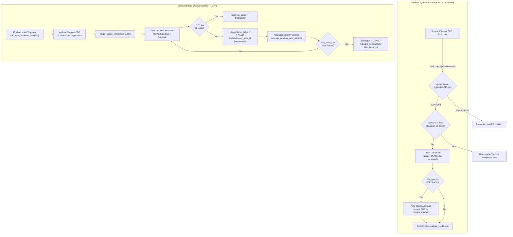

# PART 9: Data Sync

## 9.1 Sync Architecture & Mermaid Flow Diagram

DocuFlow supports full bidirectional synchronization: Inbound Ingestion (ERP &rarr; DocuFlow) and Outbound Back-Sync (DocuFlow &rarr; ERP).

---

## 9.2 Inbound Sync (ERP &rarr; DocuFlow)

### Inbound Specifications
| Attribute | Details | Key File & Class/Function |
| :--- | :--- | :--- |
| **Source System** | External ERP (e.g., SAP, Oracle, Microsoft Dynamics, n8n webhook triggers) | External |
| **Target Endpoints** | `POST /api/sync/documents` `POST /api/sync/base64-attachment` `POST /api/sync/documents/v2` | [`sync.py`](file:///backend/app/routers/sync.py), [`sync_router.py`](file:///backend/app/routers/sync_router.py) |
| **Authentication** | Header: `X-Service-API-Key: <SERVICE_API_KEY>` | [`backend/app/services/security_service.py`](file:///backend/app/services/security_service.py#L90) (`get_service_api_key`) |
| **Trigger Mechanism** | Real-time HTTP push or scheduled automation job | External integration caller |
| **Payload Format** | JSON payload containing header fields, line items, and optional Base64 attachment | [`backend/app/schemas/document.py`](file:///backend/app/schemas/document.py) |
| **Duplicate Prevention** | Checked by unique index on `document_id` and compound check on `(invoice_number, vendor_code)` | [`sync.py`](file:///backend/app/routers/sync.py#L120-L150) |

### Customer Feedback Auto-Attachment Engine
For documents ingested with `document_type = "CUSTOMER_FEEDBACK"` or `"FEEDBACK"`:
1. The sync engine inspects the incoming `invoice_number` reference.
2. It queries the database for existing documents where:
   `status == "APPROVED" AND invoice_number == incoming_invoice_number`
3. If an approved invoice is found, the sync engine automatically copies or links the approved invoice's archived PDF path to the feedback ticket.
4. If no approved document matches, the feedback document is ingested normally, and the attachment remains pending.

---

## 9.3 Outbound Back-Sync (DocuFlow &rarr; ERP)

### Outbound Specifications
| Attribute | Details | Key File & Class/Function |
| :--- | :--- | :--- |
| **Trigger Events** | Document reaches `Approved` (final stage) or `Rejected` | [`documents.py#L1278`](file:///backend/app/routers/documents.py) (`complete_document_lifecycle`) |
| **Dispatcher Function**| `dispatch_outgoing_webhook(document_id, base_url)` | [`integration_service.py#L92`](file:///backend/app/services/integration_service.py) |
| **Payload Builder** | `build_universal_export_payload(inv, base_url)` | [`integration_service.py#L42`](file:///backend/app/services/integration_service.py) |
| **Target Webhook** | Configured in `third_party_webhook_configs` | [`integration_service.py`](file:///backend/app/services/integration_service.py) |
| **Security & Signing** | HMAC-SHA256 signature calculated via `compute_hmac_signature()` sent in `X-DocuFlow-Signature` | [`integration_service.py#L86`](file:///backend/app/services/integration_service.py) |
| **Execution Order** | Strictly executed **after** physical PDF archiving succeeds and after DB commit | [`documents.py#L1360-L1370`](file:///backend/app/routers/documents.py) |
| **Tracking Table** | `integration_sync_logs` records every request attempt, response code, and latency | [`models.py`](file:///backend/app/database/models.py) (`IntegrationSyncLog`) |

---

## 9.4 Exponential Retry Schedule & Status Lifecycle

When an outbound webhook call encounters an error (HTTP 4xx, 5xx, or network connection timeout):

1. **Failure Logging**: Logged at `ERROR` level (fixing `AUD-07`), storing attempt count, error message, and next retry timestamp in `integration_sync_logs` and `Document.external_sync_error`.
2. **Exact Retry Schedule (`RETRY_BACKOFF_SECONDS = [60, 300, 900, 3600]`)**:
   - **Attempt 1**: Initial push at settlement. On failure, queues `next_retry_at = now() + 60s` (1 min).
   - **Attempt 2**: `next_retry_at = now() + 300s` (5 min).
   - **Attempt 3**: `next_retry_at = now() + 900s` (15 min).
   - **Attempt 4**: `next_retry_at = now() + 3600s` (1 hour).
   - **Attempt 5 (`MAX_RETRY_ATTEMPTS = 5`)**: Final attempt. If failed, status transitions to `DEAD`.
3. **Document Status Flow**:
   - `PENDING`: Initial state upon approval commit.
   - `PROCESSING`: Atomically claimed by `process_pending_sync_retries()` background worker.
   - `SYNCED`: Successfully delivered with HTTP 2xx response.
   - `FAILED`: Transient failure; awaiting next backoff slot.
   - `DEAD`: 5 attempts exhausted; permanent dead-letter state.
   - `NOT_CONFIGURED`: No active webhook configured.
4. **Admin Manual Recovery**:
   Administrators can view all sync logs in the UI and trigger an on-demand retry using:
   `POST /api/integrations/logs/{id}/retry`

---

**Verified against source**: [`backend/app/services/integration_service.py`](file:///backend/app/services/integration_service.py), [`backend/app/routers/sync.py`](file:///backend/app/routers/sync.py), [`backend/app/routers/sync_router.py`](file:///backend/app/routers/sync_router.py), [`backend/app/routers/documents.py`](file:///backend/app/routers/documents.py), [`backend/app/database/models.py`](file:///backend/app/database/models.py).

